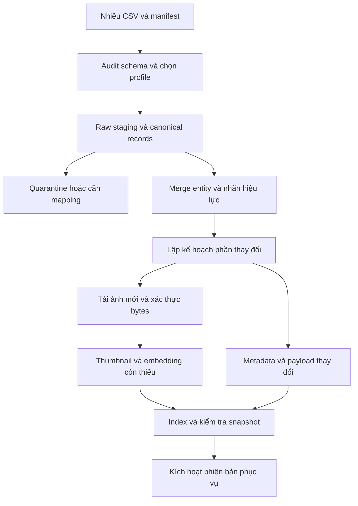
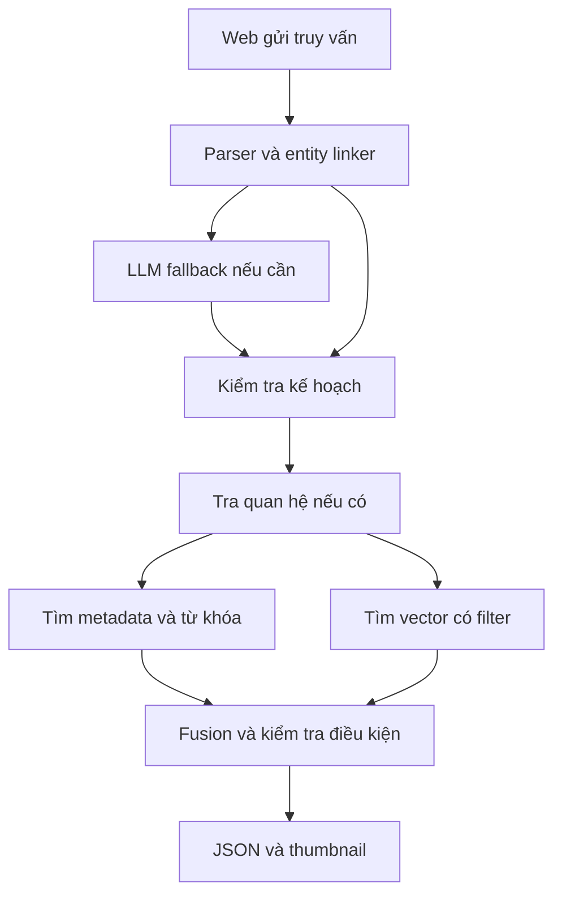
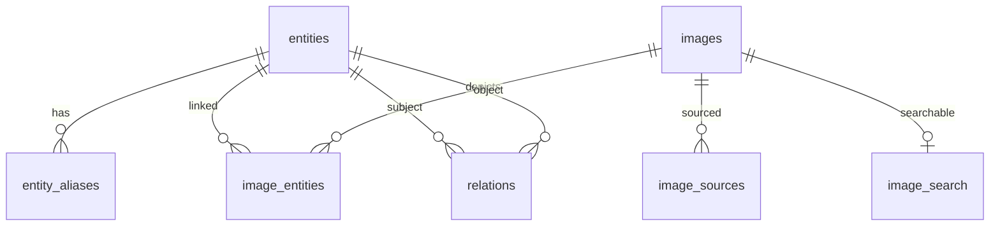

# Hướng dẫn triển khai hệ thống truy xuất ảnh cho Phần B

**Đích triển khai:** web tìm kiếm trên ít nhất 80.000 ảnh, hỗ trợ single intent, multi-intent và multi-hop, đo latency dưới 3 giây và giảm phụ thuộc vào LLM.

**Phiên bản:** 3 — cập nhật ngày 20/10/2026 theo code đã triển khai (phiên bản 2: 18/10/2026, sau khi đối chiếu hai CSV và ảnh tư vấn). **Ngày thiết kế:** 18/10/2026. **Deadline dự án:** 22/10/2026. **Đối tượng sử dụng:** intern biết Python, SQL và HTTP API, có người review các quyết định về dữ liệu và đánh giá.

Tài liệu này là bản thiết kế và hướng dẫn triển khai. Các cấu hình, ngưỡng, ngân sách thời gian và chỉ tiêu đề xuất là điểm bắt đầu cho thí nghiệm; chúng chưa phải kết quả benchmark của hệ thống đã chạy. Các lệnh `python -m app.jobs...` mô tả giao diện CLI cần xây theo cấu trúc trong tài liệu, không phải công cụ đã có sẵn sau khi cài thư viện. Các đoạn ghi **mã khung** cần được nối với repository, cấu hình và dependency thực tế.

**Thay đổi chính ở phiên bản 2:** bỏ giả định mọi CSV có 24 cột; dùng adapter có cấu hình và staging chuẩn; bổ sung import nhiều file, giữ lịch sử nhãn, xử lý thiếu metadata và cập nhật tăng dần. Phần scale được chuyển thành thí nghiệm có tiêu chí về chất lượng, latency, throughput và chi phí. Mã adapter ở mục 7 đã chạy trên cả hai CSV được gửi; các đoạn còn lại vẫn là thiết kế/mã khung, chưa phải ứng dụng hoàn chỉnh.

**Thay đổi ở phiên bản 3:** thêm [mục 0](#s00) đối chiếu thiết kế với code đã chạy: pgvector thay Qdrant, text encoder chạy ONNX, các job import thực tế, quan hệ anh chị em, ngưỡng không có kết quả, gom entity trùng của một người, sửa lỗi gõ sai, bộ eval khoảng 3.000 câu và kết quả đo. Các mục có phần làm khác thiết kế được đánh dấu bằng khung **Đã triển khai (v3)**.

**Cách dùng tài liệu để code:** đọc mục 1–2 trước; làm B01–B04 ở mục 20 để nhập được cả hai schema; sau đó làm search và web ở mục 8–16; chỉ thêm tối ưu nâng cao sau benchmark mục 17–19. Không cần làm mọi phần mở rộng trước deadline.

## Mục lục

0. [Trạng thái triển khai thực tế (v3)](#s00)
1. [Quyết định kỹ thuật và phạm vi](#s01)
2. [Đọc đúng dữ liệu đầu vào](#s02)
3. [Cơ sở nghiên cứu và cách áp dụng](#s03)
4. [Kiến trúc tổng thể](#s04)
5. [Môi trường và cấu trúc repository](#s05)
6. [Schema PostgreSQL và quy tắc dữ liệu](#s06)
7. [Import nhiều dạng CSV và chuẩn bị ảnh](#s07)
8. [Embedding và vector index](#s08)
9. [Entity linking và chỉ mục văn bản](#s09)
10. [Phân tích truy vấn và giới hạn LLM](#s10)
11. [Single intent và hợp nhất kết quả](#s11)
12. [Multi-intent](#s12)
13. [Multi-hop và xây dữ liệu quan hệ](#s13)
14. [Backend API và điều phối](#s14)
15. [Frontend và hiển thị ảnh](#s15)
16. [Docker và vận hành](#s16)
17. [Xây bộ test và đánh giá chất lượng](#s17)
18. [Benchmark latency throughput và token](#s18)
19. [Tối ưu theo bottleneck và mở rộng quy mô](#s19)
20. [Kế hoạch triển khai và checklist nghiệm thu](#s20)
21. [Nguồn tham khảo](#s21)
22. [Thuật ngữ](#s22)

<a id="s00"></a>
## 0. Trạng thái triển khai thực tế (phiên bản 3)

Mục này đối chiếu bản thiết kế bên dưới với code đã chạy trong repository, cập nhật ngày 20/10/2026. Các mục 1–22 giữ nguyên lập luận thiết kế; chỗ nào code làm khác thì có khung **"Đã triển khai (v3)"** ngay dưới tiêu đề mục đó. Khi hai nơi khác nhau, **code và mục 0 là bản đúng**.

### 0.1 Kết quả hiện có

| Chỉ tiêu | Kết quả | Nguồn |
|---|---|---|
| Ảnh đang phục vụ | 90.327 ảnh phân biệt (theo SHA-256), có thumbnail và vector SigLIP 2 | `GET /api/corpus/stats`, `data/reports/corpus_funnel.json` |
| Bộ test tự động | 3.162 câu sinh từ nhãn approved và bảng quan hệ (single 1.507, multi-intent 842, multi-hop 605, câu dễ sai 208), gồm ca dương tính, âm tính và ca dễ sai; bảng chất lượng dưới đây là lần chạy 20/10 với bộ cũ 2.998 câu | `eval/make_testcases.py --per-type 1500` |
| Latency (lần chạy 20/10 07:47, 3.176 câu, SigLIP thật, cache tắt, từng câu một) | 0 câu ≥ 3 s; max 438 ms; p99 single 176 ms, multi-intent 91 ms, multi-hop 5 ms | `reports/eval_report.md` |
| Throughput (Locust qua Nginx, 20/10 07:52) | 20 người dùng: 18,8 RPS, p99 120 ms, 0 lỗi trên 1.122 request; RPS tăng tuyến tính 1,0 → 4,8 → 9,4 → 18,8, chưa bão hòa | `reports/load_report.md` |
| Scale (20/10 08:46, 32 người không nghỉ, Locust trong mạng Docker) | 1 worker: 292 RPS bão hòa, p99 460 ms, 0 lỗi trên 17.382 request; 4 worker chỉ +24% RPS nhưng RAM 1,9 → 6,4 GB, p99 910 ms nên giữ 1 worker | `reports/scale_report_docker.md`, `docs/PERFORMANCE.md` mục 3b |
| Gọi LLM | 0 lần trên toàn bộ test: mọi câu đi qua bộ luật | cột `LLM calls` trong báo cáo |
| Unit + integration test | 58 test, chạy trong CI với Postgres pgvector thật | `backend/tests`, `.github/workflows/ci.yml` |

Chất lượng lần chạy 20/10 07:47 trên máy demo, 3.176 câu (precision@10 = tỷ lệ ảnh trong top 10 có nhãn đúng người; status = trả đúng trạng thái mong đợi):

| Loại | Số câu | Status đúng | Nhận đúng loại câu | Precision@10 |
|---|---:|---:|---:|---:|
| Single | 1.507 | 99% | 100% | 95% |
| Multi-intent | 842 | 99% | 98% | 96% |
| Multi-hop | 605 | 98% | 98% | 97% |
| Câu dễ sai (không được trả ảnh sai) | 222 | 96% | | |

So với lần chạy 19/10 trước khi sửa: gõ sai tên 44% → 84%, "chụp cùng" 61% → 82%, câu dễ sai 58% → 96%, nhận đúng câu multi-intent 86% → 98%. Chi tiết từng biến thể ở bảng "By variant" của báo cáo.

### 0.2 Đối chiếu từng phần

| Phần trong hướng dẫn | Thiết kế ban đầu | Đã triển khai | Lý do |
|---|---|---|---|
| Stack (1.2, 4.3) | FastAPI + PostgreSQL + **Qdrant** + React | FastAPI + PostgreSQL 16 + **pgvector HNSW** + React | Hướng dẫn đã nêu pgvector là phương án ít service hơn. 90K × 768 float32 chỉ khoảng 264 MiB; một DB giữ metadata, quan hệ, full-text và vector nên không phải đồng bộ hai nơi (mục 6.3, 19.5) và compose chỉ còn 3 service |
| Encoder (8.1) | SigLIP 2 base qua Transformers | Giữ `google/siglip2-base-patch16-224`. Worker dùng torch để embed ảnh; API chỉ chạy **text tower bằng ONNX Runtime** | Image API khoảng 520 MB thay vì khoảng 2 GB nếu có torch; `export_onnx` kiểm tra vector ONNX khớp torch trước khi dùng |
| Python (5.2) | 3.11, pip-tools | 3.12, `requirements-api.txt`, `requirements-worker.txt`, `requirements-dev.txt` ghim phiên bản | Image chính thức `python:3.12-slim-bookworm`; tách API và worker để image API không kéo torch |
| Cấu trúc repo (5.1) | `ingestion/`, `repositories/`, nhiều profile JSON | `backend/app/{services,jobs}`, một file `backend/config/import_profiles.json` | Gộp lại cho vừa thời gian; mỗi trách nhiệm trong bảng 5.1 vẫn có chỗ tương ứng (xem khung ở 5.1) |
| Schema (6.2) | `import_batches`, `image_search`, `identity_status`, payload Qdrant | `entities`, `entity_aliases`, `links`, `fetches`, `images` (có cột `embedding` và `search_tsv`), `image_entities`, `relations` | Vector và văn bản tìm kiếm nằm ngay trong `images` nên không có bảng dẫn xuất phải đồng bộ |
| Import (7) | audit → khóa manifest → import → plan_assets → fetch → prepare → embed → build_index → validate → activate | `import_csv` → `download` (gồm thumbnail) → `embed` → `relations_import` → `finalize` → `export_onnx`; `pipeline` chạy cả chuỗi | Giữ các nguyên tắc chính: map cột theo **tên** qua profile, khóa `(file, dòng)` để chạy lại không nhân bản, dedup theo SHA-256, nhãn mâu thuẫn thành `unknown` (không last-write-wins), resume mọi bước. `finalize` in phễu dữ liệu thay cho `validate_snapshot` |
| Entity linking (9.1) | Alias exact, pg_trgm top-5, ngưỡng chọn trên dev | Từ điển alias trong RAM, ba tầng: alias chính xác > tên rút gọn bỏ chức danh và phần trong ngoặc > vài chữ đầu của tên. Gõ sai sửa bằng pg_trgm **và** chỉ mục "lệch một chữ cái", chỉ nhận khi cùng số từ và lệch tối đa 1 ký tự (2 với tên từ 12 ký tự) | Trigram bỏ qua thứ tự từ ("Bác Hồ" khớp "Hồ Bắc", "Tòng Thị Phóng" khớp "Phạm Thị Hồng"), nên cần điều kiện khoảng cách chỉnh sửa |
| Parser (10) | Rule trước, LLM fallback một lần | Đúng như thiết kế; LLM (Anthropic) chỉ bật khi có `ANTHROPIC_API_KEY`, tối đa một lần gọi, có timeout | |
| No-answer (11.4) | Chọn ngưỡng trên dev | `min_visual_score = 0.148` hiệu chỉnh bằng `app.jobs.calibrate` (ảnh vắng mặt tối đa 0,139, có mặt từ 0,158); tìm văn bản toàn kho phải khớp **cụm từ đúng thứ tự**. Khi hai nhánh này chưa đủ top-k, thêm ảnh có mô tả khớp nhiều cặp từ nhất của câu rồi xếp lại theo vector | Tránh trả ảnh không liên quan cho câu không có đáp án, nhưng không để câu cảnh hợp lệ như "người mặc áo dài" chỉ ra 3 ảnh |
| Multi-intent (12) | groups / OR / same-photo | Đúng như thiết kế; thêm dấu phẩy làm dấu tách; "chụp cùng" gom các entity trùng của một người thành một nhóm khi lấy giao | Xem 0.3 |
| Multi-hop (13) | Predicate `has_son`, có `valid_from/valid_to` | Predicate `parent_of`, `spouse_of`, `sibling_of`, `founded`, `member_of`, `located_in`; "con trai/con gái" = `parent_of` + lọc giới tính; tối đa 2 bước, frontier 50; **130 quan hệ có nguồn** trong `data/relations/relations.csv` | Ít predicate hơn mà hỏi được từ cả hai phía (bố/mẹ ↔ con). Chưa có khoảng hiệu lực thời gian (xem 0.5) |
| API (14.1) | 7 endpoint | Có `/health/live`, `/health/ready`, `POST /api/search`, `/api/entities/suggest`, `/api/corpus/stats`. Chưa có `/api/images/{id}` và `/metrics` | Chi tiết ảnh đã nằm trong `items` của kết quả search |
| Frontend (15) | Form, groups, làm rõ, bằng chứng quan hệ | Đủ các phần đó, thêm câu ví dụ theo 3 loại, nút × (và phím Esc) xóa câu hỏi, hủy request đang chạy và đưa trang về trạng thái ban đầu | |
| Docker, CI (16) | Compose có Qdrant, migration chạy tay | Compose `db` (pgvector 0.8.0-pg16), `api`, `web`, `worker` (profile `jobs`); migration tự chạy khi API và job khởi động; GitHub Actions: ruff → pytest → build → dựng stack thử → đẩy image lên GHCR → deploy SSH tùy chọn; `compose.prod.yaml` thêm Caddy HTTPS | |
| Đánh giá (17) | 300 câu viết tay + qrels chấm tay, nDCG, baseline B0–P2 | Khoảng 3.000 câu **sinh tự động** từ nhãn approved và quan hệ đã kiểm chứng, chấm tự động theo entity; câu mô tả cảnh để riêng trong `eval/manual_cases.jsonl` để chấm bằng mắt | 300 câu chấm tay không kịp hạn và quá ít so với 90K ảnh; đáp án theo entity chấm lại được mỗi lần sửa code. Đổi lại chưa có nDCG và chưa chạy ablation B0–P2 (xem 0.5) |
| Load test (18) | Locust | `eval/run_load.py` (bọc Locust), tự sinh `reports/load_report.md` | |

### 0.3 Phần bổ sung ngoài hướng dẫn và lý do

| Bổ sung | Vì sao cần |
|---|---|
| Quan hệ anh chị em (`sibling_of`): ghi trực tiếp hoặc suy ra khi hai người có chung bố/mẹ, lọc giới tính | Người dùng hỏi "em gái của Phạm Thu Hương" (đáp án Phạm Thúy Hằng); bảng quan hệ ban đầu không có loại này. Migration `002_sibling_relation.sql` |
| "Vợ cũ/chồng cũ", "X và vợ", danh xưng (bầu, GS, TS, NSND, NSƯT, MC) | Các cách hỏi thật phát hiện khi thử bằng tên trong dữ liệu |
| Quan hệ không hỗ trợ ("bạn thân của X") trả `no_verified_relation`, **không** trả ảnh của X | Trước đó hệ thống bỏ qua chữ "bạn thân" và trả ảnh của chính X |
| Gom entity trùng của một người theo tên (bỏ chức danh và phần trong ngoặc, giữ dấu thanh) | Crawl tạo nhiều entity cho một người ("MC Trấn Thành", "Cặp đôi MC Trấn Thành - Hari Won"); không gom thì mất ảnh và "chụp cùng" trả rỗng. Giữ dấu thanh để Trấn Thành và Trần Thành vẫn là hai người |
| Tên viết hoa không khớp ai trong kho ("Jack Ma", "Taylor Swift") trả `no_seed_entity` | Tìm theo hình với một tên lạ chỉ ra người lạ trông giống (đúng cảnh báo ở 11.1) |
| Chữ "ảnh/hình" ở đầu câu không bị nhận thành tên "Anh ..." | Lỗi thật: "ảnh Trần Minh Dũng" từng khớp "Anh Trần ..." |
| Eval có nhóm "câu dễ sai" (robustness) và bảng "By variant" | Tách được chỗ yếu: gõ sai, tên đảo thứ tự, người không có trong data, chuỗi vô nghĩa |
| Kiểm tra quy mô bằng ảnh tổng hợp (`synth_scale`) | Đo latency 80K khi chưa tải xong ảnh thật, xóa được sau khi đo |
| Hỏi quan hệ không nói giới tính: "em của", "anh của", "con của", "con ruột của", "bố mẹ của", "vợ chồng của", "anh chị em ruột của", "bà xã/ông xã/phu nhân của" | "em của Phạm Thu Hương" từng trả không có quan hệ vì bộ luật chỉ biết "em gái/em trai". "ảnh của X" vẫn là ảnh của X, không bị hiểu thành "anh của" |
| Câu mô tả không có tên: khi ảnh vượt ngưỡng và cụm đúng thứ tự chưa đủ top-k, thêm ảnh có mô tả khớp nhiều cặp từ liền nhau nhất ("áo dài", "sân khấu"), xếp lại theo vector; cặp từ trùng tên người khi bỏ dấu ("công viên" và Văn Công Viễn) không tính; địa danh sau "ở/tại" chỉ góp vào xếp hạng | Báo cáo 20/10: hai ví dụ của đề "bãi biển Nha Trang" và "hồ bơi và công viên nước ở Phú Quốc" trả rỗng, "người mặc áo dài" chỉ ra 3 ảnh Bảo Đại |
| Sửa lỗi gõ phải giữ dấu đã gõ; câu toàn chữ thường không dấu chỉ được sửa khi cụm đó không có trong mô tả ảnh nào | "người mặc áo dài" từng bị sửa thành "Bảo Đại", "ca sĩ đang hát" thành "Đặng Tất" |
| CI chạy load test Locust trên stack vừa dựng và đính kèm `load_report.md` | Đáp ứng điểm cộng "load test tự động, reproducible, báo cáo tự sinh" |
| Quan hệ của một tên một chữ không có trong kho ("con trai của Bear", "bạn thân của Trang") trả "không nhận ra tên" | Trước đó cả câu thành mô tả và trả ảnh các bé trai không liên quan (eval 20/10, nhóm negative/missing_relation) |
| Scale trên một máy bằng nhiều process API: `API_WORKERS` (uvicorn `WEB_CONCURRENCY`), `DB_POOL_MAX` mỗi process, migration có advisory lock; `eval/run_scale.py` đo 1/2/4 worker và ghi `reports/scale_report.md` | Một process Python bị GIL và một khe encode giới hạn; load test 20/10 cho thấy RPS còn tăng tuyến tính nên chưa biết trần. Làm theo mục 19.3 (Mức 1–2), không cần Kubernetes (19.6) |
| Tên đầy đủ không có trong kho nhưng mở đầu giống tên người khác ("Nguyễn Chí Thanh", "Bùi Hải Linh") trả "không nhận ra tên", kể cả gõ thường hoặc không dấu; eval thêm nhóm `partial_name` | "Nguyễn Chí Thanh" từng gợi ý Nguyễn Chí Thiện, Nguyễn Chí Dũng, tìm chữ "thanh" như mô tả, và cùng lúc báo không nhận ra tên |
| Tên gõ có dấu chỉ khớp người đúng dấu đó ("Xuân Bắc" không còn ra Xuân Ba); không ai đúng dấu thì hỏi lại "Có phải bạn muốn tìm: …" thay vì trả ảnh; "Hoà"/"Hòa" coi là một; dấu đã gõ chọn đúng người khi hai người trùng tên không dấu, kể cả khi gõ sai một chữ; cache kết quả phân biệt dấu | Khi thử "Xuân Bắc" (không có trong kho), hệ thống trả ảnh của Xuân Ba; eval 20/10 cho thấy thêm 39 câu từng ra nhầm người ("Tuấn Hùng" ra Tuấn Hưng, "Hồ Văn Mời" ra Hồ Văn Lợi) nay ra đúng người |

### 0.4 Cách chạy hiện tại

Lệnh đầy đủ nằm trong `README.md`; tóm tắt:

```bash
docker compose --profile jobs build worker
docker compose --profile jobs run --rm worker python -m app.jobs.download_model
docker compose --profile jobs run --rm worker          # pipeline offline, chạy lại sẽ tiếp tục
docker compose up -d --build                           # web ở http://localhost:8080

# sau khi sửa data/relations/*.csv
docker compose --profile jobs run --rm worker python -m app.jobs.relations_import
docker compose restart api

# đánh giá (PowerShell: giữ nguyên, ${PWD} là thư mục dự án)
docker compose --profile jobs run --rm -e PYTHONPATH=/app -v "${PWD}/eval:/app/eval" -v "${PWD}/reports:/app/reports" worker sh -c "python eval/make_testcases.py --per-type 1500 > eval/testcases.jsonl && python eval/run_eval.py --api http://api:8000 --cases eval/testcases.jsonl --out reports"
```

Sau mỗi lần sửa code backend phải build lại **cả** `worker` và `api`: worker là image riêng, quên build lại thì job chạy code cũ.

### 0.5 Chưa làm hoặc làm khác, cần nói rõ khi bảo vệ

- Load test với SigLIP thật phải chạy trên máy demo (`eval/run_load.py`, lệnh ở `docs/PERFORMANCE.md` mục 4); CI chỉ chạy load test trên bộ dữ liệu mẫu nên con số CI không dùng để báo cáo.
- Kho gần như toàn ảnh người nên câu cảnh như ví dụ của đề chỉ có vài ảnh khớp (8 mô tả có "bãi biển", 1 có "hồ bơi"); câu cảnh chưa có đáp án tự động, chấm bằng mắt ở mục "Manual cases" của báo cáo.
- Chưa có qrels chấm tay, nDCG và ablation B0–P2; độ chính xác đo theo nhãn entity nên chưa nói được ảnh có đúng hoạt động ("đang hát") hay không.
- 130 quan hệ lấy từ nguồn công khai, cần người duyệt lại (`relations_review.md`). Chưa có khoảng hiệu lực thời gian; chưa phân biệt anh/chị với em vì thiếu năm sinh.
- Chưa có `audit_csv`, manifest khóa checksum, `identity_status` và cửa sổ activate snapshot như mục 7 và 8.5; cập nhật dữ liệu hiện chạy lại job rồi restart API.
- Gom entity theo tên có thể gộp hai người khác nhau trùng đúng tên có dấu; tên một từ gõ sai ("Rhymastic") không được sửa; quy tắc tên lạ dựa vào chữ hoa và họ phổ biến nên câu gõ toàn chữ thường không được kiểm tra.

<a id="s01"></a>
## 1. Quyết định kỹ thuật và phạm vi

### 1.1 Có nên chọn B với dữ liệu này

**Có, B là lựa chọn phù hợp hơn để bắt đầu với dữ liệu đã gửi và thời gian hiện tại.** Hai CSV có định danh entity, tên, URL ảnh, nguồn và kết quả duyệt; chỉ file crawl cũ có mô tả cùng các trường kỹ thuật ảnh. Những trường này trực tiếp phục vụ tìm kiếm. Để làm A đầy đủ còn cần nhãn riêng cho nhiều tiêu chí kiểm duyệt và phép đo chi phí xử lý rất lớn.

Đây là đánh giá về tính khả thi của dự án, không phải khẳng định B luôn dễ hơn. Hai phần khó nhất của B là độ tin cậy của liên kết ảnh–entity và dữ liệu quan hệ cho multi-hop. Chỉ có vector database không giải quyết được hai vấn đề đó.

### 1.2 Phương án chốt để code

> **Đã triển khai (v3):** dùng **PostgreSQL + pgvector** thay Qdrant (lý do ở [mục 0.2](#s00)). Ba tín hiệu trong bảng dưới vẫn tách đúng như thiết kế: tên qua metadata, cảnh qua vector, quan hệ qua bảng SQL.

**FastAPI + PostgreSQL + Qdrant + React/TypeScript.** Một model pretrained đa ngôn ngữ tạo embedding ảnh/văn bản trong cùng không gian. Các truy vấn đơn giản được phân tích bằng từ điển entity và quy tắc; LLM chỉ là fallback để tạo kế hoạch truy vấn có cấu trúc. Quan hệ được chuẩn bị offline và tra bằng SQL.

Ba tín hiệu phải được tách rõ:

| Câu hỏi cần trả lời | Nơi xử lý |
|---|---|
| Đây là ảnh gắn với người hoặc địa điểm nào? | Metadata và liên kết entity có căn cứ |
| Trong ảnh có hoạt động hoặc cảnh gì? | Vector ảnh và mô tả, có đánh giá chất lượng |
| Đối tượng được hỏi có quan hệ gì với đối tượng đã biết? | Bảng quan hệ có nguồn chứng minh |

Ví dụ “ảnh Lê Thúy Anh đang biểu diễn”: xác định entity trước; sau đó dùng phần “đang biểu diễn” để xếp hạng ảnh của entity. Không trông chờ model embedding tự nhận đúng mọi người có tên giống nhau.

### 1.3 MVP và phần nâng cấp

| Phải có trong bản nộp | Chỉ thêm sau khi có số liệu |
|---|---|
| Kho phục vụ ít nhất 80.000 ảnh phân biệt, tải được và có index | Kho một triệu ảnh |
| Cả ba loại truy vấn trong phạm vi được công bố | Quan hệ bất kỳ ngoài ontology |
| Nhập nhiều CSV qua profile; resume và tránh tính embedding lại | Tự đoán mọi schema hoặc tự sửa danh tính bằng LLM |
| Kết quả có nguồn, trạng thái không có dữ liệu hoặc cần làm rõ | Agent tự duyệt web trong mỗi truy vấn |
| Web nhập câu hỏi và hiển thị ảnh | Caption bằng VLM cho toàn bộ ảnh |
| Dockerfile, Compose, README | Kubernetes, Kafka, nhiều shard |
| Bộ test, benchmark chạy lại được | Fine-tune encoder, cross-encoder nặng |

Không thực hiện lại pipeline kiểm duyệt A. Chỉ xử lý những bước kỹ thuật B cần: đọc ảnh, kiểm tra khả năng phục vụ, chuẩn hóa đường dẫn, thumbnail, dedup chính xác và index. Mọi xung đột gán nhãn được lưu để đối chiếu với dữ liệu nguồn; không tự sửa danh tính bằng phỏng đoán.

### 1.4 Tiêu chí hoàn thành

1. Có ít nhất 80.000 `image_id` khác nhau trong snapshot phục vụ, mỗi ảnh có thumbnail và embedding hợp lệ. Không tính số dòng hoặc số URL thay cho số ảnh.
2. Single intent, multi-intent và multi-hop đều có truy vấn đúng, trường hợp khó và trường hợp thiếu đáp án.
3. Đo thời gian từ client gửi request đến khi nhận đủ JSON kết quả; đo riêng thời gian hiển thị hàng thumbnail đầu tiên.
4. Vì đề ghi “mỗi truy vấn < 3 giây”, báo cáo cả max và tỷ lệ vượt 3 giây; p95 tốt chưa đủ để tuyên bố mọi truy vấn đều đạt.
5. Có throughput, lỗi, cấu hình máy, model revision, corpus version và log token.
6. Giảm token được so sánh trong điều kiện chất lượng tương đương. Token bằng 0 không đồng nghĩa chi phí tính toán bằng 0.

### 1.5 Đánh giá tư vấn trong ảnh

Nội dung nhìn thấy trong ảnh: xây ứng dụng truy xuất cơ bản trước, sau đó mở rộng quy mô mà chi phí không tăng mạnh; người tư vấn nhấn mạnh scale thay vì chỉ trình diễn tên model. Ảnh **không đưa ra** kiến trúc, benchmark hoặc lựa chọn công nghệ cụ thể.

| Ý tư vấn | Đánh giá của thiết kế này | Chuyển thành việc cần làm |
|---|---|---|
| Có ứng dụng chạy được trước | Đúng về thứ tự triển khai | Baseline tìm đúng tên + web + manifest, rồi đủ ba loại query |
| Mở rộng với chi phí hợp lý | Đúng và có giá trị thực tế | Đo chi phí trên 1.000 request, chi phí index ảnh mới, RAM và QPS |
| “Còn lại chỉ là scale” | Chưa đủ với yêu cầu B | Còn độ đúng entity, coverage multi-intent, facts multi-hop và dữ liệu khác schema |
| Không chỉ chọn model này/model kia | Đúng nếu hiểu là phải chứng minh lợi ích | So baseline, giữ chất lượng, báo trade-off; model vẫn cần đánh giá tiếng Việt |
| Chi phí không đội lên | Mục tiêu hợp lý nếu nói về **chi phí đơn vị** | Không hứa tổng chi phí giữ nguyên khi số ảnh, lưu trữ và lượng truy vấn tăng |

**Kết luận triển khai:** giữ hướng B; bổ sung lớp nhập dữ liệu bền vững và xử lý tăng dần ngay trong MVP. Chưa cần đổi thành hệ thống phân tán. “Đọc nhiều CSV khác nhau” là khả năng thích nghi schema; “thêm ảnh”, “thêm người dùng”, “cập nhật dữ liệu” là ba bài toán scale khác nhau. Cần đo cả bốn, không dùng một biểu đồ latency để kết luận tất cả đã scale tốt.

### 1.6 Bài toán cụ thể để bảo vệ

> Xây hệ thống truy xuất ảnh có entity và quan hệ, nhận nhiều biến thể CSV từ cùng corpus; chuẩn hóa một lần, index offline và cập nhật phần thay đổi; phục vụ ba loại truy vấn trên ít nhất 80K ảnh với phép đo end-to-end dưới 3 giây, đồng thời giảm LLM calls mà giữ chất lượng.

Ba đóng góp có thể chứng minh: **(1)** adapter chuẩn hóa đúng hai schema thật và schema đổi tên/thứ tự cột; **(2)** router và index tránh gọi LLM hay đọc toàn kho mỗi query; **(3)** incremental pipeline tái sử dụng bytes/vector cũ. Không cần hứa 10–100 triệu ảnh của A cho sản phẩm B; 100K/1M là hướng mở rộng nếu có dữ liệu và thời gian đo.

<a id="s02"></a>
## 2. Đọc đúng dữ liệu đầu vào

### 2.1 Kết quả kiểm tra hai file thật

Đã đọc trực tiếp hai CSV được gửi, bằng CSV parser hỗ trợ trường có dấu phẩy/xuống dòng. Đây là các phần của cùng corpus lớn, **chưa phải toàn bộ ít nhất 80K link ảnh** mà người dùng mô tả.

| Chỉ tiêu | File crawl cũ | File approver mới |
|---|---:|---:|
| Tên file | `DiemCongThanh_batch-3-crawl-approved(2).csv` | `DiemCongThanh-crawl-Tam-batch9-approver(1).csv` |
| Số cột | 24 | 8 |
| Cột trạng thái | `flag` | `status` |
| Số dòng dữ liệu | 8.223 | 4.050 |
| Entity ID khác nhau | 543 | 348 |
| Dòng approved | 5.099 | 2.944 |
| Dòng rejected | 3.123 | 1.106 |
| Trạng thái trống | 1 | 0 |
| Entity có ít nhất một dòng approved | 438 | 340 |
| URL ảnh khác nhau, toàn file | 8.201 | 3.902 |
| URL ảnh khác nhau trong approved | 5.093 | 2.822 |
| Có `description`, `sha256`, kích thước | Có | Không |
| Rejected nhưng thiếu lý do | 0 | 839 |
| `source_url` có dấu hiệu bị cắt (`…` hoặc `...`) | 1.766 | 1.194 |

File mới có đúng tám trường: `entity_id, slug, canonical_name, category, image_url, source_url, status, reject_reason`; cả 4.050 dòng có `category=singer`. Đây là nhãn nguồn, không phải kết quả nhận diện nội dung ảnh mới được kiểm chứng.

**Khi gộp:** 12.273 dòng, 891 entity IDs, 8.043 dòng approved và **7.866 URL approved khác nhau**. Hai file không trùng entity IDs nhưng trùng 63 URL ảnh trong toàn dữ liệu. Có 25 URL vừa approved vừa rejected ở các liên kết entity khác nhau. Không có cặp `(entity_id, image_url)` trùng nhau giữa hai file trong mẫu này; vì vậy chưa quan sát conflict cùng liên kết giữa hai phiên bản. Các test conflict ở mục 7 là fixture tổng hợp, không phải kết luận dữ liệu mẫu đã có lỗi đó.

Riêng file cũ có 5.088 hash khai báo khác nhau trong approved, 11 hash approved gắn nhiều entity, 483 dòng approved nhưng `cluster=ambiguous`, và 4.000 dòng thiếu local_path. Những con số hash và URL khác nhau **không thể cộng trực tiếp** để suy ra số ảnh phân biệt. Chưa tải toàn bộ bytes để xác thực SHA, khả năng decode hoặc số ảnh serving.

Phát hiện thêm từ parser: 30 URL ảnh của file cũ chứa dấu cách trong phần path. Không tự kết luận đây là ảnh hỏng; URL cần được HTTP client mã hóa khi gửi, giữ nguyên giá trị nguồn để audit. Không xóa query string hoặc token của URL. Việc URL còn tải được vẫn chưa được kiểm chứng.

**Hệ quả:** “80K link” là đầu vào; báo cáo cần funnel `rows → approved links → unique locators → download/decode OK → distinct content hashes → serving image IDs`. Chỉ tầng cuối chứng minh đủ 80K ảnh index/retrieve. Không nhân bản ảnh để bù số lượng và không áp dụng điều kiện mỗi entity phải có 5 ảnh vì đề không yêu cầu.

### 2.2 Ánh xạ 24 cột cũ và trường `status` mới

| Cột nguồn | Lưu ở đâu và dùng như thế nào |
|---|---|
| `entity_id` | `entities.entity_id`; khóa của entity, không phải khóa riêng của ảnh |
| `slug` | Tên URL của entity; không suy ra bí danh bằng cách bỏ hậu tố một cách mù quáng |
| `canonical_name` | Tên hiển thị và alias chính |
| `category` | `category_raw`; chỉ dùng lọc cứng sau khi xác minh, giữ nguyên giá trị gốc |
| `kind_hint` | Gợi ý loại entity, không phải nhãn chuẩn tuyệt đối |
| `query` | Truy vấn dùng lúc crawl; lưu audit, không coi là mô tả chắc chắn của ảnh |
| `local_path` | Đường dẫn nguồn tương đối; resolve dưới thư mục dữ liệu cho phép |
| `sha256` | Hash được cung cấp; đối chiếu với hash tính từ bytes ảnh tải về |
| `image_url` | Địa chỉ tải ảnh; không dùng URL bài viết thay cho URL ảnh |
| `source_url` | Nguồn dẫn; URL có dấu `…` là chưa đầy đủ, cần đánh dấu |
| `source_domain` | Metadata nguồn; đối chiếu hostname nếu cần, không mặc định đáng tin |
| `description` | Văn bản từ nguồn, có thể mô tả cả bài/album thay vì nội dung ảnh |
| `width`, `height` | Kích thước khai báo; đo lại sau decode |
| `bytes` | Dung lượng khai báo; đo lại khi tải |
| `crawled_at` | Thời điểm crawl, giữ timezone; không phải ngày chụp ảnh |
| `has_face` | Tín hiệu từ detector nguồn; null khác false |
| `face_count` | Số khuôn mặt detector đếm được; không chứng minh danh tính |
| `face_error` | Lỗi detector trước đó; phục vụ audit |
| `face_area_pct` | Tỉ lệ diện tích khuôn mặt theo pipeline nguồn; không tự suy ra độ đúng |
| `from_db` | Nguồn nhập, chỉ dùng lineage |
| `cluster` | Thông tin phân cụm/độ mơ hồ; đối chiếu khi mâu thuẫn với duyệt |
| `flag` hoặc `status` | Ánh xạ sang `approval_status`; phải theo profile, không suy từ tên file |
| `reject_reason` | Lý do duyệt; lưu audit, không cho vào search text công khai |

Các cột không có ở file mới được giữ `null` hoặc không có trong raw record; không bổ sung bằng dữ liệu đoán. `raw_row` giữ đủ mọi cột, kể cả trường chưa hiểu. Bảng trên mô tả ý nghĩa và nơi dùng cuối cùng; bước adapter không bắt buộc phải đưa mọi trường detector vào bảng production.

### 2.3 Xử lý dòng Lê Thúy Anh

`category=businessman` và `query=doanh nhân Lê Thúy Anh` mâu thuẫn với các mô tả album, ca sĩ trong nguồn. `cluster=ambiguous` trong khi `flag=approved` chưa cho biết bước nào có quyền quyết định cuối cùng.

Cách làm:

1. Giữ nguyên dòng CSV trong bảng staging.
2. Tạo entity bằng ID nguồn; không tự đổi category thành singer.
3. Đánh dấu liên kết cần đối chiếu nếu quy trình nguồn chưa xác nhận ý nghĩa trạng thái.
4. Khi chủ dữ liệu xác nhận `approved` là kết quả cuối đã giải quyết mơ hồ, có thể nhận liên kết đó theo policy nhập, kèm `identity_status=provided` và policy version.
5. Nếu có bằng chứng gán nhầm, sửa qua bản cập nhật có audit, rồi đồng bộ search index.

Phân biệt **ảnh được duyệt để dùng** với **ảnh chắc chắn là người đang tìm**. Việc này ảnh hưởng trực tiếp đến precision của B.

### 2.4 Dữ liệu còn thiếu để triển khai đầy đủ

- Corpus đầy đủ có đủ 80.000 ảnh **sau** điều kiện phục vụ và dedup hay không.
- Bytes ảnh local hoặc URL còn tải được; `local_path` trong CSV không có nghĩa file đó đã có trên server triển khai.
- Alias và thông tin phân biệt người trùng tên.
- Quan hệ có nguồn, entity trung gian và entity đích có ảnh.
- Nhãn relevance cho bộ test. `approved` không thay thế qrels của một câu hỏi cụ thể.

Đoạn CSV dán trong chat bị bọc Markdown link và bị cắt; khi code importer phải dùng file CSV gốc với CSV parser, không dùng `split(',')` và không cố sửa chuỗi Markdown thành dữ liệu thật.

### 2.5 Hợp đồng dữ liệu nội bộ, độc lập với tên cột nguồn

Mỗi dòng chuẩn hóa biểu diễn **một quan sát về liên kết ảnh–entity**, chưa phải một ảnh đã phục vụ.

| Nhóm | Canonical fields | Quy tắc |
|---|---|---|
| Lineage | dataset, batch_id, row_no, line_start/end, profile_id, mapping hash | Lưu được file và record nào tạo ra kết quả |
| Entity | entity_namespace, entity_key, canonical_name, slug, category_raw | ID nguồn có namespace; không dùng tên làm khóa |
| Asset locator | image_url và/hoặc local_path | Có ít nhất một địa chỉ; không lấy source_url thay image_url |
| Duyệt | approval_status, reject_reason, cluster | `approved / rejected / unknown`; null không thành approved |
| Bằng chứng | source_url, source_description, source_domain | Có thể thiếu; văn bản từ nguồn không phải visual caption |
| Kỹ thuật khai báo | declared_sha256 và trường gốc width/height/bytes | Khác hash/kích thước đo từ bytes |
| Mở rộng | raw_row, extra_fields, warnings | Giữ cột mới, báo schema drift, không âm thầm bỏ |

Đây là contract `image-link-v1`. Parser chỉ tạo canonical record; job merge mới resolve internal entity UUID, tạo observation, chọn nhãn hiệu lực. Download/prepare mới tạo `images`. Tách ba bước này để không cần hash/kích thước có sẵn trong CSV.

### 2.6 File ít metadata có làm B kém khả thi không?

Không ngăn triển khai B, nhưng giảm tín hiệu lexical mô tả. Với file mới:

1. Tên/alias vẫn cho phép tìm theo người. `category_raw` giữ lại, chưa tự nâng thành verified.
2. Download ảnh để tính content hash, kích thước thực, thumbnail và visual embedding.
3. Search text ban đầu gồm các tên/alias của **liên kết đủ điều kiện**; description thiếu thì để trống. Nhánh visual xử lý hoạt động/cảnh trong phạm vi encoder làm tốt.
4. `source_domain` có thể lấy hostname của source URL nếu phân tích được, gắn nguồn `derived_from_url`. `crawled_at` thiếu không thay bằng ngày import.
5. Không tự caption mọi ảnh bằng API để lấp cột thiếu; chỉ thử caption chọn lọc nếu error analysis chứng minh ích lợi đủ bù chi phí.
6. Không suy quan hệ gia đình, người sáng lập hoặc tư cách thành viên từ category/slug. Facts multi-hop vẫn phải chuẩn bị riêng như mục 13.

Nếu corpus toàn người, benchmark tập trung tên người/hoạt động và quan hệ thật trong corpus. Ví dụ bãi biển/khách sạn trong đề chỉ có thể trả ảnh đúng khi dữ liệu có nội dung đó; không bịa domain coverage.

<a id="s03"></a>
## 3. Cơ sở nghiên cứu và cách áp dụng

Không có một paper được tìm thấy giải quyết nguyên xi tất cả yêu cầu của corpus này. Thiết kế dưới đây ghép những phương pháp đã nghiên cứu và kiểm chứng lại trên dữ liệu tiếng Việt của dự án. [R1]–[R8] là paper; [D1]–[D14] là tài liệu triển khai chính thức, liệt kê ở cuối.

| Nguồn | Kết quả hoặc ý tưởng liên quan | Dùng vào hệ thống | Giới hạn khi áp dụng |
|---|---|---|---|
| [R1] CLIP, ICML 2021 | Học biểu diễn ảnh và văn bản chung từ giám sát ngôn ngữ | Nền tảng text-to-image retrieval | Không bảo đảm đúng mọi tên riêng hoặc tiếng Việt |
| [R2] SigLIP 2, 2025 | Encoder vision-language đa ngôn ngữ, cải thiện các tác vụ gồm image-text retrieval | Ứng viên encoder mặc định để thử | Cần test câu tiếng Việt, không dùng similarity làm chứng cứ danh tính |
| [R3] HNSW, 2016/2018 | Tìm láng giềng gần đúng bằng đồ thị nhiều tầng | Vector index và thí nghiệm speed–recall | Có thể bỏ sót; phải so với exact search cùng vector/filter |
| [R4] RRF, SIGIR 2009 | Hợp nhất danh sách bằng thứ hạng | Ghép lexical và visual candidates | Không thực thi logic AND và không phải xác suất relevance |
| [R5] KVQA, AAAI 2019 | 183K câu hỏi, hơn 18K named entities và 24K ảnh, cần suy luận nhiều quan hệ | Cơ sở cho entity + knowledge graph, thiết kế test multi-hop | Đây là VQA, không phải đúng tác vụ web retrieval hay benchmark tiếng Việt của dự án |
| [R6] IRCoT, ACL 2023 | Truy xuất nhiều bước phụ thuộc thông tin bước trước | Tham khảo cấu trúc truy vấn nhiều bước | Không sao chép vòng gọi LLM nhiều lần vào online path dưới 3 giây |
| [R7] Vision-Language Models Do Not Understand Negation, CVPR 2025 | Nghiên cứu giới hạn hiểu phủ định, giới thiệu NegBench | Bổ sung ca “không có”, kiểm tra ràng buộc riêng | Không xem model vector là bộ thực thi logic đáng tin tuyệt đối |
| [R8] NIST về pooling và sampled judgments, 2007 | Phân tích độ thiếu và bias của relevance judgments | Dùng pool nhiều hệ thống, công bố giới hạn qrels | Không tuyên bố recall toàn corpus từ pool chưa đầy đủ |

**Thứ tự đọc:** R1 → R2 để hiểu embedding; R3 → R4 để hiểu tìm nhanh và fusion; R5 để hiểu quan hệ quanh người nổi tiếng; R7 → R8 để tránh đánh giá sai. R6 là tài liệu mở rộng về suy luận, không phải dependency phải cài.

**Quyết định quan trọng:** dùng pretrained encoder; không fine-tune từ đầu trong MVP. Dùng knowledge graph lưu bằng bảng SQL cho quan hệ đã biết; chưa cần một graph database riêng. Mọi nhận định “nhanh hơn”, “giảm token”, “chất lượng tốt hơn” của dự án phải có thí nghiệm riêng, không lấy số của paper làm số của hệ thống.

<a id="s04"></a>
## 4. Kiến trúc tổng thể

### 4.1 Luồng offline



Raw file được giữ bất biến. Mỗi profile chuyển schema nguồn về cùng contract; web/search chỉ đọc canonical tables. Thêm file đổi thứ tự/cột không yêu cầu sửa frontend hoặc query executor. Khi reimport metadata, tái dùng vector đúng version thay vì chạy lại encoder.

### 4.2 Luồng online



LLM chỉ được trả cấu trúc truy vấn. Nó không sinh SQL tùy ý, không tự xác nhận quan hệ và không được gửi 80.000 dòng metadata để đọc.

### 4.3 Vì sao chọn các thành phần này

> **Đã triển khai (v3):** dòng Qdrant trong bảng được thay bằng pgvector HNSW (cosine, `m=16`, `ef_construction=128`) nằm trong cùng PostgreSQL; cache là LRU 512 kết quả trong process. Model inference ở API chỉ có text tower ONNX.

| Thành phần | Quyết định |
|---|---|
| FastAPI | Python thuận tiện nối ML inference, DB và API; không làm CPU inference trực tiếp trên event loop |
| PostgreSQL | Nguồn dữ liệu chuẩn; entity, alias, liên kết, quan hệ, audit; index B-tree/GIN |
| Qdrant | Một collection vector ảnh, filter theo entity; tách để đo và mở rộng search |
| React + TypeScript + Vite | Giao diện gọn; build static và phục vụ qua Nginx |
| File local + Nginx | MVP phục vụ thumbnail ổn định; sau đó có thể chuyển object storage/CDN |
| Cache | Bắt đầu bounded cache trong process; Redis chỉ khi nhiều replica cần dùng chung |
| Model inference | Một instance nạp sẵn; offline worker và online API không chạy indexing cạnh tranh tài nguyên trong benchmark |

**Phương án ít service hơn:** PostgreSQL + pgvector cũng là một lựa chọn hợp lý cho 80K ảnh. Tài liệu chọn Qdrant để làm rõ vector filtering và benchmark; không khẳng định Qdrant luôn nhanh hơn. Không triển khai cả hai trong MVP. Chỉ đổi nếu đo được lợi ích hoặc môi trường đã chuẩn hóa pgvector.

MVP chỉ dùng **một encoder ảnh–văn bản**, không bắt đầu bằng cả BGE-M3 và SigLIP 2. Metadata được tìm bằng PostgreSQL trước. BGE hoặc một encoder văn bản riêng là thí nghiệm sau nếu paraphrase trong mô tả là lỗi lớn; hai không gian vector phải truy xuất riêng rồi fusion, không so chéo.

### 4.4 Tài nguyên thử ban đầu

Giả định lập kế hoạch, không phải yêu cầu máy đã được chứng minh:

- Máy phát triển: 8 CPU cores, RAM 16–32 GB, SSD; máy ít RAM vẫn thử được trên mẫu nhỏ.
- GPU hữu ích để tính embedding offline; khả năng CPU-only online phải được đo với checkpoint thực.
- Giữ encoder base làm ứng viên đầu, đo latency tokenization + text encoding trước khi chốt máy host.
- Dung lượng vector thô nếu `d=768`, float32, 80.000 ảnh: `80.000 × 768 × 4 = 245.760.000 bytes`, khoảng 234,4 MiB. Chưa tính HNSW, payload, allocator, model weights hoặc ảnh.
- Nếu thumbnail trung bình 50 KB/ảnh thì 80K ảnh khoảng 4 GB. Đây là giả định minh họa; thay bằng mean/p95 đo được.

Không nên đưa model weights và 80K ảnh vào image Docker. Mount model snapshot và dữ liệu qua volume.

<a id="s05"></a>
## 5. Môi trường và cấu trúc repository

### 5.1 Cách tổ chức

> **Đã triển khai (v3):** repo thật gọn hơn bảng dưới: `backend/app/services/` (encoder, entity_linker, query_parser, retriever, relations, search, llm), `backend/app/jobs/` (import_csv, download, embed, relations_import, finalize, export_onnx, pipeline, calibrate, synth_scale, download_model), `backend/config/import_profiles.json`, `backend/migrations/00x_*.sql`, `eval/` (make_testcases, run_eval, run_load, locustfile, manual_cases.jsonl), `docs/` (ARCHITECTURE, TESTING, PERFORMANCE). Không có `ingestion/` và `repositories/` riêng; SQL nằm trong từng service.

Tạo thư mục `image-retrieval-b` với các đường dẫn sau. Mỗi dòng là một file hoặc thư mục cần xây, không phải file đã được tài liệu này tạo ra.

| Đường dẫn | Trách nhiệm |
|---|---|
| `backend/app/main.py` | FastAPI app, lifespan, router và healthcheck |
| `backend/app/config.py` | Đọc env và cấu hình có validation |
| `backend/app/db.py` | Connection pool, transaction và timeout |
| `backend/app/schemas.py` | Request, response, QueryPlan |
| `backend/app/services/entity_linker.py` | Tên, alias, fuzzy matching và ambiguity |
| `backend/app/services/query_parser.py` | Rule parser và LLM fallback |
| `backend/app/services/encoder.py` | Nạp model, encode ảnh/văn bản |
| `backend/app/services/retriever.py` | Lexical, vector, fusion, eligibility |
| `backend/app/services/relations.py` | Thực thi graph path đã cho phép |
| `backend/app/services/search.py` | Điều phối toàn bộ request |
| `backend/app/repositories/` | SQL parameterized cho từng nhóm bảng |
| `backend/app/ingestion/csv_adapter.py` | Stream CSV và chuẩn hóa theo profile ở mục 7 |
| `backend/app/ingestion/profile_registry.py` | Match header với profile; phát hiện mơ hồ/schema mới |
| `backend/app/ingestion/merge.py` | Entity mapping, observations, nhãn hiệu lực, không last-write-wins tùy tiện |
| `backend/app/ingestion/planner.py` | Phân biệt metadata update, ảnh mới, revoke, re-embedding |
| `backend/config/import_profiles/*.json` | Mapping, encoding, delimiter, status dictionary có version |
| `backend/config/import_policy.json` | Quyền quyết định nguồn, identity policy, điều kiện activate |
| `backend/app/jobs/` | Audit nhiều CSV, import manifest, download, prepare, embed, index, validate |
| `backend/tests/fixtures/csv/` | Hai schema mẫu và ca drift/quotes/multiline/conflict tối giản |
| `backend/migrations/001_initial.sql` | Schema trong mục 6 |
| `backend/tests/` | Unit, integration, regression |
| `backend/requirements.in` | Dependency trực tiếp |
| `backend/requirements.lock` | Phiên bản chính xác sau smoke test |
| `frontend/src/` | Search page, results, detail modal, API client |
| `frontend/package-lock.json` | Node lockfile |
| `frontend/nginx.conf` | Static web, `/api/`, `/media/` |
| `eval/queries.dev.jsonl` | Câu dev để chỉnh hệ thống |
| `eval/queries.test.jsonl` | Câu test giữ kín khi tuning |
| `eval/qrels.tsv` | Nhãn relevance |
| `eval/locustfile.py` | Load test |
| `eval/report.py` | Đọc run và sinh báo cáo Markdown |
| `data/raw`, `data/derived`, `data/manifests` | Dữ liệu và checkpoint; không commit ảnh vào git |
| `models/`, `reports/` | Model snapshot, artifacts benchmark |
| `compose.yaml`, `.env.example`, `README.md` | Chạy từ đầu |

### 5.2 Dependency và lockfile

> **Đã triển khai (v3):** Python 3.12; phiên bản ghim trong `backend/requirements-api.txt` (không torch), `requirements-worker.txt` (torch CPU, transformers) và `requirements-dev.txt` (pytest, ruff, locust). Không dùng `qdrant-client`.

Python 3.11 là baseline môi trường của thiết kế. Dependency trực tiếp đề xuất: `fastapi`, `uvicorn`, `pydantic`, `pydantic-settings`, `psycopg[binary,pool]`, `qdrant-client`, `httpx`, `Pillow`, `numpy`, `torch`, `transformers`, `sentencepiece`, `protobuf`, `pytest`, `locust`. Dùng `pip-tools` hoặc công cụ lock tương đương để đóng băng phiên bản.

Đoạn encoder trong tài liệu viết theo giao diện Transformers **4.57.2** [D2]. Có thể bắt đầu bằng phiên bản đó; không nâng phiên bản lớn tự động trước ngày nộp. Chọn torch CPU wheel hoặc CUDA wheel theo máy; cài CUDA không phù hợp có thể làm image rất lớn hoặc không chạy.

Với Qdrant, ghép server và client có version tương thích, chạy smoke test tạo collection → upsert → query → filter rồi pin cả hai. Tài liệu API có version selector [D5]. Không coi tag `latest` hoặc nhánh `main` là một benchmark reproducible.

```bash
python3.11 -m venv .venv
source .venv/bin/activate
python -m pip install pip-tools
pip-compile backend/requirements.in -o backend/requirements.lock
pip-sync backend/requirements.lock
```

Nếu chạy trên Windows, nên dùng WSL Ubuntu và đặt repo trong filesystem WSL để thuận tiện với Docker/Linux. Lệnh trên dùng Bash; PowerShell có lệnh activate khác.

Các giá trị bắt buộc trong manifest của một lần chạy: git commit, Python version, dependency lock hash, model ID + commit revision, preprocessing version, collection name, data snapshot hash, cấu hình CPU/GPU.

<a id="s06"></a>
## 6. Schema PostgreSQL và quy tắc dữ liệu

### 6.1 Vì sao không dùng một bảng CSV duy nhất

Một entity có nhiều ảnh; một ảnh có thể chứa nhiều entity; một ảnh có thể xuất hiện ở nhiều URL. Vì vậy phải tách entity, ảnh và liên kết. Dùng `entity_id` làm point ID trong Qdrant sẽ ghi đè các ảnh của cùng người: đây là lỗi cần tránh ngay từ đầu.



### 6.2 Migration khởi đầu

> **Đã triển khai (v3):** schema thật ở `backend/migrations/001_init.sql` và `002_sibling_relation.sql`, tự áp dụng khi API hoặc job khởi động. Bảng: `entities`, `entity_aliases`, `links` (một dòng CSV, khóa `(source_file, row_no)`), `fetches` (locator đã tải), `images` (gồm `embedding vector(768)` và `search_tsv`), `image_entities` (nhãn hiệu lực), `relations`. Sơ đồ ở `docs/ARCHITECTURE.md` mục 4. SQL dưới đây là thiết kế đầy đủ hơn, chưa dùng.

SQL dưới đây là schema khởi đầu; UUID do Python tạo và truyền vào. Giữ một snapshot cố định cho benchmark. `image_search` là bảng dẫn xuất, có thể dựng lại từ dữ liệu chuẩn.

```sql
CREATE EXTENSION IF NOT EXISTS pg_trgm;

CREATE TABLE import_batches (
  batch_id text PRIMARY KEY,
  dataset_id text NOT NULL,
  source_filename text NOT NULL,
  source_sha256 text NOT NULL,
  profile_id text NOT NULL,
  mapping_sha256 text NOT NULL,
  policy_version text NOT NULL,
  canonical_schema_version text NOT NULL,
  encoding text NOT NULL,
  delimiter text NOT NULL CHECK (length(delimiter) = 1),
  raw_header jsonb NOT NULL,
  supersedes_batch_id text REFERENCES import_batches(batch_id),
  status text NOT NULL DEFAULT 'staging'
    CHECK (status IN ('staging','parsed','accepted','needs_review','failed','superseded')),
  row_count bigint,
  report jsonb NOT NULL DEFAULT '{}',
  created_at timestamptz NOT NULL DEFAULT now(),
  UNIQUE (dataset_id, source_sha256, mapping_sha256, policy_version)
);

CREATE TABLE import_rows (
  batch_id text NOT NULL REFERENCES import_batches(batch_id),
  row_no integer NOT NULL CHECK (row_no > 0),
  line_start integer NOT NULL,
  line_end integer NOT NULL,
  raw_row jsonb NOT NULL,
  canonical_row jsonb,
  parse_status text NOT NULL DEFAULT 'pending'
    CHECK (parse_status IN ('pending','normalized','quarantined','skipped_blank')),
  warnings jsonb NOT NULL DEFAULT '[]',
  error_code text,
  PRIMARY KEY (batch_id, row_no)
);

CREATE TABLE entities (
  entity_id uuid PRIMARY KEY,
  slug text NOT NULL,
  canonical_name text NOT NULL,
  name_norm text NOT NULL,
  entity_type text NOT NULL DEFAULT 'person',
  category_raw text,
  category_verified text,
  kind_hint text,
  identity_status text NOT NULL DEFAULT 'provided'
    CHECK (identity_status IN ('provided','verified','needs_review')),
  description text,
  external_id text,
  updated_at timestamptz NOT NULL DEFAULT now()
);
CREATE INDEX entities_name_idx ON entities(name_norm);

CREATE TABLE entity_source_keys (
  entity_namespace text NOT NULL,
  entity_key text NOT NULL,
  entity_id uuid NOT NULL REFERENCES entities(entity_id),
  PRIMARY KEY (entity_namespace, entity_key)
);

CREATE TABLE entity_aliases (
  entity_id uuid NOT NULL REFERENCES entities(entity_id),
  alias text NOT NULL,
  alias_norm text NOT NULL,
  source_url text,
  PRIMARY KEY (entity_id, alias_norm)
);
CREATE INDEX alias_exact_idx ON entity_aliases(alias_norm);
CREATE INDEX alias_fuzzy_idx ON entity_aliases USING gin(alias_norm gin_trgm_ops);

CREATE TABLE images (
  image_id uuid PRIMARY KEY,
  content_sha256 text NOT NULL UNIQUE
    CHECK (content_sha256 ~ '^[0-9a-f]{64}$'),
  original_path text NOT NULL,
  thumbnail_path text,
  width integer NOT NULL CHECK (width > 0),
  height integer NOT NULL CHECK (height > 0),
  byte_size bigint NOT NULL CHECK (byte_size > 0),
  mime_type text NOT NULL,
  processing_state text NOT NULL DEFAULT 'downloaded'
    CHECK (processing_state IN ('downloaded','prepared','embedded','indexed','failed')),
  is_serving boolean NOT NULL DEFAULT false,
  is_blocked boolean NOT NULL DEFAULT false,
  model_revision text,
  preprocess_version text,
  embedding_path text,
  error_code text,
  created_at timestamptz NOT NULL DEFAULT now()
);

CREATE TABLE link_observations (
  batch_id text NOT NULL,
  row_no integer NOT NULL,
  entity_id uuid NOT NULL REFERENCES entities(entity_id),
  image_id uuid REFERENCES images(image_id),
  image_url text,
  local_path text,
  approval_status text NOT NULL
    CHECK (approval_status IN ('approved','rejected','unknown')),
  decision_scope text NOT NULL DEFAULT 'link'
    CHECK (decision_scope IN ('link','asset','unknown')),
  decision_at timestamptz,
  source_revision text,
  PRIMARY KEY (batch_id, row_no),
  FOREIGN KEY (batch_id, row_no) REFERENCES import_rows(batch_id, row_no),
  CHECK (NULLIF(image_url, '') IS NOT NULL OR NULLIF(local_path, '') IS NOT NULL)
);
CREATE INDEX observations_link_idx ON link_observations(image_id, entity_id);
CREATE INDEX observations_url_idx ON link_observations(image_url);

CREATE TABLE image_sources (
  source_id bigint GENERATED ALWAYS AS IDENTITY PRIMARY KEY,
  image_id uuid NOT NULL REFERENCES images(image_id),
  entity_id uuid REFERENCES entities(entity_id),
  image_url text NOT NULL,
  source_url text NOT NULL DEFAULT '',
  source_domain text,
  source_description text,
  crawl_query text,
  crawled_at timestamptz,
  declared_sha256 text,
  source_flag text,
  batch_id text NOT NULL,
  row_no integer NOT NULL,
  FOREIGN KEY (batch_id, row_no) REFERENCES import_rows(batch_id, row_no),
  UNIQUE (batch_id, row_no)
);

CREATE TABLE image_entities (
  image_id uuid NOT NULL REFERENCES images(image_id),
  entity_id uuid NOT NULL REFERENCES entities(entity_id),
  approval_status text NOT NULL
    CHECK (approval_status IN ('approved','rejected','unknown')),
  identity_status text NOT NULL
    CHECK (identity_status IN ('provided','verified','needs_review')),
  evidence_url text,
  note text,
  PRIMARY KEY (image_id, entity_id)
);
CREATE INDEX image_entity_lookup_idx
  ON image_entities(entity_id, image_id)
  WHERE approval_status = 'approved'
    AND identity_status IN ('provided','verified');

CREATE TABLE relations (
  relation_id uuid PRIMARY KEY,
  subject_id uuid NOT NULL REFERENCES entities(entity_id),
  predicate text NOT NULL CHECK (predicate IN
    ('has_son','has_daughter','parent_of','spouse_of',
     'founded','member_of','located_in')),
  object_id uuid NOT NULL REFERENCES entities(entity_id),
  source_url text NOT NULL CHECK (length(source_url) > 0),
  evidence_note text NOT NULL,
  verification_status text NOT NULL DEFAULT 'candidate'
    CHECK (verification_status IN ('candidate','verified','rejected')),
  verified_at timestamptz,
  valid_from date,
  valid_to date,
  CHECK (subject_id <> object_id),
  CHECK (valid_from IS NULL OR valid_to IS NULL OR valid_from < valid_to),
  CHECK (verification_status <> 'verified' OR verified_at IS NOT NULL)
);
CREATE INDEX relations_forward_idx ON relations(subject_id, predicate, object_id)
  WHERE verification_status = 'verified';
CREATE INDEX relations_reverse_idx ON relations(object_id, predicate, subject_id)
  WHERE verification_status = 'verified';

CREATE TABLE image_search (
  image_id uuid PRIMARY KEY REFERENCES images(image_id),
  search_text_norm text NOT NULL,
  search_vector tsvector GENERATED ALWAYS AS
    (to_tsvector('simple'::regconfig, search_text_norm)) STORED
);
CREATE INDEX image_search_gin_idx ON image_search USING gin(search_vector);

CREATE TABLE corpus_snapshots (
  snapshot_id text PRIMARY KEY,
  collection_name text NOT NULL,
  model_revision text NOT NULL,
  preprocess_version text NOT NULL,
  manifest_sha256 text NOT NULL,
  image_count bigint NOT NULL,
  relation_version text NOT NULL,
  activated_at timestamptz
);
```

Nếu đã triển khai schema phiên bản 1 của tài liệu, viết migration `002_ingestion_profiles.sql` để thêm/backfill các bảng và trường này; **không chạy lại CREATE TABLE trên DB đang có dữ liệu**. Tạo batch records trước khi gắn FK cho import_rows cũ. `row_no` ở bản 2 là số thứ tự record dữ liệu, bắt đầu 1; physical line có cột riêng vì một record CSV có thể chứa nhiều dòng. Batch mới dùng semantics mới; dữ liệu cũ cần giữ mapping/audit khi chuyển.

`raw_row` của record hợp lệ là object giữ đúng tên cột nguồn; với record sai số cột, ghi object chứa `raw_cells` và header đã lưu ở batch. `canonical_row` có thể null. Giữ file gốc để tái lập lỗi quote/encoding không thể phục hồi theo record.

`link_observations` lưu cả approved/rejected/unknown ngay sau merge entity, trước khi tải ảnh. `image_id` null cho tới khi resolve được bytes; đừng bỏ rejected vì chưa có ảnh tải về. `image_entities` là **projection nhãn hiệu lực**, không phải lịch sử. `image_sources` lưu metadata nguồn đã gắn với nội dung ảnh xác thực.

Hai file mẫu dùng chung `entity_namespace=team_lead_capstone`. Có thể giữ UUID nguồn làm internal UUID khi policy xác nhận namespace này ổn định. Nguồn khác dùng mapping qua `entity_source_keys`; ID text không phải UUID thì tạo UUIDv5 từ namespace + external key. Không gộp hai người chỉ vì canonical_name giống nhau, không đưa tên file vào namespace của từng batch cùng bộ dữ liệu. Slug thiếu có thể sinh từ internal UUID, không dùng làm bằng chứng danh tính.

Không đặt UNIQUE cho `alias_norm` toàn cục: hai người có thể cùng tên. Tên canonical cũng không phải khóa. Các predicate có kiểu subject/object phải kiểm tra thêm ở service, ví dụ `founded` đi từ person sang organization.

`has_son`/`has_daughter` là thông tin quan hệ được xác minh từ nguồn, không được suy từ ngoại hình, tên hoặc embedding. `spouse_of` là quan hệ đối xứng; lưu một cạnh và tra cả hai chiều, hoặc chuẩn hóa cặp có quy tắc để tránh nhân đôi.

### 6.3 Quy tắc bật phục vụ

Một ảnh chỉ được `is_serving=true` sau khi:

- Bytes decode được, hash nội dung được tính, thumbnail đã có, `is_blocked=false`.
- Có ít nhất một liên kết `approved` với identity status được policy chấp nhận.
- Embedding đúng model/preprocess version đã được upsert thành công.
- Bảng search text đã cập nhật; point payload dùng **chỉ các entity đủ điều kiện**, không chứa cả liên kết rejected.

Khi thu hồi một liên kết: cập nhật PostgreSQL, tăng data version/cache key và xóa entity khỏi payload Qdrant. Nếu không còn liên kết hợp lệ thì tắt serving và xóa point. Backend luôn kiểm tra lại eligibility của các candidate trước trả kết quả; không chỉ tin payload có thể trễ.

MVP dùng job đồng bộ có checkpoint, reconciliation và phiên bản corpus. Khi cần cập nhật liên tục, thêm outbox transaction để đồng bộ DB → vector index; không cố viết hai nơi như một transaction nguyên tử. Mỗi request giữ nguyên snapshot/model/relation version; cache luôn kiểm tra eligibility hiện hành cho revoke.

### 6.4 Merge nhiều file mà không làm sai nhãn

1. Parse mọi record vào staging, không chỉ dòng approved. Chỉ batch `accepted` mới tác động projection phục vụ.
2. Resolve entity bằng namespace + key; so metadata cũ/mới. Giữ observations khi tên/category khác; không overwrite bằng file đọc sau cùng.
3. Resolve locator sang content khi có bytes, hoặc sang nội dung đã biết trong import trước. URL là địa chỉ, không phải content hash bất biến. Không dùng chuỗi 64 ký tự trong tên URL làm SHA đã xác thực.
4. Chọn observation có hiệu lực theo policy nguồn. Nếu manifest có revision/supersedes rõ ràng thì áp phiên bản mới đã được chấp nhận. Nếu cùng `(image_id, entity_id)` vừa approved vừa rejected mà không biết nguồn nào cuối cùng: projection `approval_status=unknown`, `identity_status=needs_review`; giữ cả hai bằng chứng. Không dùng thời gian import, tên `batch9` hoặc `crawled_at` để quyết định ai đúng.
5. Rejected với lý do “Không cùng người” áp dụng cho liên kết đó; không loại nội dung ảnh khỏi entity khác đã được duyệt hợp lệ. Trường hợp cùng ảnh có nhiều người cũng cần nhiều link.
6. Nếu upstream xác nhận một nhãn là thu hồi **toàn ảnh**, lưu `decision_scope=asset`, `is_blocked=true` và không phục vụ ở bất cứ link nào. Không suy scope toàn cục chỉ từ câu reject_reason tự do; ý nghĩa nhãn phải nằm trong policy nhập.
7. Cập nhật projection và ghi dirty IDs trong cùng transaction. Đồng bộ lexical/payload/cache theo dirty IDs; metadata/approval đổi không cần tính lại visual vector.

Thông tin ưu tiên nguồn cần được ghi thành config/audit một lần, không hỏi người dùng mỗi file. Nếu chưa biết quyền quyết định cuối, vẫn hoàn thành audit/staging và đánh dấu đúng phần chưa thể publish. File mới không có cluster/description **không có nghĩa** các cảnh báo đã được giải quyết; cũng không tự suy file ít cột kém đáng tin hơn.

Đổi profile để parse lại cùng file tạo batch mới có mapping hash mới; batch trước chỉ bị supersede khi batch mới accepted và phạm vi thay thế đã được xác định. Không cộng cả hai phiên bản như hai phiếu duyệt độc lập. File ảnh không còn xuất hiện trong một CSV mới không tự động bị xóa, trừ khi manifest xác nhận đó là authoritative full snapshot của đúng phạm vi dữ liệu.

<a id="s07"></a>
## 7. Import nhiều dạng CSV và chuẩn bị ảnh

### 7.1 Thiết kế adapter, không viết nhánh theo tên file

Không giữ điều kiện cũ `required = {..., 'flag'}` cho mọi CSV. Cũng không nối các file theo vị trí cột. Thiết kế gồm bốn lớp:

| Lớp | Trách nhiệm | Kết quả |
|---|---|---|
| File discovery/audit | Đọc header, encoding/dialect, thống kê trạng thái và thiếu trường | Schema report và profile được chọn |
| Adapter | Đổi tên trường, parse null/status; giữ raw và warnings | Canonical `image-link-v1` |
| Merge/policy | Resolve entity, lưu observations, chọn nhãn hiệu lực | Canonical DB và dirty IDs |
| Asset jobs | Tải/prepare/embed/index phần còn thiếu | Snapshot phục vụ |

Thêm schema gần giống bằng một file profile và fixture test, không sửa search engine. Các dạng được hỗ trợ có kiểm soát: đổi thứ tự cột; thêm/bớt cột optional; tên cột có alias đã khai báo; dấu phân cách/encoding được cấu hình. **Không hứa tự hiểu mọi CSV bất kỳ.** Thiếu định danh ổn định, không biết cột nào là trạng thái duyệt hoặc không có URL/path ảnh thì phải quarantine hay bổ sung mapping.

### 7.2 Profile và manifest mẫu

Giữ hai profile `crawl_v1` và `approver_v1` trong git. Vì đây là cùng dataset, cả hai dùng chung entity namespace. Profile không phụ thuộc filename; tên file chỉ là lineage. Config `backend/config/import_profiles/approver_v1.json`:

```json
{
  "profile_id": "approver_v1",
  "encoding": "utf-8-sig",
  "delimiter": ",",
  "entity_namespace": "team_lead_capstone",
  "columns": {
    "entity_key": ["entity_id"],
    "canonical_name": ["canonical_name"],
    "slug": ["slug"],
    "category_raw": ["category"],
    "image_url": ["image_url"],
    "local_path": ["local_path"],
    "source_url": ["source_url"],
    "source_domain": ["source_domain"],
    "source_description": ["description"],
    "declared_sha256": ["sha256"],
    "approval_status": ["status", "flag"],
    "reject_reason": ["reject_reason"],
    "cluster": ["cluster"],
    "crawl_query": ["query"],
    "crawled_at": ["crawled_at"]
  },
  "status_map": {"approved": "approved", "rejected": "rejected"}
}
```

Các alias optional không xuất hiện thì cho null; việc list cả `status` và `flag` nhằm kiểm tra conflict nếu cả hai có mặt. `crawl_v1` có cùng contract và mapping này, đổi profile_id. Không suy `1`, `yes`, `ok`, `accepted` thành approved nếu profile chưa định nghĩa. Với nguồn mới có `person_id,ten,link_anh,duyet`, thêm mapping riêng; chỉ map `duyet=có` sau khi hiểu đúng nghĩa nguồn, không dựa vào suy đoán từ tên cột.

Registry auto-detection có các signature: `crawl_v1` nhận nhóm `flag,sha256,description`; `approver_v1` nhận `status` cùng các cột entity/image tối thiểu. Registry chỉ **đề xuất** profile từ header. Không match profile nào hoặc nhiều profile cùng match thì ghi `needs_mapping`, chưa import production; khai báo profile rõ trong manifest để xử lý. Không quyết định mapping bằng một LLM call cho mỗi dòng. Nếu dùng LLM trợ giúp đặt tên mapping, chỉ là công cụ phát triển một lần, có fixture và review trước khi profile được dùng.

Manifest cần xây, `data/manifests/import.json`:

```json
{
  "dataset_id": "capstone_images",
  "policy_version": "import-policy-v1",
  "mode": "append_observations",
  "files": [
    {
      "path": "DiemCongThanh_batch-3-crawl-approved(2).csv",
      "profile_id": "crawl_v1"
    },
    {
      "path": "DiemCongThanh-crawl-Tam-batch9-approver(1).csv",
      "profile_id": "approver_v1"
    }
  ]
}
```

Paths resolve dưới `data/raw` đã cấu hình, không dưới cwd tùy ý. Audit tính checksum từng file/profile/policy và xuất manifest khóa phiên bản; import đọc bản khóa đó. File không được thay đổi giữa audit và import: copy/move vào vùng raw bất biến hoặc kiểm tra checksum trước và sau parse, mismatch làm batch failed. `mode=append_observations` không có quyền xóa ảnh vắng mặt. Chế độ full snapshot/supersedes là policy riêng cần mô tả scope nguồn.

### 7.3 Dialect, encoding và schema drift

- Mặc định thử UTF-8/BOM nghiêm ngặt. Nếu lỗi, audit báo lỗi encoding; cấu hình encoding khác khi có căn cứ. Không dùng `errors='ignore'` hay tự fallback latin1 vì có thể làm tên người sai mà không báo.
- Với profile đã biết, delimiter là config cố định. Với file mới, sniff mẫu để gợi ý `,`, `;`, tab hoặc `|`, rồi kiểm tra header và full parse. `Sniffer` là heuristic; đừng coi header/dialect auto-detect là chân lý [D11].
- Dùng `newline=''`, CSV parser có hỗ trợ quote/dấu phẩy/xuống dòng trong cell. Không `split(',')`, `splitlines()` hoặc đọc bằng vị trí cột.
- Chuẩn hóa tên header bằng NFKC + strip + casefold + khoảng trắng sang `_`; nếu hai cột thành cùng tên, dừng file. `Status` và ` status ` không được lặng lẽ ghi đè nhau.
- Thêm cột lạ: giữ trong raw/extra_fields và report, không tự dùng để lọc. Mất cột optional: report và null. Mất tên/ID/locator tối thiểu: không publish record đó. Trạng thái không hiểu: `unknown`, không eligible.
- Sai số cột trong một record: quarantine record, tiếp tục khi parser vẫn xác định được ranh giới. Quote/encoding hỏng làm mất ranh giới: fail toàn batch, không tự bỏ một dòng rồi tiếp tục tưởng đã an toàn.
- Đọc streaming; insert staging theo batch có giới hạn, ví dụ 500–2.000 records là tham số thử. Không load tất cả CSV thành một dataframe khổng lồ để phục vụ mỗi query.

DuckDB `union_by_name` hữu ích cho audit nhiều file bằng SQL: ghép cột theo tên và điền null khi thiếu [D12]. Nó **không tự biết** `flag` và `status` có cùng ý nghĩa, không giải quyết lịch sử duyệt/identity. MVP dùng Python CSV; chưa thêm DuckDB làm service production.

### 7.4 Adapter tham khảo có thể tách thành file Python

Đặt đoạn dưới vào `backend/app/ingestion/csv_adapter.py`. Đây là phần đọc/chuẩn hóa đã được chạy trên hai CSV; chưa gồm ghi DB, policy merge hay download. Config đầu vào là dict đọc từ JSON profile. `sample_profile()` chỉ giúp tạo hai config tương đương khi test, không phải nhánh xử lý filename trong production.

```python
import csv
import hashlib
import json
import re
import unicodedata
from pathlib import Path
from urllib.parse import urlsplit


def header_key(value: str) -> str:
    value = unicodedata.normalize('NFKC', value).strip().casefold()
    return re.sub(r'[\s-]+', '_', value)


def text_key(value: str) -> str:
    return unicodedata.normalize('NFKC', value).strip().casefold()


def file_sha256(path: Path) -> str:
    digest = hashlib.sha256()
    with path.open('rb') as handle:
        for chunk in iter(lambda: handle.read(1024 * 1024), b''):
            digest.update(chunk)
    return digest.hexdigest()


def mapping_sha256(profile: dict) -> str:
    encoded = json.dumps(profile, sort_keys=True, ensure_ascii=False,
                         separators=(',', ':')).encode('utf-8')
    return hashlib.sha256(encoded).hexdigest()


def checked_http_url(value: str | None) -> str | None:
    if not value:
        return None
    try:
        parts = urlsplit(value)
        valid = (parts.scheme in ('http', 'https') and parts.hostname
                 and not parts.username and not parts.password)
        _ = parts.port  # Reject a malformed port as well.
    except ValueError:
        valid = False
    if (not valid or any(c.isspace() for c in parts.netloc)
            or any(ord(c) < 32 or ord(c) == 127 for c in value) or '…' in value):
        raise ValueError('invalid_image_url')
    return value  # Preserve query parameters; content dedup happens after download.


def iter_canonical(path: Path, profile: dict):
    """Stream staging records; this function never publishes a serving image."""
    csv.field_size_limit(1024 * 1024)
    columns = profile['columns']
    status_map = {text_key(k): v for k, v in profile['status_map'].items()}
    if not set(status_map.values()) <= {'approved', 'rejected', 'unknown'}:
        raise ValueError('invalid_status_map')
    required = {'entity_key', 'canonical_name'}
    if not required <= set(columns):
        raise ValueError('invalid_profile')

    with path.open(encoding=profile['encoding'], newline='', errors='strict') as handle:
        reader = csv.reader(handle, delimiter=profile['delimiter'],
                            quotechar='"', doublequote=True, strict=True)
        original_header = next(reader, None)
        if not original_header:
            raise ValueError('missing_header')
        headers = [header_key(h) for h in original_header]
        if (len(headers) > 200 or any(not h for h in headers)
                or len(set(headers)) != len(headers)):
            raise ValueError('invalid_or_duplicate_header')
        mapped = {
            field: list(dict.fromkeys(header_key(a) for a in aliases
                                     if header_key(a) in headers))
            for field, aliases in columns.items()
        }
        if any(not mapped.get(k) for k in required):
            raise ValueError('missing_identity_columns')
        if not (mapped.get('image_url') or mapped.get('local_path')):
            raise ValueError('missing_asset_columns')
        used_headers = {h for aliases in mapped.values() for h in aliases}

        row_no = 0  # Logical data records, not physical line numbers.
        while True:
            line_start = reader.line_num + 1
            values = next(reader, None)  # csv.Error / UnicodeError abort this batch.
            if values is None:
                break
            row_no += 1
            event = {'row_no': row_no, 'line_start': line_start,
                     'line_end': reader.line_num, 'raw_cells': values,
                     'raw_row': None, 'canonical': None,
                     'parse_status': 'quarantined', 'error_code': None}
            if not values or not any(v.strip() for v in values):
                event['parse_status'] = 'skipped_blank'
                yield event
                continue
            if len(values) != len(headers):
                event['error_code'] = 'column_count_mismatch'
                yield event
                continue
            event['raw_row'] = dict(zip(original_header, values))
            row = dict(zip(headers, values))
            warnings = []

            def pick(field, transform=lambda value: value):
                candidates = {transform(row[h].strip()) for h in mapped.get(field, [])
                              if row[h].strip()}
                if len(candidates) > 1:
                    raise ValueError(f'conflicting_columns:{field}')
                return next(iter(candidates), None)

            try:
                out = {field: pick(field) for field in columns if field != 'approval_status'}
                if any(not out.get(k) for k in required):
                    raise ValueError('missing_identity_value')
                if not (out.get('image_url') or out.get('local_path')):
                    raise ValueError('missing_asset_value')
                out['image_url'] = checked_http_url(out.get('image_url'))
                if out['image_url'] and ' ' in urlsplit(out['image_url']).path:
                    warnings.append('url_path_requires_encoding')

                decisions = [text_key(row[h]) for h in mapped.get('approval_status', [])
                             if row[h].strip()]
                known = {status_map[v] for v in decisions if v in status_map}
                if len(known) > 1:
                    raise ValueError('conflicting_approval')
                if not decisions or any(v not in status_map for v in decisions):
                    out['approval_status'] = 'unknown'
                    warnings.append('missing_or_unmapped_approval')
                else:
                    out['approval_status'] = next(iter(known))

                declared_hash = out.get('declared_sha256')
                if declared_hash:
                    declared_hash = declared_hash.casefold()
                    if not re.fullmatch(r'[0-9a-f]{64}', declared_hash):
                        warnings.append('invalid_declared_sha256')
                        declared_hash = None
                out['declared_sha256'] = declared_hash
                out['entity_namespace'] = profile['entity_namespace']
                out['canonical_schema_version'] = 'image-link-v1'
                source_url = out.get('source_url') or ''
                if '…' in source_url or '...' in source_url:
                    warnings.append('source_url_may_be_truncated')
                if out['approval_status'] == 'rejected' and not out.get('reject_reason'):
                    warnings.append('rejected_without_reason')
                if out['approval_status'] == 'approved' and out.get('reject_reason'):
                    warnings.append('approved_with_reject_reason')
                if out['approval_status'] == 'approved' and out.get('cluster') == 'ambiguous':
                    warnings.append('approved_ambiguous')
                event.update(canonical=out, warnings=warnings,
                             extra_fields={h: row[h] for h in headers if h not in used_headers},
                             parse_status='normalized')
            except ValueError as exc:
                event['error_code'] = str(exc)
            yield event


COMMON_COLUMNS = {
    'entity_key': ['entity_id'], 'canonical_name': ['canonical_name'],
    'slug': ['slug'], 'category_raw': ['category'],
    'image_url': ['image_url'], 'local_path': ['local_path'],
    'source_url': ['source_url'], 'source_domain': ['source_domain'],
    'source_description': ['description'], 'declared_sha256': ['sha256'],
    'approval_status': ['flag', 'status'], 'reject_reason': ['reject_reason'],
    'cluster': ['cluster'], 'crawl_query': ['query'], 'crawled_at': ['crawled_at'],
}


def sample_profile(name: str) -> dict:
    # In the repository, these are versioned JSON config files, not filename branches.
    return {'profile_id': name, 'encoding': 'utf-8-sig', 'delimiter': ',',
            'entity_namespace': 'team_lead_capstone',
            'columns': COMMON_COLUMNS,
            'status_map': {'approved': 'approved', 'rejected': 'rejected'}}
```

Caller ghi từng event vào staging, flush theo chunk. Ghi `raw_header` vào batch; record lỗi số cột lưu `raw_cells`. `row_no` bắt đầu 1 cho record sau header; `line_start/end` là physical lines. Trường hợp newline nằm trong description vẫn chỉ là một record. Đọc hết file thành công mới đổi batch sang `parsed`; một exception giữa chừng không được làm phần đầu file tự serving. Staging có thể commit từng chunk, publication luôn qua gate riêng.

`checked_http_url` chỉ kiểm tra cú pháp; không thay thế downloader kiểm tra DNS/IP/redirect ở mục 7.8. Path chứa dấu cách/Unicode được giữ nguyên raw và giao HTTP client chuẩn mã hóa khi gửi. Không sửa dấu `…` thành phần URL bị thiếu. Nếu chỉ có local_path, kiểm tra containment và file tồn tại ở downloader. Record có locator sai nhưng có đường khác có thể phục hồi phải được xử lý bằng policy rõ ràng; adapter này ưu tiên báo lỗi hơn tự chọn một địa chỉ khác.

Các số/boolean/datetime chưa được adapter chuyển trong mẫu code vẫn nằm đầy đủ trong raw/extra_fields. Nếu đưa vào DB typed: rỗng → null; bool chỉ nhận tập giá trị theo profile; integer phải có miền hợp lệ; timezone phải rõ. Lỗi trường kỹ thuật optional không được biến thành 0/false. Kích thước và SHA dùng cho serving luôn lấy từ bytes thực.

Hàm tên và image ID dùng xuyên suốt hệ thống:

```python
import re
import unicodedata
from uuid import UUID, uuid5

IMAGE_NAMESPACE = UUID('83289675-5ca3-4e71-9a0a-ab1acb399465')

def normalize_vi(value: str) -> str:
    value = unicodedata.normalize('NFKC', value).casefold().replace('đ', 'd')
    value = ''.join(c for c in unicodedata.normalize('NFD', value)
                    if unicodedata.category(c) != 'Mn')
    return ' '.join(re.sub(r'[^a-z0-9\s]', ' ', value).split())

def image_id_from_hash(content_sha256: str) -> str:
    if not re.fullmatch(r'[0-9a-f]{64}', content_sha256):
        raise ValueError('invalid_content_hash')
    return str(uuid5(IMAGE_NAMESPACE, content_sha256))
```

Giữ tên gốc có dấu. Normalizer này dành cho Việt/Latin, cần mở rộng khi có chữ Hán/Nhật/Cyrillic. Bỏ dấu có thể làm tên trùng; entity linker phải trả candidates hoặc làm rõ, không tự chọn ID đầu tiên.

### 7.5 Job và CLI cho nhiều file

> **Đã triển khai (v3):** các job thật là `import_csv`, `download`, `embed`, `relations_import`, `finalize`, `export_onnx`, chạy tuần tự bằng `python -m app.jobs.pipeline` (mặc định của service `worker`), mỗi bước resume được, thử nhanh với `--limit 500`. `audit_csv`, `plan_assets`, `validate_snapshot`, `activate_snapshot` chưa làm; `finalize` in phễu `dòng CSV → approved → locator → tải được → ảnh phân biệt → có vector → đang phục vụ` vào `data/reports/corpus_funnel.json`.

| Job cần xây | Đầu vào | Đầu ra |
|---|---|---|
| `audit_csv` | Glob hoặc manifest, registry profiles | File inventory, schema report, canonical counts, manifest khóa checksum |
| `import_csv` | Manifest khóa + policy | Batches, raw/canonical rows, observations, entities, conflict report |
| `plan_assets` | Accepted observations và artifacts đã có | Fetch/prepare/embed/payload/revoke worklists |
| `fetch_images` | Worklist locators chưa resolve | Bytes thực, hashes, images, source mapping, lỗi |
| `prepare_images` | Nội dung mới hoặc thiếu thumbnail | Thumbnail và dimensions |
| `embed_images` | Nội dung thiếu vector đúng version | Shards + mapping image IDs |
| `build_index` | Artifacts + metadata đã merge | Collection/lexical index phiên bản mới |
| `validate_snapshot` | DB/vector/thumbnail manifests | Counts và tập ID, conflict/eligibility, smoke queries |
| `activate_snapshot` | Snapshot đạt gate | Version active và cache namespace |

Giao diện CLI phải xây, không phải lệnh có sẵn khi cài thư viện:

```bash
cd backend
python -m app.jobs.audit_csv --manifest ../data/manifests/import.json --out ../reports/import_audit
python -m app.jobs.import_csv --manifest ../reports/import_audit/locked_manifest.json --resume
python -m app.jobs.plan_assets --dataset capstone_images --out ../data/manifests/asset_plan.json
python -m app.jobs.fetch_images --plan ../data/manifests/asset_plan.json --workers 16 --resume
python -m app.jobs.prepare_images --workers 4 --resume
python -m app.jobs.embed_images --batch-size 32 --resume
python -m app.jobs.build_index --collection images_siglip2_v1
python -m app.jobs.validate_snapshot --collection images_siglip2_v1 --min-images 80000
python -m app.jobs.activate_snapshot --collection images_siglip2_v1
```

Để discovery, thêm `audit_csv --glob '../data/raw/*.csv'`; glob phải được quote để CLI kiểm soát expansion. Quy trình chốt vẫn ghi manifest chứa danh sách file, profile và checksum, không rely vào một thư mục có thể thay đổi. File dữ liệu rejected vẫn được nhập audit, chỉ không đưa ảnh/link đó vào worklist serving.

Chạy vòng đầu `--limit 100` (tham số cần hiện thực), sau đó cả hai file thật và cuối cùng toàn corpus. Giá trị workers/batch ở trên là điểm thử; ghi benchmark trước khi tăng. Một DB transaction/record thường tốn overhead; dùng batch inserts/upsert nhưng giữ keys duy nhất.

### 7.6 Batch identity, gate và error report

`batch_id = SHA256(dataset_id + source_file_sha256 + mapping_sha256 + policy_version)` với serialization có ranh giới rõ (JSON ổn định), không nối chuỗi mơ hồ. Đổi tên file nhưng bytes/profile/policy không đổi không tạo nội dung mới. Chạy lại cùng batch dùng `(batch_id,row_no)` để bỏ qua phần đã ghi; không tạo thêm entity hoặc link. Sau lỗi quote, có thể đọc lại từ đầu và skip keys; đừng seek đến một newline bất kỳ trong CSV multiline.

Report tối thiểu cho mỗi file:

```json
{
  "profile_id": "approver_v1",
  "total_records": 4050,
  "normalized": 4050,
  "quarantined": 0,
  "approved_records": 2944,
  "rejected_records": 1106,
  "unknown_records": 0,
  "approved_unique_urls": 2822,
  "downloaded_unique_images": null,
  "serving_images": null
}
```

Đây là số kiểm tra parser trên file mới, hai chỉ tiêu chưa tải/index để null. **Normalized không có nghĩa approved; approved không có nghĩa bytes đã hợp lệ.** `errors.jsonl` cần batch, record, physical lines, error code, cột liên quan và raw reference; không ghi credential URL vào log public.

Gate khởi đầu: header/profile/encoding hợp lệ; file parse xong; không có conflict khiến ID/status bị tự chọn; mọi record được tính vào normalized/quarantine/blank; các record unknown/quarantined không serving. Schema mới hoặc warning tăng đột biến cần review ở cấp batch. Batch có thể accepted với một số record bị loại khi policy có ngưỡng/loại lỗi rõ ràng và report đầy đủ; không đặt một tỷ lệ bỏ lỗi tùy ý chỉ để đạt 80K.

### 7.7 Xử lý tăng dần để thêm file không tính lại toàn kho

| Thay đổi | Download | Thumbnail | Embedding | Search/payload |
|---|---|---|---|---|
| Import lại cùng batch | Không | Không | Không | No-op |
| Metadata/tên/alias đổi, content không đổi | Revalidate locator khi cần | Tái dùng | Tái dùng | Cập nhật lexical/metadata |
| Link approved → rejected | Không cần nếu content đã biết | Không cần tạo mới | Tái dùng, có thể gỡ serving | Revoke link/point/cache |
| Thêm entity link vào ảnh đã có | Chỉ nếu chưa resolve bytes | Tái dùng | Tái dùng | Thêm link hợp lệ vào payload |
| URL mới nhưng bytes trùng | Có thể phải tải một lần để biết | Tái dùng sau hash | Tái dùng | Thêm provenance/link |
| Bytes mới | Có | Có | Có | Thêm point |
| Model/preprocess version đổi | Tái dùng original | Chỉ đổi khi thumbnail policy đổi | Tính lại đúng version | Collection mới, kiểm tra trước activate |

Cache key cho visual artifacts là `(content_sha256, model_revision, preprocess_version)`, không phải entity ID hay tên file CSV. Key thumbnail dùng thêm thumbnail-policy version. Giữ original bất biến. Lỗi một ảnh không làm batch embed tính lại mọi ảnh đã xong.

Trong cùng import run, coalesce requests theo exact locator để URL trùng không tải đồng thời nhiều lần. Qua các run, chỉ tái dùng locator→hash không revalidate nếu nguồn có cam kết immutable đã được policy chấp nhận; CDN path giống hash chưa tự chứng minh điều đó. URL mutable dùng ETag/Last-Modified nếu được hỗ trợ hoặc tải lại theo lịch xác minh; khi bytes đổi, tạo content mới và giữ lineage cũ. Không xóa signed query parameters để dedup URL.

MVP cập nhật theo **cửa sổ batch**: nhập và tính trạng thái dự kiến trong staging, tái dùng vector để dựng collection kế tiếp. Schema ở mục 6 chưa version hóa đầy đủ metadata/links theo snapshot; vì vậy không sửa projection đang serving trong lúc gọi đó là snapshot cũ. Khi publish, bật maintenance ngắn, đợi request đang chạy hoàn tất, áp projection + active snapshot trong transaction, reload API/cache và mở lại traffic. Giữ backup projection hoặc khả năng dựng lại từ observations để rollback; chỉ đổi collection alias không đủ rollback metadata. Dữ liệu bytes/vector/thumbnail mới có thể chuẩn bị trước cửa sổ này. Full rebuild cấu trúc index vẫn có thể cần đọc lại N vector, nhưng không phải inference lại N ảnh. Muốn gọi là incremental online indexing phải có thử nghiệm update live riêng, xử lý outbox/version/race như mục 19; không đánh đồng hai mức.

### 7.8 Downloader

Ưu tiên local file nếu thực sự tồn tại dưới data root được cho phép; nếu không, GET image_url. Tái sử dụng `httpx.AsyncClient`, dùng semaphore và queue giới hạn. Bắt đầu connect timeout 5 giây, read timeout 15 giây, tối đa 2 retry có backoff là cấu hình thử; 404/decode fail không retry vô hạn. Giới hạn per-host để một domain chậm không chiếm hết workers.

1. Cho HTTP/HTTPS, kiểm tra DNS/IP và mọi redirect, không truy cập loopback/private hoặc `file://`. Search API không nhận URL tùy ý để download. Kiểm tra containment khi resolve local_path, tránh thoát data root.
2. Stream bytes với giới hạn, ví dụ 20 MiB và 40M pixels decode là tham số cấu hình. Giới hạn theo số byte thật, không chỉ Content-Length.
3. Viết file tạm riêng cho mỗi task, tính SHA-256 từ bytes, decode kiểm tra rồi atomic publish vào content-addressed path. Hai task cùng nội dung không được ghi đè dở file của nhau.
4. Có declared SHA hợp lệ thì so hash thực; mismatch báo riêng, chưa serving trước khi đối chiếu. Thiếu SHA như file mới thì tính từ bytes bình thường. SHA trong URL chỉ là gợi ý chưa xác thực.
5. Lưu HTTP/decode/oversize/hash errors và attempts; update checkpoint. Nội dung không phải ảnh dù HTTP 200 vẫn failed.
6. HTTP client mã hóa dấu cách/Unicode của path đúng chuẩn; giữ raw URL và request URL để audit, không sửa ý nghĩa query hoặc tự đoán phần source URL bị cắt.

Giữ download/decode/inference ở các queue riêng có backpressure; không nạp 80K ảnh vào RAM. Thu hồi nhãn của URL đã biết có thể xử lý qua observation/content mapping mà không tải lại toàn bộ ảnh rejected.

### 7.9 Thumbnail và xử lý pixel

Mục tiêu B là chuẩn bị ảnh để hiển thị và embedding. Không tự làm đẹp, xóa watermark hoặc nhận diện lại khuôn mặt. Không crop chỉ khuôn mặt vì sẽ mất thông tin sân khấu, vật thể hoặc địa điểm.

Hàm tham khảo, nhận file đã tải xong và đã kiểm tra size:

```python
import warnings
from pathlib import Path
from PIL import Image, ImageOps

Image.MAX_IMAGE_PIXELS = 40_000_000
warnings.simplefilter('error', Image.DecompressionBombWarning)

def load_rgb(path: Path) -> Image.Image:
    with Image.open(path) as probe:
        probe.verify()
    with Image.open(path) as source:
        source.seek(0)  # MVP: frame đầu; ghi rõ policy với ảnh động.
        oriented = ImageOps.exif_transpose(source)
        rgba = oriented.convert('RGBA')
        background = Image.new('RGBA', rgba.size, (255, 255, 255, 255))
        return Image.alpha_composite(background, rgba).convert('RGB')

def make_thumbnail(source: Path, target: Path) -> tuple[int, int]:
    rgb = load_rgb(source)
    original_size = rgb.size
    rgb.thumbnail((480, 480), Image.Resampling.LANCZOS)
    target.parent.mkdir(parents=True, exist_ok=True)
    temporary = target.with_suffix(target.suffix + '.part')
    rgb.save(temporary, format='WEBP', quality=82, method=4)
    temporary.replace(target)
    return original_size
```

Đường dẫn đề xuất: `originals/ab/<sha256>.<ext>` và `thumbs/ab/<sha256>.webp`. Lưu URI public `/media/thumbs/...`, không trả absolute filesystem path cho browser. Width/height trên API là kích thước thực; aspect ratio giúp frontend không nhảy layout.

### 7.10 Dedup và dữ liệu nguồn

- SHA thực giống nhau: một `images`, nhiều sources và entity links; approval vẫn theo link/policy, không lan sang mọi entity.
- Locator giống nhau chỉ giúp tránh I/O lặp trong policy cho phép; không chứng minh nội dung bất biến.
- Near-duplicate bằng pHash chỉ là nâng cấp cho đa dạng kết quả; đánh giá trên cặp ảnh trước khi grouping. Không tự xóa các góc chụp hay ảnh khác của cùng người.
- Thêm CSV không làm duplicate vector nếu content hash + model/preprocess đã có. Metadata thiếu ở file mới không ghi đè giá trị tốt bằng chuỗi rỗng từ file cũ/khác; mỗi trường cần provenance và merge rule.

### 7.11 Test importer và kết quả đã kiểm tra trong lần cập nhật này

Adapter mục 7.4 đã đọc đủ **12.273 records** từ hai file gốc: file cũ 5.099 approved, 3.123 rejected, 1 unknown; file mới 2.944 approved, 1.106 rejected. Với profile trên, cả hai parse/normalize được toàn bộ, không có record lỗi cấu trúc. Đây là kiểm tra chức năng nhập, **không phải benchmark download, serving hay latency 80K**.

**27 kiểm tra biên của adapter đã chạy thành công.** Các fixture tổng hợp đã kiểm tra gồm BOM, đổi thứ tự/header case, cột thêm, cột thiếu, status lạ/trống, status/flag mâu thuẫn, alias trạng thái tương đương, description có dấu phẩy và newline, sai số cells, quote hỏng, URL path có dấu cách, giữ URL query, local-only và profile delimiter `;` với tên cột khác. Cần đưa các test này vào CI khi tách code sang repository.

Những integration test phải thêm khi nối DB/jobs:

1. Import cùng batch hai lần: số entity/image/link không tăng, không gọi encoder lần hai.
2. Cùng ảnh dưới hai entity: không ghi đè link; một rejected không vô hiệu link approved khác nếu scope chỉ là link.
3. Cùng link có hai quyết định, thiếu thứ tự đáng tin: cần review, không last-write-wins.
4. File bị lỗi quote sau khi staging một phần: không ảnh nào từ batch failed mới được publish.
5. Thiếu SHA/width/description: fetch/prepare hoàn thiện được kỹ thuật, description vẫn null.
6. Revoke/reimport/supersede không để cache hoặc payload trả link đã thu hồi.
7. URL bytes đổi, hash mismatch, worker bị dừng giữa `.part` và DB write: resume không đánh dấu artifact chưa xong là hoàn thành.

Các test DB/downloader này là yêu cầu cần code, chưa được chạy trong lần soạn tài liệu.

<a id="s08"></a>
## 8. Embedding và vector index

### 8.1 Encoder thử đầu tiên

Ứng viên: `google/siglip2-base-patch16-224`, dùng cho cả ảnh và truy vấn văn bản [R2, D1, D2]. Chạy một pilot với truy vấn tiếng Việt, tên riêng và hoạt động trước khi tính toàn corpus. So với baseline lexical để biết nhánh visual có thực sự giúp.

Tính vector từ ảnh local đã decode. Không encode chuỗi `image_url` rồi gọi đó là image embedding. Không dùng vector text của model A so trực tiếp với image vector model B.

Mã khung encoder, theo API Transformers 4.57.2:

```python
from pathlib import Path
import numpy as np
import torch
import torch.nn.functional as F
from transformers import AutoModel, AutoProcessor

class ImageTextEncoder:
    def __init__(self, model_path: str, device: str = 'cpu'):
        self.device = torch.device(device)
        self.model = AutoModel.from_pretrained(
            model_path, local_files_only=True
        ).to(self.device).eval()
        self.processor = AutoProcessor.from_pretrained(
            model_path, local_files_only=True
        )
        self.max_text_length = self.model.config.text_config.max_position_embeddings

    @torch.inference_mode()
    def images(self, rgb_images: list) -> np.ndarray:
        batch = self.processor(images=rgb_images, return_tensors='pt')
        batch = {k: v.to(self.device) for k, v in batch.items()}
        vectors = self.model.get_image_features(**batch)
        return F.normalize(vectors.float(), dim=-1).cpu().numpy()

    @torch.inference_mode()
    def texts(self, texts: list[str]) -> np.ndarray:
        batch = self.processor(
            text=texts, padding='max_length', truncation=True,
            max_length=self.max_text_length, return_tensors='pt'
        )
        batch = {k: v.to(self.device) for k, v in batch.items()}
        vectors = self.model.get_text_features(**batch)
        return F.normalize(vectors.float(), dim=-1).cpu().numpy()
```

`load_rgb` ở mục 7 dùng trước `images()`. Tải model snapshot ở bước setup, ghi commit revision, mount vào `/models/siglip2`; online không download weights. Đo shape đầu ra từ batch mẫu và dùng `vectors.shape[1]` để tạo collection, không đoán dimension theo tên model.

MVP lưu float32; thử FP16/BF16 cho inference GPU sau khi có baseline. Không gộp precision mode khác nhau vào cùng benchmark mà không ghi rõ. Query quá dài phải được parser rút thành các mô tả visual ngắn; có log `text_truncated`, không lặng lẽ cắt mất điều kiện ở cuối câu.

### 8.2 Lưu embedding để không tính lại

Mỗi shard, ví dụ 2.000 ảnh, có `vectors.npy` và `ids.json`. Chỉ số hàng i phải trỏ đúng image_id ở i. Ghi kèm model revision, preprocess version, dimension, dtype và checksum. Lỗi một ảnh không được làm lệch mapping các ảnh sau.

Kiểm tra trước upload: không có NaN/Inf, norm gần 1, số IDs bằng số vector, không trùng IDs. Encoder chỉ load một lần mỗi worker. Batch vừa VRAM; giảm batch size nếu OOM, ghi lại sự kiện.

### 8.3 Tạo collection và payload index

> **Đã triển khai (v3):** không dùng Qdrant. Vector nằm ở cột `images.embedding` với index HNSW cosine của pgvector; lọc theo người là `image_id IN (SELECT ... FROM image_entities ...)` trong cùng câu SQL (`backend/app/services/retriever.py`). `finalize` xóa HNSW trước khi cập nhật hàng loạt rồi dựng lại. Mã Qdrant ở 8.3–8.5 giữ lại để tham khảo.

Mã khung theo Qdrant client; chọn version tương thích server [D3–D5]. Chạy với server riêng trong Docker, không dùng local in-memory client để báo cáo latency production.

```python
from qdrant_client import QdrantClient, models

def create_image_collection(client: QdrantClient, name: str, dim: int):
    client.create_collection(
        collection_name=name,
        vectors_config=models.VectorParams(size=dim, distance=models.Distance.COSINE),
        hnsw_config=models.HnswConfigDiff(m=16, ef_construct=100),
    )
    client.create_payload_index(
        collection_name=name, field_name='entity_ids',
        field_schema=models.PayloadSchemaType.KEYWORD, wait=True,
    )
    client.create_payload_index(
        collection_name=name, field_name='is_serving',
        field_schema=models.PayloadSchemaType.BOOL, wait=True,
    )

def upsert_batch(client, name, ids, vectors, entity_ids_per_image):
    points = [
        models.PointStruct(
            id=image_id, vector=vector.tolist(),
            payload={'entity_ids': entity_ids, 'is_serving': True},
        )
        for image_id, vector, entity_ids in zip(
            ids, vectors, entity_ids_per_image, strict=True
        )
    ]
    client.upsert(collection_name=name, points=points, wait=True)
```

Tạo payload indexes trước khi build dữ liệu để filter có cơ sở hoạt động. Collection mới được xây tách khỏi collection đang phục vụ; không xóa collection hiện tại mỗi lần startup. `m=16`, `ef_construct=100` là cấu hình khởi đầu, chưa tối ưu cho corpus này.

Payload giữ nhỏ. URL dài, mô tả và provenance ở PostgreSQL; Qdrant chỉ trả IDs/scores. Nếu cần filter `category_verified`, `location_id`, thêm field và index tương ứng sau khi dữ liệu đã được xác minh.

### 8.4 Truy vấn vector có ràng buộc

```python
from qdrant_client import models

def search_visual(client, collection, vector, entity_ids=None, limit=100, exact=False):
    conditions = [models.FieldCondition(
        key='is_serving', match=models.MatchValue(value=True)
    )]
    # None = không có filter entity; [] = đã resolve nhưng không có entity phù hợp.
    if entity_ids is not None:
        if not entity_ids:
            return []
        conditions.append(models.FieldCondition(
            key='entity_ids', match=models.MatchAny(any=entity_ids)
        ))
    response = client.query_points(
        collection_name=collection,
        query=vector.tolist(),
        query_filter=models.Filter(must=conditions),
        search_params=models.SearchParams(hnsw_ef=128, exact=exact),
        limit=limit,
        with_payload=False,
        with_vectors=False,
        timeout=1,
    )
    return [(str(point.id), float(point.score)) for point in response.points]
```

`MatchAny` là OR giữa entity IDs. “Cùng trong một ảnh” phải dùng nhiều điều kiện `must`, mỗi entity một `MatchValue`, hoặc tập giao từ SQL. Không nhầm hai semantics này.

Một entity có ít ảnh thì exact scoring trong tập đã lọc có thể rất hợp lý. Không ép mọi truy vấn dùng ANN. Đo ANN recall so với exact trên **cùng vector, cùng bộ lọc và cùng snapshot**. Timeout ở code là cấu hình ban đầu; timeout không phải một truy vấn tìm kiếm thành công.

### 8.5 Activation và xác nhận 80K

Xuất manifest tất cả image IDs hợp lệ. Đối chiếu theo tập ID, không chỉ counts: DB serving IDs = collection serving IDs = IDs có vector và thumbnail trong snapshot. Nếu 80K dòng chỉ còn 70K ảnh thực thì cần bổ sung dữ liệu, không nhân bản ảnh.

Với bản cập nhật, validate trước trên **manifest trạng thái dự kiến** từ staging và collection mới; sau cutover đối chiếu lại tập serving IDs trong DB. Không bật `images.is_serving` cho ảnh mới chỉ để làm số kiểm tra trước publish. Bản MVP giữ API trong maintenance tới khi kiểm tra sau cutover đạt; benchmark chỉ chạy khi corpus đã đóng băng. Muốn không gián đoạn serving, cần version hóa cả metadata/link projection hoặc cơ chế online update có kiểm soát ở mục 19.5.

Qdrant có thể vẫn trả kết quả bằng full scan khi graph chưa dựng xong. Trước benchmark cần ghi trạng thái optimizer/indexing và tình trạng segments; không suy luận “upsert xong” đồng nghĩa HNSW đã sẵn sàng [D3].

<a id="s09"></a>
## 9. Entity linking và chỉ mục văn bản

### 9.1 Xác định entity từ tên

> **Đã triển khai (v3):** từ điển alias nạp vào RAM khi API khởi động (`entity_linker.py`), tìm khớp dài nhất trên câu đã bỏ dấu. Ngoài alias trong CSV còn tự tạo tên rút gọn ("Ca sĩ Bằng Kiều" → "Bằng Kiều", "Mỹ Tâm (queen Vpop)" → "Mỹ Tâm") và tên rút từ vài chữ đầu (bỏ nếu chung cho hơn 8 người). Các entity trùng của một người được gom lại; tên trùng nhiều người khác nhau thì trả lựa chọn để người dùng chọn. Gõ sai: chỉ nhận khi cùng số từ và lệch 1 ký tự (2 với tên từ 12 ký tự). Tên viết hoa không khớp ai thì trả `no_seed_entity`.

Thực hiện theo thứ tự:

1. Chuẩn hóa câu cho việc match tên, vẫn giữ nguyên câu gốc.
2. Tra alias dài nhất theo ranh giới từ. Không match “Anh” bên trong mọi tên có chữ Anh.
3. Nếu alias exact trỏ một entity đủ căn cứ, ghi candidate chính.
4. Nếu nhiều entity: dùng ngữ cảnh đáng tin để phân biệt hoặc trả `needs_clarification`.
5. Nếu không exact: dùng pg_trgm tìm top candidates, không tự gán danh tính theo score tùy ý.

Có thể dựng trie alias trong RAM để lấy spans trong câu. MVP vài nghìn entity có thể dùng dictionary + n-gram; phải kiểm tra độ dài câu và tránh so tất cả tên bằng fuzzy cho mỗi request.

SQL exact (placeholder theo psycopg):

```sql
SELECT e.entity_id, e.canonical_name, e.category_verified, e.identity_status
FROM entity_aliases a
JOIN entities e USING (entity_id)
WHERE a.alias_norm = %(alias_norm)s
ORDER BY e.entity_id;
```

SQL fuzzy candidate dùng toán tử hỗ trợ index [D6]:

```sql
SELECT e.entity_id, e.canonical_name,
       max(similarity(a.alias_norm, %(alias_norm)s)) AS name_score
FROM entity_aliases a
JOIN entities e USING (entity_id)
WHERE a.alias_norm %% %(alias_norm)s
GROUP BY e.entity_id, e.canonical_name
ORDER BY name_score DESC, e.entity_id
LIMIT 5;
```

`%%` ở đây là cách viết literal `%` trong chuỗi query psycopg có `%(... )s` parameters. Nếu chạy trực tiếp trong psql, toán tử là `%` đơn. Không nội suy tên bằng f-string.

Ngưỡng auto-resolve phải chọn trên dev set. Cần cả score top-1 và khoảng cách top-1/top-2; alias duy nhất nhưng context/category mâu thuẫn vẫn phải có policy xem xét. Đừng dùng LLM làm nguồn xác minh cuối.

### 9.2 Chuẩn bị văn bản tìm kiếm

`image_search.search_text_norm` = tên và alias được chấp nhận + description từ nguồn phù hợp + tags đã xác minh. Không thêm `reject_reason`; không lặp query crawl để tăng điểm. Giữ provenance của description ở `image_sources`, đánh dấu nội dung đó là mô tả từ nguồn.

File mới không có description: dùng `COALESCE(source_description, '')`, vẫn index tên/alias từ links hợp lệ. Không tự lấy text từ query crawl hay tên file để giả làm caption. Với nhiều source của cùng ảnh, chỉ chọn mô tả gắn đúng link được phục vụ và giữ provenance; không trộn description từ một liên kết đã rejected vào search text. Khi thiếu lexical visual terms, nhánh vector vẫn hoạt động; báo riêng chất lượng cohort có/không description để biết mức phụ thuộc metadata.

FTS baseline dùng `simple` và GIN. Đây không phải BM25: `ts_rank_cd` của PostgreSQL là cách ranking khác [D7]. Không ghi báo cáo “BM25 baseline” nếu code thực tế chỉ dùng `ts_rank_cd`.

Tiếng Việt có từ nhiều âm tiết; cấu hình `simple` chỉ là baseline token matching. Đánh giá câu có dấu/không dấu, từ ghép và alias. Chỉ thêm word segmentation hoặc một engine BM25 riêng nếu lỗi phân tích cho thấy cần; khi thêm phải áp dụng nhất quán cho document và query.

### 9.3 Truy vấn lexical sau entity linking

```sql
WITH q AS (
  SELECT plainto_tsquery('simple', %(residual_norm)s) AS tsq
)
SELECT s.image_id, ts_rank_cd(s.search_vector, q.tsq) AS score
FROM image_search s
JOIN images i USING (image_id)
CROSS JOIN q
WHERE i.is_serving
  AND s.search_vector @@ q.tsq
  AND EXISTS (
    SELECT 1 FROM image_entities ie
    WHERE ie.image_id = s.image_id
      AND ie.entity_id = ANY(%(entity_ids)s::uuid[])
      AND ie.approval_status = 'approved'
      AND ie.identity_status IN ('provided','verified')
  )
ORDER BY score DESC, s.image_id
LIMIT 100;
```

Nếu không có entity filter, dùng query riêng bỏ `EXISTS`; nếu entity đã resolve nhưng list rỗng thì trả rỗng. Nếu chỉ hỏi tên và residual text rỗng, lấy ảnh trực tiếp theo entity, không chạy `plainto_tsquery('')`.

Với truy vấn chỉ tên, thứ tự ảnh có thể ưu tiên liên kết verified, kích thước phù hợp rồi image_id để ổn định. Nếu cần score thẩm mỹ thì phải có dữ liệu/model riêng; không đổi `face_area_pct` thành “độ đẹp”.

<a id="s10"></a>
## 10. Phân tích truy vấn và giới hạn LLM

### 10.1 QueryPlan là hợp đồng giữa parser và executor

Ba loại trong đề không nhất thiết loại trừ nhau: một câu có thể vừa nhiều ý định vừa chứa đường quan hệ. API nên biểu diễn `intents[]`, mỗi intent có `relation_steps[]`; loại query chỉ là nhãn để thống kê.

Một intent đã resolve mẫu, UUID dưới đây chỉ là ID minh họa:

```json
{
  "version": 1,
  "combine": "groups",
  "intents": [
    {
      "label": "Ảnh biểu diễn của người được hỏi",
      "seed_entity_ids": ["11111111-1111-4111-8111-111111111111"],
      "entity_operator": "any",
      "visual_text": "người đang cầm micro biểu diễn trên sân khấu",
      "relation_steps": [],
      "location_entity_id": null
    }
  ]
}
```

Pydantic model khởi đầu cho QueryPlan đã resolve:

```python
from typing import Literal
from uuid import UUID
from pydantic import BaseModel, ConfigDict, Field

class StrictModel(BaseModel):
    model_config = ConfigDict(extra='forbid')

class RelationStep(StrictModel):
    predicate: Literal[
        'has_son', 'has_daughter', 'parent_of', 'spouse_of',
        'founded', 'member_of', 'located_in'
    ]
    direction: Literal['out', 'in']

class Intent(StrictModel):
    label: str = Field(min_length=1, max_length=120)
    seed_entity_ids: list[UUID] | None = None
    entity_operator: Literal['any', 'all'] = 'any'
    visual_text: str = Field(default='', max_length=400)
    relation_steps: list[RelationStep] = Field(default_factory=list, max_length=2)
    location_entity_id: UUID | None = None

class QueryPlan(StrictModel):
    version: Literal[1] = 1
    combine: Literal['groups', 'union', 'intersection'] = 'groups'
    intents: list[Intent] = Field(min_length=1, max_length=3)
```

Executor còn kiểm tra: UUID tồn tại, tối đa số seed IDs, type của entity phù hợp predicate, relation path cần seed, không có query rỗng hoàn toàn, visual conditions không bị mất, giới hạn 2 hop và 3 intent. `None` nghĩa chưa có filter; `[]` nghĩa không có entity đích. Cấm đổi `[]` thành tìm toàn kho.

### 10.2 Rule parser ưu tiên trước

> **Đã triển khai (v3):** bộ luật còn hiểu thêm: dấu phẩy và "hoặc" làm dấu tách; "vợ cũ/chồng cũ"; anh trai, em trai, chị gái, em gái, anh chị em; "X và vợ" (quan hệ áp vào người đứng trước); danh xưng đứng trước tên (bầu, GS, TS, NSND, NSƯT, MC...). Câu có "của" mà cụm đứng trước không phải quan hệ đã biết ("bạn thân của X") trả `no_verified_relation`. Cách hỏi không nói giới tính cũng được hiểu: "em của", "anh của" (chỉ khi gõ đúng chữ "anh" có dấu, "ảnh của X" vẫn là ảnh của X), "con của", "con ruột của", "bố mẹ của", "vợ chồng của", "anh chị em ruột của", "bà xã/ông xã/phu nhân của".

Hỗ trợ trước các dạng:

| Mẫu câu | QueryPlan |
|---|---|
| “ảnh [tên]” | Một entity, không path |
| “ảnh [tên] đang [hoạt động]” | Entity + residual visual text |
| “ảnh [tên A] và [tên B]” | Hai intent, combine groups |
| “ảnh [A] chụp cùng [B]” | Một intent, entity_operator all |
| “ảnh con trai của [X]” | Seed X, has_son/out |
| “ảnh người sáng lập [tổ chức]” | Seed tổ chức, founded/in |
| “ảnh con trai của người sáng lập [tổ chức]” | founded/in rồi has_son/out |

Phải dùng entity spans và mẫu ngữ pháp; không chỉ `query.split('và')`. Tên tổ chức có thể chứa “và”; “đẹp và rõ” không phải hai đối tượng. Với câu không khớp chắc chắn, parser cần fallback hoặc làm rõ, không tự bỏ phần khó.

Đường rule thành công không dùng token LLM. “0 token” ở đây nói về gọi LLM sinh văn bản; tokenizer/encoder local vẫn tính toán và dùng tài nguyên.

### 10.3 LLM fallback có giới hạn

Đầu vào tối đa gồm câu hỏi, ontology predicate, vài candidate tên/alias và ví dụ schema. Không gửi toàn corpus hoặc toàn bảng quan hệ. Yêu cầu trả JSON gồm mentions, operators, residual visual text và predicate/direction. Backend resolve mentions thành UUID bằng linker; nếu LLM chọn candidate UUID thì vẫn kiểm tra nó thuộc candidate set.

Yêu cầu trong prompt:

> Chuyển câu hỏi thành kế hoạch tìm kiếm theo schema. Không trả lời sự thật về người hoặc quan hệ. Chỉ dùng predicate cho phép. Khi không đủ rõ, đặt trạng thái cần làm rõ. Không tạo SQL, URL, tên người con hoặc ID ngoài danh sách đã cung cấp.

Tối đa một call, output giới hạn khởi đầu khoảng 400 token, timeout theo budget. JSON sai hoặc timeout: trả `needs_clarification`/`temporarily_unavailable`, hoặc trả kết quả một phần có nhãn rõ nếu đã có nhánh xác định. Không có vòng tự sửa vô hạn. Không báo tìm đúng chỉ vì đã trả HTTP 200.

Một parser-only LLM không cần nhìn ảnh. Chi phí phụ thuộc provider và model được chọn lúc triển khai; ghi input/output token thực từ usage. Không đo bằng số ký tự chia bốn rồi trình bày như token thật.

### 10.4 Các tình huống cần làm rõ

- Hai entity cùng alias mà không có ngữ cảnh phân biệt.
- “A và B” chưa rõ hai nhóm hay cùng xuất hiện; UI hiển thị interpretation, có lựa chọn đổi chế độ.
- Truy vấn phủ định nội dung chưa có tag đáng tin: không khẳng định vector bảo đảm loại hết ảnh vi phạm điều kiện [R7].
- Hỏi quan hệ ngoài ontology hoặc hơn 2 hop trong MVP.

Không thêm lỗi cố ý vào baseline để làm phương án tối ưu có vẻ tốt. Cùng LLM, cùng schema, cùng retrieval engine khi so “always LLM” với “rule + fallback”.

<a id="s11"></a>
## 11. Single intent và hợp nhất kết quả

### 11.1 Bốn trường hợp

| Trường hợp | Luồng |
|---|---|
| Tên entity, không mô tả | Alias → entity → SQL ảnh eligible |
| Entity và hoạt động/cảnh | Entity filter → lexical + visual residual → fusion |
| Mô tả ảnh, không entity | Lexical + vector trên toàn collection phục vụ |
| Tên mơ hồ | Trả candidate để chọn trước khi lọc cứng |

“Chưa biết entity” không đồng nghĩa tự động search vector bằng tên rồi trả một người nhìn giống. Định danh phải có căn cứ từ liên kết metadata.

### 11.2 Candidate generation

Khởi đầu top-100 lexical và top-100 visual cho mỗi intent. Hai nhánh độc lập chạy đồng thời sau khi có query vector. Lấy union IDs, kiểm tra lại eligibility và ràng buộc cứng, rồi fusion. Điều chỉnh 50/100/200 trên dev theo chất lượng và latency.

Không lọc entity chỉ sau top-k toàn kho nếu đã có entity ID: có thể top-k toàn kho không chứa ảnh của entity dù corpus có ảnh đúng. Áp filter ngay trong cả hai nhánh.

### 11.3 RRF

Theo ý tưởng [R4], với rank tính từ 1:

`RRF(image) = Σ_branch weight_branch / (k_rrf + rank_branch(image))`.

MVP thử `k_rrf=60`, hai weight bằng 1, rồi tune trên dev. Đây là lựa chọn cấu hình của dự án, không phải khẳng định default của mọi search engine. Không cộng trực tiếp cosine và `ts_rank_cd` vì thang điểm khác nhau.

```python
from collections import defaultdict

def fuse_rrf(rankings: list[list[str]], weights=None, k_rrf=60):
    if k_rrf < 0:
        raise ValueError('invalid_k_rrf')
    weights = [1.0] * len(rankings) if weights is None else weights
    if len(weights) != len(rankings):
        raise ValueError('weights_length_mismatch')
    scores = defaultdict(float)
    for ranking, weight in zip(rankings, weights, strict=True):
        unique_ids = list(dict.fromkeys(ranking))
        for rank, image_id in enumerate(unique_ids, start=1):
            scores[image_id] += weight / (k_rrf + rank)
    return sorted(scores.items(), key=lambda item: (-item[1], item[0]))
```

### 11.4 Không kết luận relevance từ RRF score

> **Đã triển khai (v3):** câu chỉ có mô tả, không có tên, chỉ nhận ảnh có cosine ≥ `min_visual_score = 0.148` (hiệu chỉnh bằng `python -m app.jobs.calibrate`, kết quả ở `data/reports/calibration.json`), và nhánh full-text toàn kho phải khớp cả cụm từ theo đúng thứ tự. Nếu hai nhánh đó chưa đủ top-k, thêm ảnh có mô tả khớp nhiều cặp từ liền nhau nhất của câu (ít nhất một nửa số cặp, trừ khi không ảnh nào khớp được nhiều như vậy) và xếp lại theo độ giống hình (`lexical_partial`, `rank_by_vector` trong `retriever.py`).

Vector search luôn có thể trả một số ảnh gần nhất, ngay cả khi tất cả đều không phù hợp. RRF chỉ tổ chức thứ hạng; ngưỡng RRF không tự trở thành xác suất “ảnh đúng”.

Thiết kế no-answer trên dev: dùng eligibility, entity/path evidence, raw similarity đã hiệu chỉnh theo nhóm query, top-score margin và các kiểm tra nội dung bổ sung nếu có. Nếu chỉ dùng visual similarity, công bố độ không chắc và đo no-answer precision/recall. Không chuyển cosine 0,8 thành “80% chính xác”.

MVP chưa cần reranker đắt tiền. Có thể thêm rerank top-20/50 nếu error analysis cho thấy rõ lợi ích; caption-based reranker chỉ đánh giá văn bản mô tả, không chứng minh nội dung pixel nếu không nhìn ảnh.

<a id="s12"></a>
## 12. Multi-intent

### 12.1 Định nghĩa semantics trước khi code

| Yêu cầu | Cách thực hiện |
|---|---|
| “A và B”, muốn hai nhóm | Tìm riêng, trả `groups`, giữ intent label |
| “A hoặc B” | Union kết quả, dedup theo image_id |
| “A chụp cùng B” | Giao ảnh có hai liên kết entity đủ căn cứ |
| “hồ bơi và công viên nước ở Phú Quốc” | Hai nhánh, cùng location filter đã xác minh |
| “một ảnh có cả hồ bơi và công viên nước” | Conjunction trên cùng ảnh, cần kiểm tra điều kiện đồng thời |

Mẫu hiện tại chứa người. Nếu corpus đầy đủ không có địa điểm, không xây benchmark địa điểm rồi giả vờ hệ thống phải tìm ra. Dùng test cùng cấu trúc trên domain người, công bố độ phủ; bổ sung dữ liệu thật nếu người ra đề yêu cầu địa điểm.

Nếu có domain địa điểm: dùng `image_entities` để gắn ảnh với place được xác minh, rồi đi các cạnh `located_in` giữa place để tìm vùng cha. Có thể materialize các ID địa điểm/vùng này vào payload `location_ids` và tạo keyword index. Không suy địa điểm chụp từ nơi sinh hoặc nơi sống của một người trong ảnh. Khi chưa có dữ liệu location, `location_entity_id` phải dẫn tới trạng thái chưa hỗ trợ/thiếu dữ liệu; không được nhận tham số rồi bỏ qua.

### 12.2 Không để một intent chiếm hết kết quả

Với top_k=20 và hai nhóm, khởi đầu 10 ảnh mỗi nhóm. Nếu một nhóm chỉ có 3 ảnh, trả 3 và thông báo thiếu; có thể dùng phần còn lại cho nhóm kia nhưng phải giữ nhóm. Các group chứa item image_id để tránh download ảnh trùng; renderer có thể hiển thị thumbnail một lần hoặc đánh dấu ảnh thuộc nhiều nhóm.

Khi chấm coverage@k trên danh sách phẳng, quy định trước cách flatten, ví dụ round-robin các nhóm. Không thay flatten sau khi nhìn kết quả test.

### 12.3 Intersection trong SQL

Sau khi resolve entity IDs và loại duplicate IDs trong request:

```sql
SELECT ie.image_id
FROM image_entities ie
JOIN images i USING (image_id)
WHERE i.is_serving
  AND ie.entity_id = ANY(%(entity_ids)s::uuid[])
  AND ie.approval_status = 'approved'
  AND ie.identity_status IN ('provided','verified')
GROUP BY ie.image_id
HAVING count(DISTINCT ie.entity_id) = %(required_count)s
ORDER BY ie.image_id
LIMIT 100;
```

Đối với same-photo claims, ưu tiên liên kết `verified` hoặc policy nguồn xác nhận danh tính từng người trong ảnh. `face_count=2` không đủ chứng minh hai người là A và B.

Với điều kiện visual “áo đỏ và cầm micro”, lấy union candidate từng thuộc tính rồi chấm lại các điều kiện cho cùng candidate. Nếu không có detector/tag để xác minh AND, trả kết quả như xếp hạng tương đồng và công bố giới hạn; không mô tả đó là bộ lọc logic chính xác. Giữ một tập test riêng cho loại này.

<a id="s13"></a>
## 13. Multi-hop và xây dữ liệu quan hệ

### 13.1 Đây là phần cần bổ sung thật

Không có cột quan hệ trong CSV. `description` có thể nhắc tới người khác nhưng một tên xuất hiện trong bài không tự tạo quan hệ. Muốn giải multi-hop đáng tin phải xây bảng facts trước, có nguồn và trạng thái kiểm tra.

V1 hỗ trợ tối đa hai cạnh quan hệ. Đây là phạm vi MVP được công bố, không phải hard-code câu hỏi thành đáp án. Ví dụ “con trai của người sáng lập tổ chức X” có hai cạnh: tổ chức X ← founded — người Y → has_son — người Z. Ba entity là minh họa, không phải assertion về người thật.

### 13.2 Quy trình xây tập quan hệ

1. Xuất danh sách entity duy nhất từ corpus.
2. Chọn nhóm entity có quan hệ công khai, nguồn rõ và có ảnh đích trong kho; lưu số entity/quan hệ được bao phủ.
3. Tìm nguồn chính thức, hồ sơ tổ chức hoặc tài liệu đáng tin. Có thể dùng Wikidata để đề xuất candidates, nhưng phải map external ID với entity nội bộ bằng tên + ngữ cảnh, không theo tên duy nhất.
4. Thu thập fact vào `relations.csv`: subject ID, predicate, object ID, source URL đầy đủ, đoạn ghi chú chứng minh, thời điểm kiểm tra và khoảng hiệu lực nếu có.
5. Reviewer xác minh trước khi đặt `verified`. LLM có thể đề xuất fact offline nhưng không được tự cho trạng thái verified.
6. Kiểm tra loại entity, chiều quan hệ, trùng fact, nhiều đáp án và entity đích có ảnh.
7. Đóng băng relation snapshot trước test. Người viết test diễn đạt lại câu hỏi; không nạp sẵn chuỗi query → đáp án vào database.

Mục tiêu khởi đầu có thể là 50–100 cạnh verified trong 3–4 loại quan hệ; số này là phạm vi gợi ý, không bảo đảm đủ 100 câu multi-hop độc lập. Ưu tiên số đường quan hệ thực và đa dạng hơn số paraphrase của cùng một đường.

### 13.3 Format quan hệ

> **Đã triển khai (v3):** format thật dùng tên thay UUID cho dễ duyệt: `data/relations/relations.csv` có cột `subject, predicate, object, source_url, evidence, verified`; người chưa có trong CSV ảnh khai báo ở `entities_extra.csv` (`name, entity_type, gender, aliases, entity_id`). Predicate: `parent_of`, `spouse_of`, `sibling_of`, `founded`, `member_of`, `located_in`. Hiện có 130 quan hệ (100 gia đình, công ty, nhóm nhạc và 30 cặp anh chị em). Chưa có `valid_from/valid_to`.

Ví dụ format với giá trị giả minh họa, không import như dữ liệu thật:

```csv
subject_id,predicate,object_id,source_url,evidence_note,verified_at,valid_from,valid_to
11111111-1111-4111-8111-111111111111,founded,22222222-2222-4222-8222-222222222222,https://example.org/source-a,MINH_HOA_CAN_THAY_BANG_NGUON_THAT,2026-10-18T00:00:00Z,,
11111111-1111-4111-8111-111111111111,has_son,33333333-3333-4333-8333-333333333333,https://example.org/source-b,MINH_HOA_CAN_THAY_BANG_NGUON_THAT,2026-10-18T00:00:00Z,,
```

Nguồn có dấu ba chấm/truncated không được nhận làm bằng chứng. Khi có nhiều nguồn cho một fact, có thể lưu nhiều row evidence; executor lấy distinct target nhưng giữ đầy đủ relation IDs để giải thích.

### 13.4 SQL một hop

Ví dụ `has_son/out`, hiệu lực ngày `as_of` và khoảng thời gian dạng `[valid_from, valid_to)`:

```sql
SELECT DISTINCT object_id AS target_id
FROM relations
WHERE subject_id = ANY(%(seed_ids)s::uuid[])
  AND predicate = 'has_son'
  AND verification_status = 'verified'
  AND (valid_from IS NULL OR valid_from <= %(as_of)s::date)
  AND (valid_to IS NULL OR %(as_of)s::date < valid_to);
```

Nếu dùng direction=in thì tra object và trả subject. Predicate và direction chỉ chọn từ enum có whitelist; không cho user đưa tên cột SQL tùy ý.

### 13.5 SQL hai hop

“Con trai của người sáng lập tổ chức X”:

```sql
SELECT DISTINCT r2.object_id AS target_id,
       r1.subject_id AS intermediate_id,
       r1.relation_id AS first_edge,
       r2.relation_id AS second_edge
FROM relations r1
JOIN relations r2 ON r2.subject_id = r1.subject_id
WHERE r1.object_id = %(organization_id)s::uuid
  AND r1.predicate = 'founded'
  AND r2.predicate = 'has_son'
  AND r1.verification_status = 'verified'
  AND r2.verification_status = 'verified'
  AND (r1.valid_from IS NULL OR r1.valid_from <= %(as_of)s::date)
  AND (r1.valid_to IS NULL OR %(as_of)s::date < r1.valid_to)
  AND (r2.valid_from IS NULL OR r2.valid_from <= %(as_of)s::date)
  AND (r2.valid_to IS NULL OR %(as_of)s::date < r2.valid_to);
```

Hàm tổng quát có thể chạy từng bước frontier bằng query parameterized, tối đa 2 bước. Giới hạn frontier, ví dụ 50 IDs, để tránh nở quan hệ ngoài ngân sách. Nếu vượt giới hạn thì cần làm rõ hoặc trả trạng thái giới hạn, không lặng lẽ cắt đáp án rồi báo đầy đủ.

Sau khi có targets, tìm ảnh bằng đường single intent. Nếu nhiều targets thì trả nhóm theo người; tên và evidence đều lấy từ DB.

### 13.6 Các kết quả khác nhau phải phân biệt

> **Đã triển khai (v3):** trạng thái thật: `ok`, `partial`, `no_results`, `needs_clarification`, `no_verified_relation` (gồm cả quan hệ ngoài ontology, thay cho `unsupported`), `no_images_for_target`, `no_seed_entity` (không nhận ra tên người trong câu).

| Trạng thái | Ý nghĩa |
|---|---|
| `ok` | Có path verified và có ảnh đích |
| `no_verified_relation` | Chưa có đủ bằng chứng trong kho quan hệ; không kết luận quan hệ không tồn tại ngoài đời |
| `no_images_for_target` | Biết entity đích nhưng kho không có ảnh hợp lệ |
| `needs_clarification` | Seed hoặc ý định mơ hồ |
| `unsupported` | Ngoài ontology hoặc giới hạn số hop |

Giải thích hiển thị là đường dữ liệu như “Tổ chức X → người sáng lập Y → con trai Z”, kèm nguồn; không cần sinh một bài trả lời dài bằng LLM. Không live web search trong online path; cập nhật quan hệ bằng job offline.

<a id="s14"></a>
## 14. Backend API và điều phối

### 14.1 Endpoint cần có

> **Đã triển khai (v3):** đã có `/health/live`, `/health/ready`, `POST /api/search` (thêm `?nocache=true` cho eval), `/api/entities/suggest`, `/api/corpus/stats`. Chưa có `/api/images/{image_id}` (thông tin ảnh đã nằm trong `items`) và `/metrics`. Response có thời gian từng bước `parse_ms`, `relation_ms`, `encode_ms`, `retrieval_ms`, `hydrate_ms`.

| Method và route | Contract |
|---|---|
| `GET /health/live` | Process còn chạy; không query model mỗi lần |
| `GET /health/ready` | DB và vector service truy cập được, snapshot đã chọn, model cần dùng đã nạp |
| `POST /api/search` | Nhận query, top_k và tùy chọn chọn entity; trả groups, items, evidence, timing |
| `GET /api/entities/suggest?q=...` | Gợi ý tên/alias giới hạn, debounce từ frontend |
| `GET /api/images/{image_id}` | Chi tiết nguồn và entity; chỉ ảnh eligible |
| `GET /api/corpus/stats` | Counts serving từ snapshot, model/data version, thời điểm cập nhật; không lấy số raw rows làm số ảnh |
| `GET /metrics` | Chỉ nội bộ hoặc bảo vệ; phục vụ giám sát |

Không mở endpoint import/xóa/reindex không có kiểm soát trên web public. Job dữ liệu chạy bằng CLI nội bộ.

Request:

```json
{
  "query": "ảnh Lê Thúy Anh đang biểu diễn",
  "top_k": 20,
  "selected_entity_ids": [],
  "combine_preference": "auto"
}
```

`selected_entity_ids` là lựa chọn làm rõ của user, không được bỏ qua kiểm tra query/entity. Giới hạn query, ví dụ 500 ký tự; top_k từ 1 đến 50. Không expose tham số `disable_cache`, `force_model` hoặc custom prompt cho mọi người dùng; benchmark điều khiển bằng cấu hình server.

Response shape minh họa; các giá trị null/ID bên dưới không phải kết quả đã chạy:

```json
{
  "request_id": "req_example",
  "status": "ok",
  "interpretation": {
    "labels": ["Lê Thúy Anh đang biểu diễn"],
    "combine": "groups",
    "parser": "rule"
  },
  "groups": [
    {"intent_id": "i1", "label": "Lê Thúy Anh", "image_ids": []}
  ],
  "items": {},
  "relation_paths": [],
  "clarification_options": [],
  "warnings": [],
  "corpus_snapshot": "snapshot_example",
  "metrics": {
    "server_ms": null,
    "parser_ms": null,
    "entity_ms": null,
    "relation_ms": null,
    "encode_ms": null,
    "retrieval_ms": null,
    "postprocess_ms": null,
    "llm_calls": 0,
    "input_tokens": 0,
    "output_tokens": 0,
    "cache_hit": false
  }
}
```

Trong kết quả thật, `items[image_id]` chứa thumbnail URL, width/height, tên entity, description nguồn và source URL. Không trả vector/base64 ảnh trong JSON search. Ví dụ shape không được dùng làm fixture “ok” nếu không có ảnh; unit test cần phân biệt `ok` có kết quả và `no_results`.

Status HTTP: 422 cho input/schema không hợp lệ; 429 cho giới hạn tải; 503 dependency chưa sẵn sàng; 504 khi quá deadline. `no_verified_relation` hoặc `needs_clarification` có thể là HTTP 200 với business status, nhưng evaluation phải tính riêng, không nhập vào số “tìm thành công”.

### 14.2 Pseudocode điều phối

Đây là pseudocode, các repository/service phải được hiện thực theo contract ở các mục trước:

```text
search(request):
    lấy snapshot đang active và deadline request
    kiểm tra query, top_k, lựa chọn entity
    thử result cache theo query + snapshot + model + relation_version
    nếu hit: kiểm tra policy eligibility hiện hành rồi trả

    lấy alias spans và entity candidates
    rule parser tạo plan nếu đủ chắc
    nếu chưa có plan: LLM fallback tối đa một lần hoặc hỏi làm rõ
    validate plan với schema, ontology, số intent và số hop

    cho mỗi intent:
        resolve entity; ambiguity thì làm rõ
        nếu có relation steps: tra facts verified thành target IDs
        nếu target rỗng: trả trạng thái thiếu quan hệ, không mở rộng toàn kho
        nếu chỉ có entity và không visual text: lấy ảnh bằng SQL
        nếu có visual text:
            encode residual text, dùng cache vector đúng model revision
            chạy lexical và vector branches độc lập, có entity/location filters
            hợp nhất theo image_id, kiểm tra điều kiện và eligibility
            fusion RRF, đánh giá no-answer, lấy top-k

    ghép nhóm theo semantics, dedup đúng cấp, hydrate metadata một batch
    ghi timing từng stage, token usage, business status, cache status
    trả JSON gọn; lưu cache nếu thích hợp
```

Dùng async HTTP client và async PostgreSQL pool. Với Qdrant có thể dùng `AsyncQdrantClient`; đoạn sync mục 8 phù hợp job/smoke test. Nếu dùng sync client trong FastAPI, đưa vào executor có giới hạn; không block event loop.

Sau khi các intent đã resolve, có thể encode các residual visual text trong một batch nhỏ rồi chạy các nhánh tìm kiếm đồng thời với semaphore. Giữ phụ thuộc trong từng đường relation theo đúng thứ tự; đừng chạy bước thứ hai trước khi biết frontier bước đầu. Đây là concurrency của service, không phải gọi nhiều agent hoặc nhiều LLM để xử lý một câu hỏi.

Inference PyTorch là tác vụ nặng: dùng worker/queue có giới hạn hoặc thread executor chuyên dụng, tối đa số inference chạy đồng thời theo tài nguyên. `async def` không biến CPU/GPU inference thành non-blocking. Timeout coroutine không nhất thiết dừng được PyTorch đang chạy; queue phải có deadline và không nhận job quá hạn. Dưới tải tăng, trả busy/error rõ ràng thay vì tích lũy queue vô hạn.

### 14.3 Lifespan và connection pool

Startup thực hiện: đọc config → mở DB pool → mở client vector → chọn snapshot → load encoder → warm-up một batch nhỏ → bật readiness. Chưa sẵn sàng thì `/health/ready` trả 503. Liveness vẫn phản ánh process.

Một process giữ một model instance. Không tăng `uvicorn --workers 8` tùy ý vì có thể nạp tám bản model và hết RAM. MVP một API process; khi tải cần tăng, tách inference service trước hoặc đo khả năng chia sẻ tài nguyên.

Metadata hydrate dùng `WHERE image_id = ANY(...)` cho toàn bộ candidate cần trả; tránh một SQL query cho mỗi card ảnh. Bảo toàn thứ tự ranking khi ghép rows theo ID.

### 14.4 Cache đúng và cache sai

Cache key gồm: câu query đã chuẩn hóa vừa đủ, selected entity IDs, top_k, combine mode, data snapshot, model revision, parser version và relation version. Nếu query có thời gian “hiện nay”, thêm ngày as_of. Không dùng cache chỉ theo tên người cho mọi câu về người đó.

- Cache vector query: độc lập với top_k; gắn model và preprocessing.
- Cache kết quả: TTL khởi đầu 5 phút, giới hạn entries/bytes; tắt trong benchmark chính.
- Không cache timeout/lỗi lâu dài. No-result có TTL ngắn và data version.
- Sau revoke: tăng eligibility/data version, invalidate cache; server recheck trước trả.
- Cache hit và miss phải báo riêng. Random query parameter không bảo đảm cache đã tắt.

### 14.5 Mục tiêu ngân sách latency

Bảng dưới là **ngân sách thiết kế**, không phải số đo và không phải cộng các p95 độc lập:

| Phần trong critical path | Ngân sách khởi đầu |
|---|---:|
| Validate, rule parse và entity linking | 150 ms |
| Graph lookup nếu có | 100 ms |
| Text embedding | 350 ms |
| Retrieval lexical/vector độc lập | 400 ms |
| Fusion, hydrate, serialize | 150 ms |
| LLM fallback nếu có | Tối đa khoảng 1.200 ms |
| Dự phòng queue/network phía API | 300 ms |

Tổng có LLM theo budget khoảng 2.650 ms. Đặt deadline nội bộ ban đầu khoảng 2.700 ms để còn phần truyền JSON; client latency và thời gian thumbnail vẫn phải đo riêng. Nếu LLM/model phần cứng không đáp ứng budget thì phải đổi đường xử lý hoặc phạm vi, không thể hứa mọi query dưới 3 giây chỉ bằng timeout 2,7 giây.

<a id="s15"></a>
## 15. Frontend và hiển thị ảnh

### 15.1 Các màn hình và trạng thái

MVP một trang chính với ô nhập query và các ví dụ đúng corpus. Sau submit:

- Hiển thị cách hiểu ngắn: entity nào, đang tìm hai nhóm hay cùng ảnh.
- Dùng skeleton trong lúc chờ; tránh gửi request mới trên mỗi phím gõ của query chính.
- Cards có thumbnail và tên entity; description là optional. Nút nguồn chỉ bật với URL đầy đủ, hợp lệ; nguồn bị cắt thì ghi “Nguồn chưa đầy đủ”, không tự dựng lại URL.
- Với multi-intent: tiêu đề riêng từng nhóm và trạng thái nhóm không có kết quả.
- Với multi-hop: đường quan hệ và nguồn có thể mở, không cần prose dài từ LLM.
- Với ambiguity: đưa candidate tên kèm thông tin phân biệt, để người dùng chọn.
- Với timeout/dependency failure: trạng thái lỗi và retry, không hiển thị “không có ảnh”.

Frontend chỉ nhận response chuẩn, không biết dữ liệu từng đến từ `flag` hay `status`. API dùng null cho trường không có; tránh render chuỗi `undefined`, không lấy ngày import làm ngày ảnh. Có thể hiển thị số ảnh phục vụ và ngày cập nhật từ `/api/corpus/stats`. Màn hình upload/mapping CSV cho admin là tùy chọn; để kịp deadline, dùng CLI và report, không mở upload public.

Không đưa debug JSON, RRF score và cấu hình HNSW vào flow người dùng bình thường. Chế độ báo cáo hoặc panel nội bộ mới xem timing và token.

### 15.2 Data contract TypeScript

```typescript
type ImageItem = {
  image_id: string;
  thumbnail_url: string;
  width: number;
  height: number;
  entity_names: string[];
  description: string | null;
  source_url: string | null;
};

type SearchResponse = {
  request_id: string;
  status: string;
  groups: Array<{ intent_id: string; label: string; image_ids: string[] }>;
  items: Record<string, ImageItem>;
  warnings: string[];
  corpus_snapshot: string;
};
```

Dùng OpenAPI để sinh type đầy đủ hoặc giữ contract test. Không giữ hai phiên bản schema lệch nhau giữa backend và frontend.

### 15.3 Gửi query và tránh kết quả cũ ghi đè

Mã khung client; component React quản lý state bên ngoài hàm:

```typescript
let activeController: AbortController | null = null;

export async function searchImages(query: string): Promise<SearchResponse> {
  activeController?.abort();
  const controller = new AbortController();
  activeController = controller;
  const response = await fetch('/api/search', {
    method: 'POST',
    headers: { 'Content-Type': 'application/json' },
    body: JSON.stringify({ query, top_k: 20, selected_entity_ids: [] }),
    signal: controller.signal,
  });
  if (!response.ok) throw new Error(`search_http_${response.status}`);
  return response.json();
}
```

Component bỏ qua `AbortError`, kiểm tra sequence/request ID trước setState. Abort trên browser không chắc dừng inference backend; deadline server vẫn cần độc lập.

### 15.4 Render ảnh

```tsx

```

CSS đặt card có aspect ratio và `object-fit: contain` hoặc chế độ crop minh bạch. Modal mở original khi người dùng yêu cầu, không tải originals của cả trang. Mỗi ảnh lỗi hiện placeholder; ghi metric load error. Links nguồn mở tab mới với `rel="noopener noreferrer"` và chỉ chấp nhận http/https.

Cache-Control dài cho thumbnail có tên hash bất biến. Hạn chế retry ở client. Trong demo nên có thống kê snapshot thực: số ảnh phục vụ, số entity, ngày cập nhật, phạm vi quan hệ.

### 15.5 Đo trải nghiệm web

Ghi `performance.now()` trước fetch và sau nhận JSON. Tiếp tục đo tới khi các thumbnail thuộc hàng đầu phát `load` hoặc `error`; số ảnh cần đợi phải cố định theo viewport. Báo cáo cache browser lạnh/ấm và mạng test. Không cộng thời gian frontend được đo bằng một thiết bị khác vào server latency một cách tùy tiện.

Có thể dùng Playwright để kiểm tra submit → groups → ảnh load → mở source. Một kiểm tra UI meaningful: query multi-intent phải hiện hai nhóm và không lấy hết quota cho nhóm đầu.

<a id="s16"></a>
## 16. Docker và vận hành

### 16.1 Nguyên tắc đóng gói

- Một image API, một image web static, PostgreSQL và Qdrant. Job offline dùng lại image API nhưng chạy riêng.
- Không đưa dataset, model cache, `.venv`, `.git`, `node_modules` vào build context. Tạo `.dockerignore` cho từng context.
- Lock Python/Node dependencies và image versions/digests sau smoke test. Không công bố build reproducible với `latest`.
- Mount data/model ở ngoài image. App readiness chỉ bật khi dependency/model/snapshot sẵn sàng.
- Đo image size, build time có/không cache, startup đến ready. Torch/model có kích thước đáng kể; không hứa một con số MB trước khi build.

### 16.2 Dockerfile backend mẫu

Đặt tại `backend/Dockerfile`, build context là `backend`. CPU image tham chiếu; GPU cần base/runtime tương ứng và kiểm tra driver trên host.

```dockerfile
FROM python:3.11-slim AS builder
WORKDIR /build
COPY requirements.lock .
RUN python -m venv /opt/venv \
    && /opt/venv/bin/pip install --no-cache-dir -r requirements.lock

FROM python:3.11-slim AS runtime
ENV PATH="/opt/venv/bin:$PATH" \
    PYTHONDONTWRITEBYTECODE=1 \
    PYTHONUNBUFFERED=1
RUN apt-get update \
    && apt-get install -y --no-install-recommends libgomp1 \
    && rm -rf /var/lib/apt/lists/* \
    && useradd --create-home --uid 10001 appuser
COPY --from=builder /opt/venv /opt/venv
WORKDIR /app
COPY app ./app
COPY config ./config
USER appuser
EXPOSE 8000
HEALTHCHECK --interval=10s --timeout=3s --start-period=120s --retries=6 \
  CMD python -c "import urllib.request; urllib.request.urlopen('http://127.0.0.1:8000/health/ready', timeout=2)"
CMD ["uvicorn", "app.main:app", "--host", "0.0.0.0", "--port", "8000", "--workers", "1"]
```

Mẫu dùng tag major/minor để dễ đọc; bản nộp nên ghi digest thực đã chạy vào manifest/Compose. `requirements.lock` phải chứa torch wheel phù hợp, không vô tình kéo toàn CUDA vào CPU deployment. Mount directory có quyền cho UID 10001 đối với jobs; API chỉ cần đọc media/models.

### 16.3 Dockerfile frontend và Nginx

Đặt `frontend/Dockerfile`; `frontend/nginx.conf` là bản cấu hình bên dưới. Sau `npm create vite@latest frontend -- --template react-ts`, lưu `package-lock.json`; generator chỉ dùng lúc scaffold, build sau dùng `npm ci`.

```dockerfile
FROM node:22-alpine AS builder
WORKDIR /web
COPY package*.json ./
RUN npm ci
COPY . .
RUN npm run build

FROM nginx:alpine
COPY --from=builder /web/dist /usr/share/nginx/html
COPY nginx.conf /etc/nginx/conf.d/default.conf
EXPOSE 80
```

```nginx
server {
    listen 80;
    server_name _;
    root /usr/share/nginx/html;
    client_max_body_size 16k;

    location /api/ {
        proxy_pass http://api:8000;
        proxy_set_header Host $host;
        proxy_set_header X-Forwarded-For $proxy_add_x_forwarded_for;
        proxy_connect_timeout 1s;
        proxy_read_timeout 4s;
    }
    location /media/ {
        alias /srv/media/;
        add_header Cache-Control "public, max-age=300";
        autoindex off;
    }
    location / {
        try_files $uri $uri/ /index.html;
    }
}
```

`proxy_pass` ở đây không có dấu `/` cuối để giữ prefix `/api/`, khớp route FastAPI. Chỉ mount `data/published` chứa thumbnails được phép phục vụ dưới `/srv/media`; original, raw CSV, vector shards và manifests ở thư mục khác. Publish bước activate theo manifest, không expose toàn bộ `derived`. Cache 300 giây là điểm thử; revoke toàn ảnh phải gỡ public file và xử lý cache/CDN tương ứng. Nếu cần kiểm tra quyền/thu hồi tức thời trên từng lượt tải ảnh, dùng media endpoint có gate thay cho static public URL. Khi deploy domain, terminate HTTPS ở reverse proxy; chỉ public cổng web.

### 16.4 Compose mẫu

> **Đã triển khai (v3):** `compose.yaml` thật có 4 service: `db` (`pgvector/pgvector:0.8.0-pg16`, cổng chỉ mở trên 127.0.0.1), `api`, `web` (Nginx, cổng 8080) và `worker` (profile `jobs`). Không có Qdrant. `compose.prod.yaml` thêm Caddy để có HTTPS.

Đây là cấu hình cần hoàn thiện với image tag Qdrant đã smoke-test. Không có version được bịa như “đã benchmark”. `.env` phải khai báo `QDRANT_IMAGE` và `POSTGRES_PASSWORD`; dùng password dạng chuỗi URL-safe hoặc encode đúng khi xây DATABASE_URL.

```yaml
services:
  db:
    image: postgres:17-alpine
    environment:
      POSTGRES_USER: app
      POSTGRES_PASSWORD: ${POSTGRES_PASSWORD:?set POSTGRES_PASSWORD}
      POSTGRES_DB: images
    volumes:
      - pg_data:/var/lib/postgresql/data
    healthcheck:
      test: ["CMD-SHELL", "pg_isready -U app -d images"]
      interval: 5s
      timeout: 3s
      retries: 20

  qdrant:
    image: ${QDRANT_IMAGE:?set a tested Qdrant image tag or digest}
    volumes:
      - qdrant_data:/qdrant/storage

  api:
    build: ./backend
    environment: &app_environment
      DATABASE_URL: postgresql://app:${POSTGRES_PASSWORD}@db:5432/images
      QDRANT_URL: http://qdrant:6333
      MODEL_PATH: /models/siglip2
      DATA_ROOT: /data
      IMPORT_PROFILE_DIR: /app/config/import_profiles
      RESULT_CACHE_ENABLED: ${RESULT_CACHE_ENABLED:-false}
      LLM_ENABLED: ${LLM_ENABLED:-false}
      DEVICE: cpu
    volumes:
      - ./data:/data:ro
      - ./models:/models:ro
    depends_on:
      db:
        condition: service_healthy
      qdrant:
        condition: service_started

  web:
    build: ./frontend
    ports:
      - "8080:80"
    volumes:
      - ./data/published:/srv/media:ro
    depends_on:
      api:
        condition: service_healthy

  jobs:
    build: ./backend
    profiles: ["jobs"]
    environment: *app_environment
    volumes:
      - ./data:/data
      - ./models:/models:ro
    depends_on:
      db:
        condition: service_healthy
      qdrant:
        condition: service_started
    entrypoint: ["python", "-m"]

volumes:
  pg_data:
  qdrant_data:
```

Qdrant service ở mẫu không giả định image có curl/wget. API/job tự retry kết nối Qdrant có giới hạn; readiness API phải phản ánh dependency này. Compose phân biệt `service_started` với `service_healthy` [D9]. Nếu thêm healthcheck cho Qdrant, phải dùng công cụ thật sự có trong image.

### 16.5 Trình tự chạy lần đầu sau khi code xong

> **Đã triển khai (v3):** trình tự thật ngắn hơn, xem [mục 0.4](#s00) và `README.md`. Không cần chạy migration bằng tay; sau mỗi lần sửa code phải build lại cả `worker` và `api`.

1. Tạo `.env`, điền image version đã test; tạo `data/raw`, `data/derived`, `data/published`, `data/manifests`, `data/reports`, `models` và phân quyền. Đặt tất cả CSV gốc trong raw, tạo profiles và manifest mục 7. Docker image copy `backend/config`, không copy dữ liệu raw.
2. Tải model snapshot riêng, kiểm tra license và lưu commit revision.
3. `docker compose up -d db qdrant`.
4. Chạy migration:

```bash
docker compose exec -T db psql -U app -d images < backend/migrations/001_initial.sql
```

5. Build job image, chạy các CLI mục 7. Ví dụ:

```bash
docker compose build jobs
docker compose --profile jobs run --rm jobs app.jobs.audit_csv --manifest /data/manifests/import.json --out /data/reports/import_audit
docker compose --profile jobs run --rm jobs app.jobs.import_csv --manifest /data/reports/import_audit/locked_manifest.json --resume
docker compose --profile jobs run --rm jobs app.jobs.plan_assets --dataset capstone_images --out /data/manifests/asset_plan.json
```

6. Theo asset plan: download → prepare → embed phần thiếu → build index → validate; publish thumbnail theo serving manifest. Khi thử mẫu dùng min-images thấp có ghi rõ; chỉ nghiệm thu với min-images 80000.
7. Lần đầu: activate snapshot trong transaction, API load khi startup. Những lần cập nhật: theo cửa sổ maintenance ở mục 7.7, áp projection và đổi active version nhất quán. MVP đóng băng corpus trong benchmark, không cập nhật metadata đồng thời.
8. `docker compose up -d --build api web` rồi mở `http://localhost:8080`.
9. Smoke test ba loại query, no-answer, source link và restart giữ dữ liệu.

Sau khi đổi active snapshot, restart API hoặc có cơ chế reload atomic để request dùng trọn một version. Không chuyển nửa request sang collection mới. Nếu job rebuild thất bại trước publish, projection cũ chưa bị thay nên snapshot cũ vẫn phục vụ. Nếu lỗi ở cutover, rollback cả projection và active version trước khi mở traffic.

### 16.6 CI và triển khai public

> **Đã triển khai (v3):** `.github/workflows/ci.yml`: ruff + pytest với Postgres pgvector thật và encoder giả → build frontend → build image, dựng cả stack và gọi thử `/api/search` khi mở PR → chạy load test Locust trên stack đó và đính kèm `load_report.md` (tab Summary và artifact `load-report`) → push lên `main` thì đẩy image lên GHCR → deploy qua SSH nếu repo có secret `DEPLOY_HOST`, `DEPLOY_USER`, `DEPLOY_SSH_KEY`.

CI tối thiểu: lint/typecheck → unit tests → integration PostgreSQL/Qdrant với fixtures nhỏ → build Docker → upload test report. E2E model thật chạy ở môi trường có model snapshot; không dùng mock embedding để tuyên bố chất lượng search.

Deployment: reverse proxy HTTPS, env secrets, backup PostgreSQL/Qdrant snapshot và media manifest. Không expose 5432/6333 trực tiếp ra Internet. Smoke test sau deploy trước khi đổi traffic. Ghi rollback image digest và snapshot trước đó. Repo/CI/CD là điểm cộng; không để nó chiếm thời gian xây query quality.

<a id="s17"></a>
## 17. Xây bộ test và đánh giá chất lượng

### 17.1 Test collection gồm ba phần

1. **Corpus snapshot:** danh sách ảnh eligible và IDs cố định.
2. **Queries:** câu hỏi, loại truy vấn, semantics, đáp án entity/path và expected status.
3. **Qrels:** image_id liên quan tới từng query/intent, có mức relevance.

`flag=approved` chỉ là eligibility. Một ảnh approved của Lê Thúy Anh chưa chắc phù hợp câu “đang cầm micro”. Không tự gán mọi ảnh của đúng entity là relevance 2 với tất cả câu hỏi.

### 17.2 Quy mô bộ test đề xuất

> **Đã triển khai (v3):** thay vì 300 câu viết tay, `eval/make_testcases.py` sinh khoảng 3.000 câu từ toàn bộ dữ liệu: single (6 kiểu gõ: đủ tên, không dấu, gõ sai, tên + cảnh, có danh xưng, chữ hoa và dấu câu), multi-intent ("và", "hoặc", dấu phẩy, "chụp cùng" lấy từ ảnh thật có hai người khác nhau), multi-hop (mọi quan hệ hỏi từ mỗi phía, 2 bước, câu âm tính) và nhóm câu dễ sai (quan hệ không hỗ trợ, 30 người không có trong data như "Tập Cận Bình", tên đảo thứ tự, chuỗi vô nghĩa). Multi-hop có thêm biến thể hỏi không nói giới tính (`<quan hệ>_no_gender`: "con của", "bố mẹ của", "vợ chồng của", "em của"). Đáp án lấy từ nhãn approved và bảng quan hệ nên chấm tự động. Câu mô tả cảnh để ở `eval/manual_cases.jsonl` và chấm bằng mắt. Phương pháp chi tiết ở `docs/TESTING.md`.

Khởi đầu 300 truy vấn: 100 single, 100 multi-intent, 100 multi-hop. Mỗi nhóm 20 dev và 80 test. Điều chỉnh quy mô theo số quan hệ thật đã xác minh; nếu chỉ có ít path thì công bố số path distinct, không dùng hàng chục paraphrase để che thiếu độ phủ.

| Nhóm | Những dạng bắt buộc |
|---|---|
| Single | Tên có dấu, không dấu, alias, lỗi gõ nhẹ, người trùng tên, visual-only, entity + hoạt động |
| Multi-intent | Hai nhóm, OR, same-photo AND, điều kiện chung, một nhánh không có kết quả |
| Multi-hop | Một và hai cạnh, đảo chiều, nhiều target, thiếu cạnh, target không có ảnh, quan hệ hết hiệu lực |

Khoảng 15–20% queries toàn bộ nên là no-answer/ambiguous/unsupported có nhãn đúng. Không đưa toàn câu dễ theo template vào test. Tách các paraphrase của cùng câu gốc/path vào cùng split. Có thêm subset entity chưa xuất hiện trong dev để xem khả năng tổng quát hóa, dù tất cả entity đó vẫn nằm trong corpus tìm kiếm.

### 17.3 Gán nhãn thực tế

Lấy pool top-20 hoặc top-50 từ ít nhất lexical, visual và hybrid, hợp nhất rồi chấm. Với câu tên cụ thể, bổ sung toàn bộ ảnh entity đó nếu số lượng nhỏ. Với visual-only, bổ sung negative cùng hoạt động/người gần giống và random samples. Không chỉ chấm top-k của hệ thống mình chọn [R8, D8].

Mức nhãn:

- `2`: thỏa ý định và mọi điều kiện cần thiết đã kiểm tra.
- `1`: liên quan một phần, ví dụ đúng người nhưng chưa đúng hoạt động.
- `0`: sai người/nội dung hoặc vi phạm điều kiện bắt buộc.
- `unjudged`: chưa chấm; không tự coi là 0 trong quá trình phân tích lỗi.

Có ít nhất một người chấm thủ công; tốt hơn hai người chấm độc lập một phần rồi xử lý bất đồng. Nếu intern làm một mình, reviewer kiểm tra một subset và công bố giới hạn. LLM có thể đề xuất câu hỏi hoặc hỗ trợ đọc mô tả, nhưng không là nguồn đáp án duy nhất.

Trước chạy test cuối, đóng băng model revision, ngưỡng linker/no-answer, RRF weights, HNSW params và tập quan hệ. Không thêm facts chỉ vì test cuối thất bại rồi vẫn gọi đó là kết quả trên test chưa nhìn thấy.

### 17.4 File query mẫu

ID dưới là minh họa. Trong dữ liệu thật thay bằng entity/path đã xác minh, không ghi câu hỏi được giải sẵn vào runtime lookup.

```json
{
  "query_id": "mh_001",
  "query": "ảnh con trai của người sáng lập tổ chức X",
  "query_type": "multi_hop",
  "split": "test",
  "expected_status": "ok",
  "expected_intent_count": 1,
  "expected_target_entity_ids": ["33333333-3333-4333-8333-333333333333"],
  "expected_path": [
    {"predicate": "founded", "direction": "in"},
    {"predicate": "has_son", "direction": "out"}
  ],
  "evidence_refs": ["source_record_a", "source_record_b"],
  "paraphrase_group": "path_example_01"
}
```

File JSONL thực tế: mỗi JSON object trên một dòng. `qrels.tsv` gồm `query_id`, `intent_id`, `image_id`, `relevance`, `judge_id`. Giữ provenance labels, không public reviewer thông tin cá nhân không cần thiết.

### 17.5 Metrics và cách tính

| Metric | Cách dùng |
|---|---|
| Precision@10 | Số ảnh relevance=2 trong 10 vị trí đầu / 10; vị trí thiếu được tính không đúng; báo thêm số kết quả trả |
| nDCG@10 | DCG dùng gain `2^relevance - 1`, chia IDCG từ qrels; query không có đáp án đánh giá riêng |
| Entity accuracy | Tỷ lệ query có entity đúng được resolve chính xác; ambiguity không được tự tính đúng |
| Intent coverage@k | Số intent có ít nhất một ảnh relevance=2 trong top-k / tổng intent mong đợi |
| Joint intent success | Mọi intent đều có kết quả đúng và không đánh đổi sai semantics |
| Target entity F1 | So tập entity đích của multi-hop với gold set; không chỉ top-1 khi có nhiều con/người sáng lập |
| Path accuracy | Đúng predicate, direction, intermediate và facts supporting; endpoint đúng do đoán chưa đủ |
| No-answer precision/recall | Đánh giá các trạng thái thiếu dữ liệu riêng với lỗi hệ thống |
| Judged@k | Tỉ lệ kết quả top-k đã được chấm |

Recall@k chỉ báo khi biết tập relevant đủ đầy hoặc ghi rõ **recall trên tập qrels đã chấm**. Không tuyên bố recall toàn 80K từ pool nông. Khi hệ thống mới đưa ra ảnh unjudged top-k, phải chấm bổ sung trước so sánh hoặc công bố incompleteness.

**ANN recall@k khác relevance recall@k.** ANN recall so ID kết quả ANN với exact vector search; không chứng minh ảnh đó đúng người/ý định. Báo riêng hai loại.

### 17.6 Các baseline công bằng

| Run | Thành phần | Câu hỏi thí nghiệm |
|---|---|---|
| B0 | Alias + PostgreSQL lexical | Metadata có thể giải tới đâu? |
| B1 | Visual vector thuần | Nhánh thị giác được gì và mất gì về tên riêng? |
| B2 | Entity filter + lexical + visual + RRF | Hybrid có cải thiện relevance? |
| B3 | B2 + graph executor | Multi-hop tăng chất lượng bao nhiêu? |
| P0 | B3, luôn gọi cùng LLM parser | Chi phí/latency baseline parser |
| P1 | B3, rule trước và LLM fallback | Tiết kiệm token có giữ chất lượng không? |
| P2 | P1 + cache | Lợi ích cache trên phân bố truy vấn có lặp |

B0/B1 không có graph có thể thất bại multi-hop; đó là ablation hợp lệ nhưng phải ghi rõ thiếu thành phần. P0/P1 cùng model, prompt schema, backend và dataset, chỉ thay routing. Nếu không có API budget, có thể không chạy P0; khi đó chỉ báo mức sử dụng token thật, không tuyên bố giảm X% so baseline chưa đo.

### 17.7 Những test code có giá trị

- Import cả hai schema, cùng batch hai lần không tăng số ảnh/entity sai; xem ca chi tiết mục 7.11.
- Một content hash gắn hai entity không ghi đè link và không chuyển approved sang rejected link.
- Canonical names trùng nhau vẫn giữ hai IDs và trả clarification.
- Vector shard row i khớp image_id i sau một ảnh lỗi.
- Không có relation target trả rỗng; không fallback sang ảnh của seed.
- Hai query “A và B” / “A chụp cùng B” tạo semantics khác nhau.
- Revoke link rồi query/cache không còn trả liên kết đã thu hồi.
- Chuỗi có dấu và không dấu tìm alias đúng; query có tên chứa “và” không bị tách sai.
- Offline preprocessing và query encoder cùng model/preprocess contract.
- Lỗi dependency/timeout không bị ghi thành `ok` với kết quả rỗng.

<a id="s18"></a>
## 18. Benchmark latency throughput và token

### 18.1 Định nghĩa mốc đo

| Mốc | Điểm bắt đầu → kết thúc |
|---|---|
| Client API latency | Trước gửi HTTP → nhận đủ JSON |
| Server latency | API nhận request → hoàn thành response body |
| First row visible | Browser submit → các thumbnail hàng đầu load/error xong theo viewport cố định |
| Index throughput | Số ảnh mới index thành công / wall time job, báo riêng thời gian tải và embedding |
| Online throughput | Số search hoàn thành / giây; ghi business status, errors và SLO |

Benchmark API phải bao gồm tokenization, embedding, entity linking, graph, LLM nếu được gọi, DB, fusion, serialize và queue. Không đo riêng `Qdrant time` rồi gọi đó là latency end-to-end.

### 18.2 Ma trận chạy

- Corpus thực: 10K, 40K, ít nhất 80K ảnh; snapshot cố định, không nhân bản ảnh.
- Tải đồng thời: 1, 5, 10, 20 users, tăng tiếp khi máy còn dư.
- Query mix: đều ba nhóm ở benchmark đối chiếu; thêm mix gần nhu cầu thật nếu có logs.
- Kịch bản 1: model đã warm, result/query cache tắt; đây là kết quả chính cho truy vấn mới.
- Kịch bản 2: cache bật, có tỉ lệ lặp được ghi rõ.
- Kịch bản 3: cold start/first query đo riêng, không trộn với steady state.
- Warm-up khoảng 60 giây, mỗi run chính 5 phút và lặp 3 lần nếu đủ thời gian. Nếu ít request thì không diễn giải p99 như ước lượng rất chắc chắn.

Khi so subsets 10K/40K/80K, giữ các relevant images của query để chất lượng không đổi chỉ vì đã xóa đáp án; bổ sung distractors thực. Với scope test độc lập, ghi cả tỷ lệ query còn answerable ở mỗi subset.

### 18.3 Locust mẫu

> **Đã triển khai (v3):** `eval/run_load.py` chạy `eval/locustfile.py` theo các mức 1, 5, 10, 20 người dùng, trộn đều 3 loại câu, request quá 3 giây tính là lỗi, rồi ghi `reports/load_report.md`. `THINK=0` đo throughput bão hòa.

File `eval/locustfile.py` dưới đây đọc query JSONL đã chuẩn bị. Nó đánh dấu latency >3 giây và status sai như lỗi SLO; quality ranking vẫn được chấm bằng evaluator riêng. Chạy backend với cache tắt ở config server cho baseline.

```python
import itertools
import json
import os
import random
from pathlib import Path
from time import perf_counter
from locust import HttpUser, task, constant

query_file = Path(os.environ.get('QUERIES_FILE', 'eval/queries.test.jsonl'))
queries = [json.loads(line) for line in query_file.read_text(encoding='utf-8').splitlines() if line.strip()]
if not queries:
    raise ValueError('empty_query_set')
random.Random(42).shuffle(queries)
sequence = itertools.cycle(queries)

class SearchUser(HttpUser):
    wait_time = constant(0.2)

    @task
    def search(self):
        case = next(sequence)
        started = perf_counter()
        with self.client.post(
            '/api/search',
            json={'query': case['query'], 'top_k': 20},
            name='search/' + case['query_type'],
            timeout=10,
            catch_response=True,
        ) as response:
            elapsed_ms = (perf_counter() - started) * 1000
            if response.status_code != 200:
                response.failure('http_error')
                return
            try:
                payload = response.json()
            except ValueError:
                response.failure('invalid_json')
                return
            if elapsed_ms >= 3000:
                response.failure('slo_over_3s')
            elif payload.get('status') != case['expected_status']:
                response.failure('unexpected_business_status')
```

```bash
mkdir -p reports
locust -f eval/locustfile.py --headless \
  --host http://localhost:8080 \
  --users 10 --spawn-rate 2 --run-time 5m \
  --csv reports/u10 --csv-full-history --html reports/u10.html
```

Warm-up chạy riêng trước rồi bắt đầu run đo; Locust mẫu không tự bỏ thời gian ramp-up, vì vậy giữ raw logs và cắt đúng khoảng steady-state khi sinh báo cáo. Đặt client load generator ngoài server nếu có thể; nếu chung máy, ghi rõ tranh chấp CPU/mạng. Chạy phân tán phải lưu query schedule/seed mỗi worker, không mặc định sequence toàn cụm là xác định.

Locust user loop là closed-loop: request chậm sẽ giảm tốc độ phát tải. Nó đủ cho baseline concurrency nhưng không mô phỏng mọi arrival-rate spike. Muốn công bố khả năng chịu RPS cố định thì bổ sung công cụ/scenario open-loop và đo queue, dropped requests; không nhầm `users=20` với `20 QPS` [D10].

### 18.4 Log và file report

Mỗi request log một record có request_id, query_id (evaluation only), query_type, path_used, status, client/server duration, stage timing, cache hit, LLM usage, snapshot/model/config version. Không log API key. Với public demo, query logs chỉ giữ mức cần thiết và hạn chế thông tin cá nhân.

`eval/report.py` cần:

1. Đọc request logs, Locust CSV và quality run.
2. Nhóm theo query_type, config và cache state.
3. Tính p50/p95/p99/max, error rate, over-3s rate, completed QPS và successful-answer QPS.
4. Ghép relevance metrics, token totals và resource logs.
5. Sinh Markdown bảng so sánh cùng manifest và command chạy.

Bảng kết quả để trống cho tới khi đo:

| Config | Query type | nDCG@10 | Coverage@20 | p95 ms | p99 ms | Max ms | ≥3s % | QPS | Errors % | LLM calls/query | Tokens/query |
|---|---|---:|---:|---:|---:|---:|---:|---:|---:|---:|---:|
| P0 | single | Chưa đo | N/A | Chưa đo | Chưa đo | Chưa đo | Chưa đo | Chưa đo | Chưa đo | Chưa đo | Chưa đo |
| P1 | multi_intent | Chưa đo | Chưa đo | Chưa đo | Chưa đo | Chưa đo | Chưa đo | Chưa đo | Chưa đo | Chưa đo | Chưa đo |
| P1 | multi_hop | Chưa đo | N/A | Chưa đo | Chưa đo | Chưa đo | Chưa đo | Chưa đo | Chưa đo | Chưa đo | Chưa đo |

Đừng gộp tất cả query types thành một p95 duy nhất làm che nhóm multi-hop chậm. Báo kết quả có/không LLM fallback riêng. Server trả lỗi trong 100 ms không được tính là “retrieval nhanh thành công”.

### 18.5 Token và chi phí

Với `Q` request và `Q_llm` request có call:

- `LLM_call_rate = Q_llm / Q`.
- `mean_input_tokens = tổng input tokens / Q`, kể cả request không gọi LLM với giá trị 0.
- `mean_output_tokens = tổng output tokens / Q`.
- `token_reduction = 1 - tổng_tokens_P1 / tổng_tokens_P0`, chỉ tính khi cùng query set và baseline khác 0.
- `API_cost = input_tokens / 1e6 × giá_input + output_tokens / 1e6 × giá_output`; áp đúng giá cached/reasoning nếu provider phân loại riêng.

Ghi model/provider, bảng giá và ngày truy cập khi đo; tài liệu này không gắn giá giả định với số thực. API parser không phải toàn chi phí: cộng CPU/GPU giờ, lưu trữ, network và chi phí embedding offline. Báo chi phí indexing một lần và serving/1.000 query riêng, tránh tính toàn offline cost vào từng request.

### 18.6 Benchmark riêng cho import, incremental và chi phí scale

Giữ benchmark online ở mục 18.1–18.4. Thêm ba suite nhỏ, xuất report tự động; không dùng chúng thay benchmark retrieval:

| Suite | Input | So sánh công bằng | Metrics |
|---|---|---|---|
| Ingest schema | Hai CSV thật và fixtures drift | Cùng nội dung, đảo cột/đổi alias qua profile; output semantic phải tương đương | records/s, peak RSS, normalized/quarantine/unknown, mất cột, ID/link consistency |
| Incremental | Snapshot S và batch delta có ảnh/link mới, sửa metadata, revoke | Full recompute vs reuse trên **cùng snapshot đích S′** | wall time, số fetch/bytes, ảnh encode thực, CPU/GPU time, chi phí, equality IDs/links/vectors |
| Scaling serving | 10K/40K/80K ảnh thực, nhiều mức tải | Cùng query mix/config và điều kiện cache | quality, p95/p99/max, ≥3s%, successful QPS, RAM/disk, cost/request |

Incremental test không cần 80K ngay lúc phát triển: kiểm tra đúng bằng corpus nhỏ có thật rồi lặp trên snapshot đủ 80K khi có. Fixtures metadata dùng entity/ảnh có sẵn và được đánh dấu test; không tạo hàng nghìn bản sao ảnh để tăng corpus count. Khi ảnh mới làm thay đổi relevance, cập nhật qrels cho pool mở rộng; không suy chất lượng bất biến chỉ từ ID consistency.

Các biến phải log: `rows_seen`, `new_content_count`, `existing_content_reused`, `vectors_computed`, `vectors_reused`, `payload_updates`, `revoked_links`, `download_bytes`, `failed_jobs`, `retry_attempts`, `wall_seconds`. Số encode lấy từ việc encoder đã thực thi thành công, không lấy từ kế hoạch dự kiến. Kiểm tra resume sau kill và rerun cùng input.

Định nghĩa rõ:

- `ingest_rows_per_second = normalized_records / elapsed_normalization_seconds`; báo quarantine/skips riêng.
- `new_image_throughput = new_distinct_images_indexed / elapsed_job_seconds`; không tính hàng nghìn cache hits thành ảnh mới được embed.
- `embedding_reuse_rate = reused_valid_artifacts / required_valid_artifacts` trên snapshot đích và đúng model/preprocess; đây không phải phần trăm giảm tổng chi phí nếu download/index rebuild vẫn tốn thời gian.
- `C_1000_requests = 1000 × serving_cost_in_window / requests_sent`; báo thêm `C_1000_SLO_success = 1000 × serving_cost_in_window / requests_successful_within_3s`. Ghi định nghĩa success theo expected business status, không tính timeout/unsupported của câu answerable là thành công.
- `C_1000_new_images = 1000 × incremental_job_cost / new_distinct_images_serving`; nếu không có ảnh mới, chỉ báo tổng chi phí cập nhật metadata, mẫu số 0 là N/A.

`serving_cost_in_window` gồm CPU/GPU, phần storage/network và LLM API được quy đổi trên cùng khoảng thời gian. Chạy trên máy cá nhân vẫn ghi giờ máy và giả định đơn giá, không báo compute miễn phí vì không thấy hóa đơn. Giữ giá/tỷ giá/ngày báo giá trong manifest nếu quy đổi tiền. Cost tổng theo tháng là dự báo theo workload, tách khỏi số đo một load test ngắn.

Nếu Q tăng và hit rate h, số LLM calls kỳ vọng xấp xỉ `Q × (1-h) × r`, với r là fallback rate trên cache misses; đây là mô hình lập kế hoạch, không phải số đã đo. Corpus N tăng không bắt buộc tăng prompt tokens, vì parser chỉ nhận query + số entity candidates có giới hạn. Tổng storage/offline compute vẫn tăng theo N; cache cũng không giúp câu hoàn toàn mới. Report billable LLM tokens và chi phí encoder nội bộ tách nhau.

| Thử nghiệm | N ảnh thực | Schema profiles | Encode calls | Reuse % | Ingest/index time | p95/p99/max | Quality | Chi phí đơn vị |
|---|---:|---:|---:|---:|---|---|---|---|
| Parse hai file mẫu, đã kiểm tra | Chưa tải để đếm | 2 | 0, chỉ parse | N/A | Không benchmark | N/A | Counts/fields đúng như mục 2, không phải retrieval quality | Không đo |
| Full pipeline 80K | Chưa chạy | Theo manifest | Chưa đo | Chưa đo | Chưa đo | Chưa đo | Chưa đo | Chưa đo |
| Reimport cùng snapshot | Chưa chạy | Theo manifest | Chưa đo | Chưa đo | Chưa đo | N/A | Invariants chưa chạy | Chưa đo |
| Delta + metadata/revoke | Chưa chạy | Theo manifest | Chưa đo | Chưa đo | Chưa đo | Chưa đo | Chưa đo | Chưa đo |

Chỉ tuyên bố “scale với chi phí hợp lý” khi đường tăng chi phí, quality và SLO đều có bằng chứng. Không hứa tổng chi phí cố định; mục tiêu là chi phí đơn vị/khả năng tận dụng máy tốt hơn trong phạm vi đo.

### 18.7 Điều kiện chọn cấu hình cuối

Đặt ngưỡng chất lượng trên dev trước khi nhìn test, ví dụ: nDCG@10 không giảm quá 0,02 tuyệt đối so baseline mạnh, coverage và target F1 không giảm đáng kể, tỷ lệ đáp sai nguy hiểm được kiểm tra riêng. Đây là **ngưỡng đề xuất cần chốt**, không phải chuẩn ngành hoặc yêu cầu ngầm của đề.

Nếu confidence interval rộng vì ít query, nói rõ chưa đủ bằng chứng hơn/kém. Với paired query results, có thể bootstrap theo query group, không theo từng ảnh độc lập. Ưu tiên cấu hình nằm trên trade-off tốt giữa chất lượng, latency và chi phí; không tối ưu một con số bằng cách loại câu khó khỏi test.

<a id="s19"></a>
## 19. Tối ưu theo bottleneck và mở rộng quy mô

### 19.1 Thứ tự tối ưu

| Bottleneck đo được | Cách sửa trước | Phải kiểm tra lại |
|---|---|---|
| Startup/first request chậm | Load model một lần, local snapshot, warm-up | Ready time và first-query latency |
| LLM parser chậm | Rule coverage tốt hơn, candidate context ngắn, output JSON ngắn, model nhanh hơn | Parser accuracy và fallback success |
| Text encoder chậm | Giảm batching delay, giới hạn threads, GPU/ONNX nếu tương thích | Vector parity, relevance, cold latency |
| Vector search chậm | Payload index, candidate depth, HNSW tuning | ANN recall so exact và relevance |
| SQL chậm | Index đúng, EXPLAIN ANALYZE, hydrate batch, pool | Tính đúng và query plans |
| Tải đồng thời làm queue dài | Bounded queues, admission control, tách inference | Error rate, successful QPS, fairness |
| Browser hiện ảnh chậm | Thumbnail nhỏ, local/CDN, eager hàng đầu, lazy phía dưới | First row visible và lỗi load |
| RAM nhiều | Giảm worker trùng model, payload nhỏ, cân nhắc quantization | Quality và CPU latency |

Không đồng thời thay model, HNSW và fusion weights rồi không biết thay đổi nào mang lại lợi ích. Mỗi lần ghi config khác biệt và chạy cùng bộ dev.

### 19.2 HNSW và exact baseline

Khởi đầu thử `hnsw_ef` 64, 128, 256; top candidates 50, 100, 200. Giữ `m` và `ef_construct` cố định ở vòng đầu vì đổi chúng có thể phải rebuild. Nếu ANN recall thấp, tìm nguyên nhân trước khi tăng tài nguyên.

Định nghĩa `ANN_recall@k = |IDs_ANN ∩ IDs_exact| / |IDs_exact|`; nếu filtered corpus có ít hơn k ảnh, mẫu số là số exact results thực. Score ties có thể làm ID recall khác dù distance gần bằng; giữ tie policy và báo khi cần. Không so ANN có filter với exact không filter.

80K vectors có thể đủ nhỏ để exact search là baseline khả thi trên một số máy. Chọn index theo đo đạc; HNSW không mặc nhiên nhanh hơn cho mọi tập candidate đã lọc nhỏ.

### 19.3 Bốn chiều mở rộng và lộ trình từ 80K

| Chiều scale | Việc tối thiểu cần code | Bằng chứng phải có |
|---|---|---|
| Nhiều schema/file | Adapter + profile registry + raw staging + errors | Hai schema thật và fixtures mới vào cùng contract; không mất trường/status |
| Corpus lớn hơn | Offline embedding, index filter, payload nhỏ, tái dùng artifacts | N thực, build time, RAM/disk, ANN recall và end-to-end latency |
| Người dùng/QPS tăng | Model nạp sẵn, bounded concurrency, cache, DB pool | Load curve, queue wait, SLO success, error rate và cost/request |
| Data thay đổi thường xuyên | Delta plan, checkpoint, nhãn hiệu lực, invalidate/reconcile | Không stale revoke, số encode đúng phần mới, thời gian cập nhật |

**Mức 0 — bắt buộc để nộp:** một host/Compose, corpus ≥80K serving, import nhiều schema, cập nhật theo batch, một encoder, ba query types, báo cáo có số thật. Không cần sharding hay Kafka để chứng minh phần này.

**Mức 1 — sau baseline:** giảm lặp download/embedding; tăng throughput offline bằng batch và queue có giới hạn; tune HNSW/filter depth; so exact trong tập nhỏ; cache query/result có version. Tách tải index khỏi API để online không tranh CPU/VRAM. Những cải tiến này khả thi cho intern nếu có test invariants và senior review.

**Mức 2 — khi đo ra hạn chế thật:** tách inference khỏi API để nhiều API replicas không nạp nhiều bản model; shared cache khi có nhiều replicas; object storage/CDN khi bandwidth/đĩa thành bottleneck. Cân nhắc nén vector hoặc đặt các cấu trúc ít truy cập trên disk nếu RAM thiếu. Qdrant có lựa chọn quantization/memory placement và rescoring [D14]; chúng đổi trade-off recall, CPU và I/O, không bảo đảm nhanh hơn trên model/dữ liệu này. Giữ full-precision baseline, đo ANN recall và relevance trước khi chốt. Tên tham số cần đúng server/client version đã pin.

> **Đã triển khai (v3.2), trục "Người dùng/QPS tăng":** chạy nhiều process uvicorn trong container `api` (`API_WORKERS`), mỗi process một pool DB nhỏ (`DB_POOL_MAX`) và một khe encode; `eval/run_scale.py` dựng lại api với 1, 2, 4 worker, đo RPS bão hòa, p95/p99, CPU và RAM, rồi ghi `reports/scale_report.md`. Kết quả đo 20/10: 1 worker đã chịu 292 RPS bão hòa không lỗi (gấp khoảng 15 lần tải 20 người thực tế); 4 worker chỉ thêm 24% RPS nhưng RAM gấp 3,3 lần và p99 gấp đôi, vì encoder của câu mô tả tranh CPU với Postgres và Locust trên cùng máy. Vì vậy mặc định giữ 1 worker; bước scale tiếp theo hợp lý là tách encoder (Mức 2) hoặc thêm máy, không phải thêm process trên cùng máy.

**Mức 3 — tùy thời gian và dữ liệu:** shard/replica, online outbox, rolling index rebuild. Replica phục vụ throughput/availability; shard chia corpus nhưng thêm fan-out/merge cost. Chỉ chuyển bước khi mức trước không đạt mục tiêu trên máy/tải được công bố. Một triệu vector không tự động đòi Kubernetes.

Minh họa raw vector storage float32 d=768: 80K khoảng 234,4 MiB; 1M khoảng 2,86 GiB. Đây chỉ là `N × d × 4`, chưa gồm graph/payload/model/cache/temp segments/replica/ảnh; không dùng để chọn RAM container sát ngưỡng. Nén vector không giảm tương ứng dung lượng thumbnails hoặc chi phí download.

Nếu chỉ có 80K ảnh, phép thử 1M vector tổng hợp phải ghi riêng **synthetic capacity test**, không dùng làm bằng chứng có 1M ảnh thật hay giữ chất lượng retrieval trên 1M. Deadline hiện tại ưu tiên hoàn tất 80K thật, schema robustness và incremental correctness trước.

### 19.4 Rủi ro và cách xử lý

| Rủi ro | Cách xử lý có thể code |
|---|---|
| URL chết/chống hotlink | Download offline có retry; thumbnail local; failed manifest |
| Description sai hoặc gán nhầm entity | Giữ provenance, identity status, sample audit; không dùng làm gold tự động |
| Tên trùng, không dấu gây collision | Alias trả nhiều candidates; UI clarification |
| Không có facts multi-hop | Trả thiếu quan hệ; mở rộng knowledge offline có nguồn |
| Model không hiểu tốt tiếng Việt | Pilot, benchmark VI; thử encoder khác hoặc dịch có cache như một cấu hình riêng |
| Vector bỏ qua phủ định/AND | Kiểm tra structured tags/links; công bố unsupported khi thiếu dữ liệu |
| LLM tạo predicate/ID sai | JSON schema + ontology whitelist + entity resolution backend |
| Thay weights nhưng giữ vector cũ | Model/preprocess version trong manifest; rebuild collection mới |
| Data thu hồi nhưng cache vẫn trả | Versioned cache + kiểm tra eligibility trước response |
| Đo chỉ cache hit làm số đẹp | Uncached primary benchmark; tách warm/cold |

### 19.5 Worker, checkpoint và cập nhật nhất quán

MVP một process điều phối với queue giới hạn và chunk checkpoint là đủ để bắt đầu. Nếu cần nhiều process/máy lấy jobs chung, thêm job table trong PostgreSQL rồi claim bằng transaction ngắn với `FOR UPDATE SKIP LOCKED`; cách này phù hợp queue consumers, không phải truy vấn dùng để chứng minh đã đọc đủ corpus [D13]. Không cần thêm broker khi PostgreSQL vẫn đáp ứng.

Contract job đề xuất: `job_id, task_type, dedup_key, payload, status, attempts, next_run_at, lease_until, lease_token, last_error`. Unique theo task type + artifact key; ví dụ embed key gồm content hash/model/preprocess. Worker:

1. Claim một batch nhỏ, đặt running + lease token/deadline, commit.
2. Thực hiện download/inference ngoài DB transaction; heartbeat nếu tác vụ dài.
3. Ghi artifact bất biến/atomic; chỉ cập nhật trạng thái cuối nếu lease token vẫn thuộc worker. Worker hết lease không được ghi đè projection mới.
4. Lỗi retryable có backoff/attempt cap; hết lượt đưa dead-letter report. Lease hết hạn được requeue, không coi là succeeded.
5. Ghi request timings và queue depth; không tăng workers vô hạn khi GPU đã đầy hoặc domain throttling.

Đây là at-least-once execution; vì crash/retry có thể chạy lại, side effects phải idempotent. Không tuyên bố exactly-once chỉ vì có khóa job. Content-addressed artifacts có thể tái dùng; update approval phải có revision/fencing để job cũ không hồi sinh link revoked.

Với online updates, ghi DB projection và outbox event trong cùng transaction, consumer cập nhật Qdrant rồi đánh dấu applied. Event có image_id + revision; payload cuối cùng lấy từ trạng thái DB hiện hành, không phát lại snapshot cũ tùy tiện. Reconciliation so IDs/payload hashes và xử lý lệch. Khi full rebuild: ghi change-log từ mốc bắt đầu, replay thay đổi tới watermark, kiểm tra rồi chuyển active snapshot. **Đây là nâng cấp sau MVP**, không phải điều kiện để demo batch ingestion chạy được.

### 19.6 Các tối ưu chưa nên thêm

| Đề xuất | Vì sao chưa làm ngay | Khi nào mới đáng thử |
|---|---|---|
| Caption VLM cho mọi ảnh thiếu description | Tăng offline cost và thêm nguồn lỗi mô tả | Pilot chứng minh cải thiện visual queries đáng kể |
| LLM cho mọi CSV row | 80K rows tạo token/latency không cần thiết | Chỉ hỗ trợ tạo profile một lần, output có review |
| LLM duyệt web cho multi-hop online | Latency khó kiểm soát, facts thay đổi, khó benchmark | Offline knowledge enrichment có nguồn và version |
| Hai/ba embedding models cùng lúc | Nhân chi phí inference/index và khó biết phần nào có ích | Ablation chỉ ra loại lỗi model hiện tại không giải được |
| Shard/Kubernetes ngay | Nhiều trạng thái phân tán, tốn vận hành, chưa chắc tăng tốc | Đã đo giới hạn một node và có workload thực lớn hơn |

<a id="s20"></a>
## 20. Kế hoạch triển khai và checklist nghiệm thu

### 20.1 Kế hoạch từ 18 đến 22 tháng 10

Đây là kế hoạch khá sát deadline; điều kiện đầu vào là có quyền truy cập corpus đầy đủ và máy chạy. Không có 80K ảnh eligible thì phải giải quyết dữ liệu ngay, vì code không bù được thiếu corpus.

| Ngày | Việc ưu tiên | Điều kiện hoàn thành |
|---|---|---|
| 18/10 | Audit cả hai CSV, profiles/manifest, merge policy, schema, setup repo/Compose | Hai schema cùng canonical contract; 100 ảnh tìm theo tên và hiển thị được |
| 19/10 | Download/thumbnail, embedding pilot, index corpus, query vector | Có manifest và ít nhất 80K ảnh serving nếu dữ liệu đáp ứng |
| 20/10 | Rule parser, groups/intersection, relation facts và multi-hop | Ba loại query chạy; có negative/ambiguity cases |
| 21/10 | Đóng băng dev/test, chạy ablation, load test, sửa bottleneck | Báo cáo có số thực và cấu hình reproducible |
| 22/10 | Final test, README, build clean, rehearsal 15 phút | Demo/zip/repo/tài liệu/benchmark đầy đủ |

Chuẩn bị facts và query labels từ ngày đầu trong các khoảng job offline đang chạy; không chờ tới lúc code multi-hop xong mới tìm nguồn. Nếu intern thiếu kinh nghiệm, senior review schema, semantics và benchmark trước khi họ code nhiều UI.

### 20.2 Backlog có thứ tự

1. **B01 Audit:** inventory mọi CSV, header/profile, rows/URLs/status/missing/conflict; xuất locked manifest, không thay raw file.
2. **B02 Schema:** import_batches/raw rows/entity keys/link observations + core schema; migration và round-trip đúng kiểu.
3. **B03 Import:** adapter profile đọc cả flag/status; streaming, quarantine, lineage, idempotency và merge nhãn đúng. Fixture test + reimport không gọi encoder.
4. **B04 Assets:** delta plan, hash từ bytes, thumbnail web, artifact reuse và checkpoint resume; thiếu description/SHA nguồn vẫn xử lý được.
5. **B05 Entity search:** alias exact/fuzzy và clarification.
6. **B06 Encoder:** smoke test ảnh/văn bản cùng dimension, norm hợp lệ.
7. **B07 Index:** một point một ảnh, payload đúng entity, collection version.
8. **B08 Single/hybrid:** lấy candidates, RRF, no-answer, source metadata.
9. **B09 Multi-intent:** groups, OR, same-photo AND và shared constraints.
10. **B10 Relations:** import facts, lookup một/hai hop, nhiều đích, evidence.
11. **B11 Parser fallback:** một call có schema/timeout, log usage; optional khi rule chưa đủ.
12. **B12 UI:** query form, groups, ambiguity, graph evidence, lỗi và thumbnail.
13. **B13 Evaluation:** qrels, split, metrics, ablation, load scripts; bổ sung schema fixtures và full-vs-incremental trên cùng snapshot đích.
14. **B14 Release:** Docker clean build, README, report, source/code versions.

Mỗi ticket phải có dữ liệu mẫu và acceptance test nhỏ. Không để intern tự suy ra định nghĩa AND/OR hoặc thế nào là một câu multi-hop đúng.

### 20.3 Acceptance riêng cho phần cải tiến

| Ticket cải tiến | Bài kiểm tra hoàn thành |
|---|---|
| CSV profiles | 24 cột/flag và 8 cột/status ra cùng contract; thiếu optional không crash |
| Schema drift | Đảo cột không đổi kết quả; thêm alias qua config không sửa search code; field lạ vẫn giữ raw |
| Approval merge | Rejected không có lý do vẫn rejected; conflict cùng link cần review; shared image không lan nhãn |
| Incremental | Reimport cùng batch không tạo mới; metadata update không embed lại; ảnh mới embed đúng số |
| UI dữ liệu thưa | Thiếu description/source đầy đủ vẫn hiển thị được card và trạng thái phù hợp |
| Evidence | Import report + retrieval benchmark + cost sheet dùng số đo, chưa đo ghi rõ |

Nếu chưa có repository, đây là thứ tự đủ cụ thể để intern làm từng PR. Senior nên review B02/B03 trước, rồi query semantics và benchmark. Lịch bốn ngày chỉ khả thi khi có corpus và môi trường sẵn; không coi tài liệu là cam kết một intern bất kỳ sẽ hoàn thành toàn bộ nâng cấp trong bốn ngày.

### 20.4 Nếu thiếu thời gian

Giữ bắt buộc: đủ corpus, ba kiểu query trong phạm vi thật, nguồn quan hệ, web, Docker và số đo trung thực. Giảm trước: UI trang trí, caption hàng loạt, fine-tune, distributed deployment, reranker nặng và chatbot sinh văn bản.

Không bỏ multi-hop mà vẫn ghi đáp ứng đủ B. Không dùng câu hỏi hard-code làm demo duy nhất. Nếu không đủ dữ liệu/máy để đạt điều kiện, ghi rõ hạng mục chưa đạt thay vì suy diễn số liệu.

### 20.5 Checklist cuối

> **Đã triển khai (v3):** trạng thái từng mục tính đến 20/10 nằm ở [mục 0.1](#s00) và [mục 0.5](#s00). Đã đạt: hai schema CSV, dedup theo nội dung, hơn 80K ảnh phục vụ, có/không dấu và trùng tên, multi-intent không mất nhánh, multi-hop có nguồn, trạng thái không có đáp án tách riêng, p50/p95/p99/max và số ca ≥ 3 s, token đo từ `usage`, Docker Compose và CI. Chưa đạt: qrels chấm tay, load test với encoder thật, cửa sổ activate snapshot.

- [ ] Hai file thật parse được; profile/checksum/policy và missing fields có report.
- [ ] CSV mới thêm/bớt/đổi thứ tự cột không buộc sửa search/frontend; profile lạ không tự publish.
- [ ] Raw rows, quarantine, unknown và observations bị rejected không mất khỏi audit.
- [ ] Reimport/delta không tạo duplicate content hoặc tính lại vector đúng version đã có.
- [ ] Shared image links và conflicting approvals có test, không last-write-wins theo tên batch.
- [ ] Counts là ảnh phân biệt serving, không phải dòng CSV hoặc URL.
- [ ] Ít nhất 80K IDs nhất quán giữa DB, vectors và thumbnails.
- [ ] Không có point ID dùng nhầm entity ID.
- [ ] Tìm tiếng Việt có/không dấu, alias và trùng tên đã test.
- [ ] Multi-intent không mất một nhánh; same-photo không bị xử lý như OR.
- [ ] Multi-hop có facts verified, hướng quan hệ đúng, nguồn đầy đủ.
- [ ] Câu không có đáp án và dependency error trả trạng thái khác nhau.
- [ ] Cả đường rule và LLM fallback đều được đo end-to-end.
- [ ] Có p50/p95/p99/max, tỷ lệ vượt 3 giây, lỗi, QPS theo từng loại query.
- [ ] Token/cost là usage đo được hoặc được ghi rõ chưa đo.
- [ ] Quality qrels không lấy nguyên approved làm relevance cho mọi câu.
- [ ] Cache, warm-up, cold start, hardware và versions được ghi rõ.
- [ ] Docker Compose chạy từ máy sạch theo README; dữ liệu/model setup được mô tả.
- [ ] Tất cả credentials nằm ngoài repo; DB/search port không public.
- [ ] Bộ nộp có source, README, sơ đồ, benchmark commands/logs/report và hạn chế.

### 20.6 Dàn ý thuyết trình 15 phút

| Thời lượng | Nội dung |
|---|---|
| 2 phút | Bài toán, dữ liệu thật, vì sao entity + visual + relations |
| 3 phút | Kiến trúc và demo ba dạng truy vấn |
| 3 phút | Query planning, index offline, tránh gọi LLM không cần |
| 4 phút | Quality, latency, QPS, token; baseline và cấu hình cuối |
| 2 phút | Failure cases, thiếu facts, dataset noise, trade-off |
| 1 phút | Nhập thêm schema/batch, tái dùng vector, cách chạy lại và giới hạn scale đã đo |

Điểm bảo vệ quan trọng là kết quả đo và giới hạn đã biết: số request vượt 3 giây, trường hợp hỏi làm rõ, và khi nào hệ thống không đủ bằng chứng để trả ảnh đúng.

<a id="s21"></a>
## 21. Nguồn tham khảo

Các nguồn được đối chiếu ngày 18/10/2026. Paper cung cấp phương pháp và bằng chứng trên bộ dữ liệu của tác giả; thiết kế áp dụng ở đây cần benchmark riêng. Không sao chép độ chính xác hoặc throughput của paper làm kết quả capstone.

### Paper và nghiên cứu

- **[R1]** Radford và cộng sự. *Learning Transferable Visual Models From Natural Language Supervision*. ICML 2021. [Trang paper](https://proceedings.mlr.press/v139/radford21a.html). Đọc phần phương pháp biểu diễn chung và các tác vụ transfer.
- **[R2]** Tschannen và cộng sự. *SigLIP 2 Multilingual Vision-Language Encoders with Improved Semantic Understanding Localization and Dense Features*. 2025, arXiv:2502.14786. [Paper](https://arxiv.org/abs/2502.14786). Đọc phần multilingual và evaluation retrieval; không dùng paper thay kiểm tra tiếng Việt trên corpus này.
- **[R3]** Malkov và Yashunin. *Efficient and Robust Approximate Nearest Neighbor Search Using Hierarchical Navigable Small World Graphs*. Bản arXiv 2016, cập nhật 2018. [Paper](https://arxiv.org/abs/1603.09320). Đọc cấu trúc graph, search và trade-off recall/compute.
- **[R4]** Cormack, Clarke và Büttcher. *Reciprocal Rank Fusion Outperforms Condorcet and Individual Rank Learning Methods*. SIGIR 2009. [Trang nghiên cứu](https://research.google/pubs/reciprocal-rank-fusion-outperforms-condorcet-and-individual-rank-learning-methods/), [DOI](https://doi.org/10.1145/1571941.1572114). Cơ sở cho hợp nhất rankings.
- **[R5]** Shah, Mishra, Yadati và Talukdar. *KVQA Knowledge-Aware Visual Question Answering*. AAAI 2019. [Paper](https://ojs.aaai.org/index.php/AAAI/article/view/4915), [Trang dataset của tác giả](https://malllabiisc.github.io/resources/kvqa/). Liên quan trực tiếp named entities, nhiều quan hệ và tri thức ngoài ảnh; task gốc là VQA.
- **[R6]** Trivedi và cộng sự. *Interleaving Retrieval with Chain-of-Thought Reasoning for Knowledge-Intensive Multi-Step Questions*. ACL 2023. [Paper](https://aclanthology.org/2023.acl-long.557/). Tài liệu về truy xuất phụ thuộc nhiều bước; pipeline này chọn SQL trên facts chuẩn bị trước để hạn chế latency.
- **[R7]** Alhamoud và cộng sự. *Vision-Language Models Do Not Understand Negation*. CVPR 2025. [Paper](https://openaccess.thecvf.com/content/CVPR2025/html/Alhamoud_Vision-Language_Models_Do_Not_Understand_Negation_CVPR_2025_paper.html). Cơ sở đưa phủ định vào error analysis và test logic.
- **[R8]** NIST. *A Comparison of Pooled and Sampled Relevance Judgments in the TREC 2006 Terabyte Track*. EVIA 2007. [Trang nghiên cứu](https://www.nist.gov/publications/comparison-pooled-and-sampled-relevance-judgments-trec-2006-terabyte-track). Tham khảo giới hạn của pooling khi đánh giá retrieval.

### Tài liệu triển khai chính thức

- **[D1]** Google model card: [siglip2-base-patch16-224](https://huggingface.co/google/siglip2-base-patch16-224). Intended uses, checkpoint và license.
- **[D2]** Transformers 4.57.2: [SigLIP API](https://huggingface.co/docs/transformers/v4.57.2/model_doc/siglip). `get_image_features`, `get_text_features`, processor và padding. Checkpoint SigLIP 2 base FixRes dùng model type SigLIP; đọc đúng class của checkpoint.
- **[D3]** Qdrant: [Indexing](https://qdrant.tech/documentation/manage-data/indexing/). Payload index và HNSW configuration.
- **[D4]** Qdrant: [Filtering](https://qdrant.tech/documentation/search/filtering/). Các điều kiện must/should và match.
- **[D5]** Qdrant: [Query points API](https://api.qdrant.tech/api-reference/search/query-points). Endpoint query và version selector; chọn đúng server version khi triển khai.
- **[D6]** PostgreSQL: [pg_trgm](https://www.postgresql.org/docs/current/pgtrgm.html). Alias fuzzy candidate và index hỗ trợ.
- **[D7]** PostgreSQL: [Controlling Text Search](https://www.postgresql.org/docs/current/textsearch-controls.html). Tsvector, tsquery và ranking; không đồng nhất với BM25.
- **[D8]** NIST TREC: [Relevance judgments](https://trec.nist.gov/data/reljudge_eng.html). Test collection và pooling.
- **[D9]** Docker: [Control startup and shutdown order in Compose](https://docs.docker.com/compose/how-tos/startup-order/). Dependencies và health readiness.
- **[D10]** Locust: [Running without the web UI](https://docs.locust.io/en/stable/running-without-web-ui.html). Headless execution và tham số tải; đóng băng version dùng cho báo cáo.

- **[D11]** Python 3.11: [CSV File Reading and Writing](https://docs.python.org/3.11/library/csv.html). CSV parser, `newline`, dialect, `Sniffer` và giới hạn heuristic; cơ sở cho lớp đọc file, không tự suy semantics cột.
- **[D12]** DuckDB: [Combining Schemas](https://duckdb.org/docs/current/data/multiple_files/combining_schemas). `union_by_name` để hợp cột khi audit; không thay canonical mapping/policy.
- **[D13]** PostgreSQL 17: [SELECT — Locking Clause](https://www.postgresql.org/docs/17/sql-select.html). `SKIP LOCKED` cho nhiều queue consumers, lưu ý không dùng như một consistent snapshot để kiểm kê dữ liệu.
- **[D14]** Qdrant: [When Your Collection Outgrows RAM](https://qdrant.tech/documentation/search-tuning/when-your-collection-outgrows-ram/). Quantization, memory placement và cost của rescoring. Số đo trong bài của nhà cung cấp không phải số đo SigLIP/corpus của dự án.

<a id="s22"></a>
## 22. Thuật ngữ

| Thuật ngữ | Nghĩa trong dự án |
|---|---|
| Adapter/profile | Mã và cấu hình chuyển schema nguồn về contract chung |
| Schema drift | Tên/thứ tự/tập cột hoặc kiểu/ý nghĩa dữ liệu thay đổi giữa các file |
| Canonical record | Bản ghi nội bộ đã chuẩn hóa, độc lập tên cột nguồn |
| Staging/quarantine | Nơi giữ dữ liệu trước publish và các record chưa đủ điều kiện xử lý |
| Lineage | Dấu vết từ output về file, record, mapping và policy đã dùng |
| Incremental | Chỉ xử lý phần mới/thay đổi, tái dùng artifacts hợp lệ |
| Idempotency | Chạy lại cùng input không tạo side effect trùng hoặc sai |
| Backpressure | Giới hạn tốc độ nhận việc khi bước phía sau không xử lý kịp |
| Entity | Người, địa điểm hoặc tổ chức có một ID ổn định |
| Image ID | Định danh một nội dung ảnh, khác entity ID |
| Indexing | Chuẩn bị cấu trúc tìm kiếm trước khi nhận query |
| Retrieval | Lấy và xếp hạng ảnh phù hợp từ kho đã index |
| Embedding | Vector biểu diễn nội dung để so tương đồng |
| Entity linking | Nối một tên/cụm trong câu tới đúng entity trong DB |
| Hybrid retrieval | Kết hợp nhiều tín hiệu như từ khóa và vector |
| Candidate | Ảnh có khả năng liên quan trước khi xếp hạng cuối |
| HNSW | Một thuật toán approximate nearest-neighbor search |
| RRF | Hợp nhất nhiều rankings dựa trên thứ hạng |
| Knowledge graph | Các entity và cạnh quan hệ; ở đây lưu trong SQL |
| Multi-intent | Một câu có nhiều nhu cầu cần được bao phủ |
| Multi-hop | Cần đi qua các quan hệ để xác định đối tượng đích |
| Qrels | Nhãn relevance giữa query và ảnh để đánh giá |
| p95 | 95% mẫu đo có latency nhỏ hơn hoặc bằng giá trị này |
| Throughput | Số công việc hoàn thành mỗi đơn vị thời gian |
| QPS | Số query mỗi giây; không bằng số người dùng đồng thời |
| Snapshot | Phiên bản cố định của corpus, model và quan hệ để chạy lại |
| Ablation | Bỏ/thêm từng thành phần để đo đóng góp của nó |
| Cold start | Quãng khởi tạo khi model/cache chưa sẵn sàng |
| No answer | Không đủ đáp án trong phạm vi dữ liệu, khác lỗi hệ thống |


### Phạm vi kiểm tra của bản tài liệu này

Đã kiểm tra các code fences và liên kết mục lục; cú pháp của 9 khối Python, 7 khối JSON, 1 khối YAML và 5 khối Bash; chạy adapter trích trực tiếp từ tài liệu trên hai CSV (12.273 records), đối chiếu nhãn và giữ nguyên toàn bộ raw fields, cùng 27 ca biên. Chưa chạy PostgreSQL migrations, build Docker, download toàn corpus, inference encoder hoặc benchmark retrieval 80K. Những phần đó là nhiệm vụ triển khai và nghiệm thu, không phải kết quả có sẵn từ việc đọc tài liệu.
