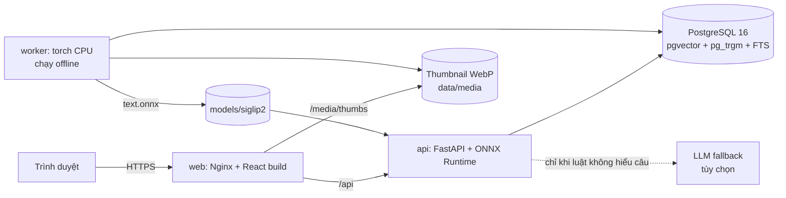
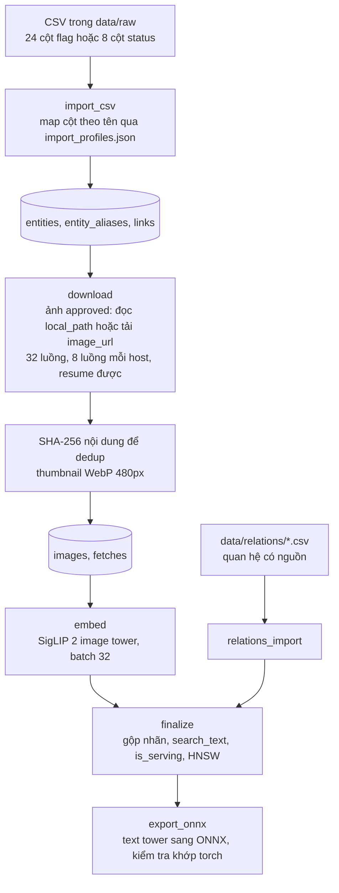
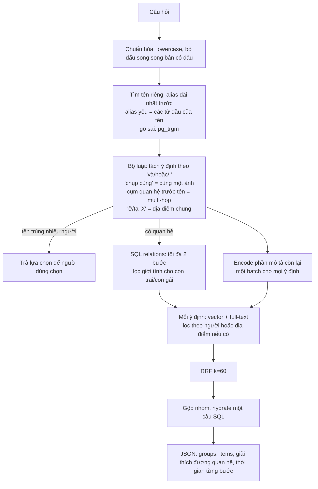
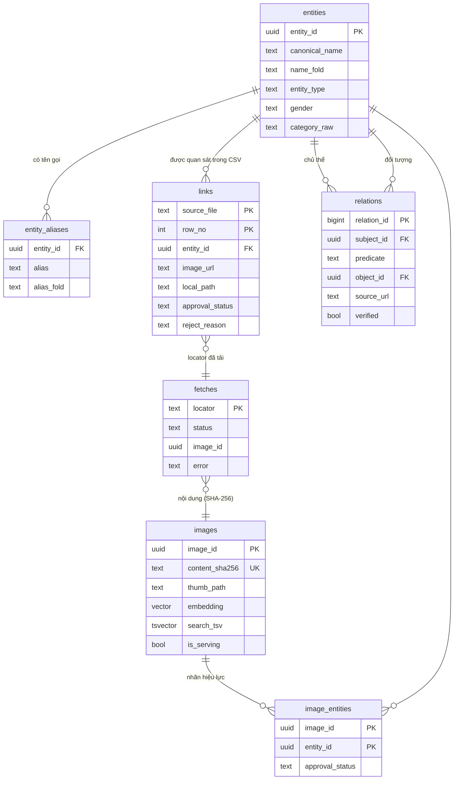

# Kiến trúc hệ thống truy xuất ảnh (Phần B)

## 1. Tổng quan

| Thành phần | Lựa chọn | Lý do |
|---|---|---|
| Embedding | SigLIP 2 base (`google/siglip2-base-patch16-224`), ảnh và câu hỏi chung một không gian, đa ngôn ngữ | Một model cho cả ảnh và văn bản; pretrained, không cần fine-tune |
| Vector index | pgvector HNSW (cosine) trong PostgreSQL | 80K × 768 float chỉ ~235 MB; một DB cho metadata, quan hệ, FTS và vector nên compose chỉ 3 service, không phải đồng bộ hai nơi |
| Lexical | PostgreSQL full-text (`simple`) trên tên/alias/mô tả đã bỏ dấu | Bắt tên riêng, địa danh mà model ảnh không chắc nhận ra |
| Quan hệ (multi-hop) | Bảng `relations` + SQL, tối đa 2 bước | Sự thật phải có nguồn kiểm chứng; không để model đoán "con trai của ai" |
| Hiểu câu hỏi | Bộ luật tiếng Việt + từ điển alias trong RAM | Không tốn token, < 20 ms; LLM chỉ là fallback, tối đa 1 lần gọi |
| API image | onnxruntime + tokenizers, không có torch | Image nhỏ (~520 MB so với ~2 GB nếu có torch), khởi động nhanh |

## 2. Luồng xử lý dữ liệu (offline, `worker`)

- Nhãn theo từng cặp (ảnh, người): approved chỉ khi mọi quan sát đồng ý; vừa approved vừa rejected thành `unknown` và không được phục vụ (không "file sau ghi đè file trước").
- Ảnh trùng nội dung (cùng SHA-256) chỉ lưu và embed một lần, giữ nhiều liên kết người.
- Chạy lại bất kỳ bước nào cũng an toàn: import theo khóa (file, dòng), download bỏ qua locator đã xong, embed chỉ xử lý ảnh chưa có vector.
- `finalize` in ra phễu dữ liệu: dòng CSV → dòng approved → locator → tải được → ảnh phân biệt → có vector → đang phục vụ.

## 3. Luồng truy vấn (online, `api`)

| Loại truy vấn | Cách xử lý | Ví dụ |
|---|---|---|
| Single intent, chỉ tên | Ảnh của người đó bằng SQL | "ảnh Mỹ Tâm" |
| Single intent, tên + mô tả | Vector và full-text giới hạn trong ảnh của người đó, RRF | "Sơn Tùng đang biểu diễn" |
| Single intent, chỉ mô tả | HNSW toàn kho (chỉ nhận ảnh vượt ngưỡng cosine) + full-text đúng cụm, RRF. Nếu chưa đủ top-k: thêm ảnh có mô tả khớp nhiều mảnh nhất của câu (cặp từ liền nhau như "áo dài", "sân khấu"), xếp lại theo độ giống hình | "người mặc áo dài", "bãi biển Nha Trang" |
| Single intent, địa danh | Ảnh gắn với địa điểm và các địa điểm con (`located_in`), xếp theo mô tả | "bãi biển Nha Trang" |
| Multi-intent "A và B" | Mỗi ý định một nhóm, chia đều top-k | "hồ bơi và công viên nước ở Phú Quốc" |
| Multi-intent "A hoặc B" | Hợp nhất bằng RRF thành một danh sách | "Sơn Tùng hoặc Mỹ Tâm" |
| Multi-intent "A chụp cùng B" | Giao: ảnh gắn với cả hai người | "Sơn Tùng chụp cùng Hà Anh Tuấn" |
| Multi-hop 1 bước | Tra quan hệ ra người đích, rồi tìm ảnh người đó | "ảnh con trai chủ tịch Phạm Nhật Vượng" |
| Multi-hop anh chị em | Quan hệ anh chị em ghi trực tiếp, hoặc suy ra khi hai người có chung bố/mẹ; lọc theo giới tính, chưa phân biệt anh/chị với em | "em gái của Phạm Thu Hương" |
| Multi-hop 2 bước | Tra lần lượt, mỗi người đích một nhóm, có giải thích đường đi | "con trai của người sáng lập Vingroup" |

Các trạng thái trả về được tách riêng để không nhầm "không có" với "lỗi": `ok`, `partial`, `no_results`, `needs_clarification`, `no_verified_relation`, `no_images_for_target`, `no_seed_entity`.

## 4. Schema

## 5. Hạn chế đã biết

- Chất lượng phụ thuộc nhãn trong CSV: dữ liệu đầu vào chưa sạch thì kết quả theo tên người cũng chưa sạch. Hệ thống không tự sửa danh tính.
- Multi-hop chỉ trả lời được quan hệ đã nhập vào `data/relations/relations.csv`; quan hệ chưa có trả `no_verified_relation` thay vì đoán.
- Truy vấn địa điểm chỉ lọc chính xác khi địa điểm là một entity trong kho; nếu không, hệ thống dựa vào mô tả và vector (xếp hạng tương đồng, không phải bộ lọc chắc chắn).
- SigLIP không hiểu phủ định ("không có người") và không nhận diện được mặt người theo tên; tên luôn đi qua metadata.
- "anh trai", "em trai" cùng hiểu là anh chị em là nam (tương tự "chị gái", "em gái" là nữ): kho chưa có năm sinh nên chưa phân biệt lớn hay nhỏ tuổi.
- "A chụp cùng B" dựa vào việc cùng một ảnh được gắn nhãn cho cả hai người; ảnh có hai người nhưng chỉ gắn một nhãn sẽ không được tính.
- Một người bị crawl thành nhiều entity ("MC Trấn Thành", "Trấn Thành (MC)", "Cặp đôi MC Trấn Thành - Hari Won") được gom lại theo tên sau khi bỏ chức danh và phần trong ngoặc, giữ dấu thanh. Hai người khác nhau trùng đúng tên có dấu vẫn bị gom chung; khi gõ không dấu mà tên trùng nhiều người khác nhau (Trấn Thành và Trần Thành), hệ thống đưa lựa chọn để người dùng chọn.
- Tên viết hoa không khớp ai trong kho ("Jack Ma", "Taylor Swift", "Thành Văn Lương") trả `no_seed_entity` thay vì tìm theo hình, vì tìm theo hình chỉ ra người lạ trông giống. Quy tắc dựa vào chữ hoa và họ phổ biến: câu gõ toàn chữ thường hoặc toàn chữ hoa không được kiểm tra này, và một tên địa danh không có trong kho mở đầu bằng họ (ví dụ "Trường Sa") cũng bị coi là tên người lạ.
- Gõ sai được sửa khi lệch một chữ cái (hai chữ với tên dài từ 12 ký tự) và đúng số từ; tên một từ ("Rhymastic", "Kimmese") không được sửa để tránh khớp nhầm từ thường.
- Kho gần như toàn ảnh người, nên câu tả cảnh ("bãi biển Nha Trang", "hồ bơi ở Phú Quốc") chỉ có vài ảnh khớp: ảnh người chụp ở bãi biển, ảnh có mô tả nhắc tới Nha Trang. Phần khớp một phần của mô tả không tính các cặp từ trùng tên người khi bỏ dấu ("công viên" và Văn Công Viễn, "Phú Quốc" và Phạm Phú Quốc), và địa danh sau "ở/tại" chỉ góp vào xếp hạng chứ không đủ để một ảnh được chọn. Câu cảnh chưa có đáp án tự động, được chấm bằng mắt trong mục "Manual cases" của báo cáo eval.
- Sửa lỗi gõ phải giữ đúng dấu người dùng đã gõ: "áo dài" có dấu không bị sửa thành "Bảo Đại", "đang hát" không thành "Đặng Tất". Câu gõ toàn chữ thường không dấu chỉ được sửa khi cụm đó không xuất hiện trong mô tả ảnh nào ("ao dai" có trong 463 mô tả nên giữ nguyên).
- Tên gõ có dấu chỉ khớp người có đúng dấu đó: "Xuân Bắc" không phải Xuân Ba, "Vân Dung" không phải Văn Dung. Không có ai đúng dấu thì hệ thống không trả ảnh mà hỏi lại "Có phải bạn muốn tìm: …" (status `needs_clarification`, lựa chọn có `kind: "spelling"`) hoặc báo không nhận ra tên. Gõ không dấu vẫn khớp mọi cách bỏ dấu. Hai kiểu đặt dấu "Hoà"/"Hòa", "Thuỷ"/"Thủy" được coi là một. Khi hai người có cùng tên không dấu (Tuấn Hưng và "Tuấn Hùng (Bức Tường)"), dấu người dùng gõ chọn đúng người, kể cả khi gõ sai một chữ ("Hồ Văn Mời" ra Hồ Văn Mười, không ra Hồ Văn Lợi). Cache kết quả phân biệt dấu và chữ hoa.
- Tên gõ thiếu họ trùng phần cuối tên một người trong kho ("Quang Thắng" so với Tạ Quang Thắng) được hỏi lại "Có phải bạn muốn tìm: Tạ Quang Thắng", dù gõ hoa, gõ thường hay không dấu. Với câu gõ thường chỉ gồm 2–4 từ, cách này cũng áp dụng cho cụm trùng đuôi tên người ("hoa hồng" sẽ hỏi Huấn Hoa Hồng); muốn tìm theo mô tả thì gõ thêm từ ("bó hoa hồng").
- Tên đầy đủ không có trong kho nhưng mở đầu giống tên người khác ("Nguyễn Chí Thanh" so với Nguyễn Chí Thiện, Nguyễn Chí Dũng; "Bùi Hải Linh" so với Hải Linh) trả `no_seed_entity`, kể cả khi gõ thường hoặc không dấu: phần tên khớp được đứng cạnh một chữ thường làm tên riêng (chữ cuối của ít nhất 3 tên người trong kho) hoặc một họ. Không áp dụng khi chữ đứng sau là mô tả, quan hệ hay danh xưng ("Sơn Tùng đang hát"), hoặc khi chữ đầu đọc được là quan hệ ("vợ thành viên..." trùng "Võ Thanh..." khi bỏ dấu). Gõ sai không bao giờ được sửa thành một tên rút gọn (chỉ vài chữ đầu của tên).
